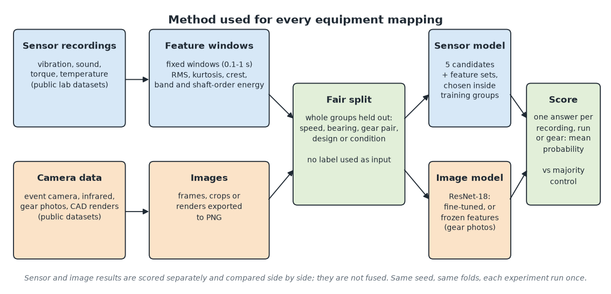

# Final report: sensor and image condition classification for eight mining equipment mappings

AI-Based Predictive Maintenance for Mining Equipment · Saskatchewan Polytechnic · Group 9: Ganesh Mishra, Lakshya Sharma and Sagar Patel · November 10, 2026

This report brings the project's evidence into one place. Every number comes from a saved result file in `Results/` and can be rerun with the commands in the [README](../README.md). The detailed records are the [evidence matrix](equipment_evidence_matrix.md), the [methodology](methodology.md), the [follow-up experiments](followup_experiments.md), the [improvement results](improvement_results.md), the [Grader matched-class results](grader_matched_classes_results.md) and the [deployment verification](deployment_verification.md).

## 1. Question and scope

Can sensor data and camera data each classify the current condition of a mining machine component, and how do the two compare?

- **What we built:** for eight mining machines, one component each is mapped onto a public laboratory dataset that has both sensor recordings and images (or a closely related image set). For each machine we train a sensor model and an image model, test both on data held out in whole groups, and provide a working prediction route for uploads.
- **What we do not claim:** no data comes from mining equipment. These are laboratory analogues. The models classify present condition; they do not predict remaining useful life or a repair date. Sensor and image results are compared side by side; no sensor sample is paired with an image sample, and nothing is fused.

## 2. Data

All datasets are public and licensed CC BY 4.0. Sources, versions, checksums and local paths are in the [dataset manifest](../Dataset_Manifest/manifest.md).

| Machine | Component analogue | Sensor data | Image data | Classes |
|---|---|---|---|---|
| Pump | support bearing | University of Ottawa bearing rig, vibration | XJTU-DV-Pump event camera | healthy, inner race, outer race, ball |
| Haul Truck | wheel-motor bearing | UODS-VAFDC, vibration and microphone | XJTU-DV-Rotor event camera | healthy, inner, outer, ball |
| Belt Conveyor | geared drive | CORA rig, Vx vibration and temperature | CORA infrared, same runs | healthy, 25 / 50 / 75% gear wear |
| Dozer | geared drive | same runs as Belt Conveyor | same | same |
| Excavator | drivetrain | CORA drive-fault runs | CORA infrared, same runs | healthy, bearing, unbalance, misalignment |
| Wheel Loader | electric drive | CORA drive-fault runs | CORA infrared, same runs | healthy, bearing, half-broken bar, broken bar |
| Drill Rig | rotary-head reduction gear | MCC5-THU gearbox vibration | MFGNet-Gear synthetic CAD renders | healthy, wear, pitting, tooth crack (CAD: root breakage) |
| Motor Grader | circle-drive slewing bearing | JUST slewing bearing, six accelerometers | gear-tooth photos (GearBox_adddingImg) | sensor: healthy, inner ring, outer ring, rolling element; images: good vs damaged tooth |

## 3. Method

1. **Features from the signal or image only.** Recordings are cut into fixed windows (0.1 to 1 s). Each window gets statistics (RMS, kurtosis, crest factor, skewness) and the share of energy in frequency bands; where shaft speed is known, the bands are in shaft orders so they line up across speeds. Images are exported as PNG frames, crops or renders. No label is ever used as an input.
2. **Fair split.** The test always holds out whole groups: a speed, a bearing, a gear design, a gear pair or a working condition. Nothing from a held-out group is seen in training.
3. **Model choice inside the training data.** Sensor: five candidate models (random forest, extra trees, gradient boosting, RBF SVM, logistic regression) and the machine's feature sets; the best pair is chosen by macro F1 on validation groups inside the training data. Images: ImageNet ResNet-18, fine-tuned with the number of epochs chosen inside the training data (frozen features and logistic regression for the gear-tooth photos).
4. **One answer per unit.** Each test recording, run or gear gets one prediction: the class with the highest mean probability over its windows or images. We report accuracy, balanced accuracy and macro F1 against a majority-class control.
5. **Planned before running.** Every follow-up experiment was written down and committed before it ran, and each ran once. Weak results are reported, not tuned away.

## 4. Main results (fair test)

| Machine | Fair test holds out | Sensor: accuracy / balanced / macro F1 | Image: accuracy / balanced / macro F1 | Units tested (sensor; image) |
|---|---|---|---|---|
| Pump | speed profile (sensor), camera speed (images) | **95.8 / 95.8 / 95.8%** | **100 / 100 / 100%** | 24; 24 recordings |
| Haul Truck | 3 whole bearings per round (sensor), speed (images) | **80.0** / 73.3 / 74.1% | 58.3 / 58.3 / 56.6% | 30; 12 recordings |
| Belt Conveyor | one speed per round | 43.8 / 43.8 / 35.0% | 50.0 / 50.0 / 43.2% | 16; 16 runs |
| Dozer (same runs as Belt Conveyor) | one speed per round | 43.8 / 43.8 / 35.0% | 56.3 / 56.3 / 52.1% | 16; 16 runs |
| Excavator | one speed per round | 25.0 / 25.0 / 18.3% | 25.0 / 25.0 / 21.7% | 16; 16 runs |
| Wheel Loader | one speed per round | 31.3 / 31.3 / 32.5% | 18.8 / 18.8 / 20.6% | 16; 16 runs |
| Drill Rig | one speed (sensor), 3 CAD designs per round (images) | 73.3 / 68.1 / 70.5% | **88.9 / 88.9 / 88.8%** | 120 recordings; 4,800 rendered gears |
| Motor Grader | one working condition (sensor), one photo or video set (images) | **84.2 / 84.2 / 84.7%** | **97.2 / 82.6 / 85.8%** | 120 recordings; 2,879 tooth crops |

The majority control is 25% for the four-class tests (30% for the Drill Rig sensor, 50% accuracy for the Haul Truck sensor). Bold marks results at or above 80% accuracy.

**Reading the table.**

- **Pump** is the strongest result: both modalities, the same four bearing classes, well above the control. The two sides use different rigs, so they cannot be ranked against each other.
- **Grader** reaches 80% on both sides, but the sensor model diagnoses a slewing bearing and the images diagnose gear teeth, so they answer different questions (see section 5).
- **Drill Rig** images reach 88.9%, but they are CAD renders, not camera photographs.
- **Haul Truck** sensor accuracy is exactly 80%, but its balanced accuracy is 73.3%, and its ball-fault class was recorded without load while every other class was loaded.
- **The four CORA machines** fail when a whole speed is held out (18.8 to 56.3%). They share one rig with one run per class and speed, so each run is worth 6.25 points.

## 5. Follow-up and improvement experiments

All were planned in advance, saved separately, and left the main results and deployed models unchanged.

| Experiment | Test | Result | Conclusion |
|---|---|---|---|
| CORA healthy vs worn (Belt Conveyor runs) | unseen speed, 16 runs | sensor 45.8%, images 75.0% balanced (control 50%) | image gain is 2 runs, not defensible (p = 0.05); CORA modelling stopped |
| Haul Truck sensor without the load-confounded ball class | unseen bearing, 25 recordings | 84.0% accuracy, 73.3% balanced | confirms the load confound; reported separately |
| A. Drill Rig sensor with shaft-order features | unseen speed, 120 recordings | 77.5% accuracy, 75.7% balanced (was 73.3 / 68.1%) | real gain under the same test, still below 80% |
| D. Drill Rig sensor with envelope order features | unseen speed, 120 recordings | 75.0% accuracy, 72.2% balanced | under 80% and below attempt A; not deployed, no further attempts |
| B. Haul Truck images with speed-scaled frames | unseen speed, 12 recordings | 50.0% (archived 58.3%) | no gain; the image model mostly learns the camera angle |
| C. CORA transient runs | unseen repetition at a **trained** speed, 80 runs | 100% Belt Conveyor, 100% Excavator, 97.5% Wheel Loader | features carry fault information; the CORA failure is the change of speed |
| E. CORA transient runs at an **unseen** speed (planned in advance, November 11) | unseen speed, 80 runs | 63.7% Belt Conveyor, 31.3% Excavator, 35.0% Wheel Loader (control 25%) | more runs help gear wear; drive faults stay near chance; not deployed |
| Grader with matched classes, Aalto rig | unseen gear pair, 425 runs | 78.4% accuracy, **77.8% balanced** (control 50%) | the sensor side now answers the image side's question (healthy gear vs damaged tooth) |
| Grader with matched classes, MCC5-THU | unseen speed, 60 recordings | 88.3% accuracy, 70.8% balanced | shares the Drill Rig's rig; not independent |

## 6. Which machines reach 80%

Under the fair test, four of the eight machines reach 80% on at least one modality: **Pump** (both), **Grader** (both, separate tasks), **Drill Rig** (images, CAD renders) and **Haul Truck** (sensor accuracy, exactly at the line). The four CORA machines do not. They reach 97.5 to 100% only when the test speed was seen in training, which is a narrower test and is labelled as such.

We did not change tests, merge test data into training, or select results after seeing them to raise these numbers. The remaining gaps come from the data: one CORA run per class and speed, three camera angles per class for the Haul Truck images, and synthetic renders for the Drill Rig.

## 7. Working prediction system

- **Three ways to use it:** the integrated notebook (upload a file, see the machine, fault class and confidence), a command-line `predict`, and a local upload page.
- **Routes:** eight sensor routes, eight image routes and the Grader gear-vibration route. The November 10 route check passed all 39 routes, and correctly rejected an unsupported file and returned "Ambiguous Equipment" for a CORA file shared by four machines.
- **Grader gear model:** built from all 425 Aalto runs (logistic regression on vibration, shaft orders and torque). Its accuracy estimate is the 77.8% held-out result; the final fit has no extra gear pair left to test it on.
- **The route check uses training samples.** It shows that each route loads and answers. It is not an accuracy test. On those samples one Excavator misalignment image was called bearing and one Drill Rig pitting render was called healthy.
- **Safety and reproducibility:** saved models load only if their SHA-256 is on the local trust list; the upload page accepts files only from itself and only on this computer; downloaded data is checked against published hashes; package versions are pinned in `requirements-lock.txt`, and pip-audit found no known vulnerabilities in them on November 10, 2026.

## 8. Limits

- No mining-equipment data. Every result is a laboratory or synthetic analogue of a mining component.
- Small test sets. One recording moves accuracy by 6 to 8 points on the CORA and Haul Truck image tests.
- The CORA rig has one run per class and speed. The Dozer reuses the Belt Conveyor runs, and Excavator and Wheel Loader share eight runs.
- Haul Truck ball faults are confounded with load.
- The Pump source gives no bearing IDs, so its test holds out speed profiles, not physical bearings.
- Drill Rig images are CAD renders, and CAD root breakage is mapped to the sensor's tooth crack; camera performance is untested.
- Grader: the sensor and photo sides use different gears and rigs; on Aalto, healthy and faulty runs of a pair are different installations, so part of the signal may be the re-installation.
- PyTorch training on a multi-core CPU is not bit-for-bit repeatable, so image reruns can differ slightly.

## 9. What would make this stronger

1. Field data from one mining machine, with sensor and camera recorded at the same time on the same component.
2. More than one run per class and speed for the CORA-type drives, so a held-out speed is not a single run.
3. More camera angles per class (Haul Truck) and real photographs of gears (Drill Rig).
4. An independent gear pair to validate the final Grader gear model.
5. More MCC5-THU speeds for the Drill Rig. Attempt A's order features improved the fair test, but a refit on all 120 recordings with them offered chose vibration features only (the existing model), so more speeds are needed before order features can be chosen on evidence.

## 10. Data credits

University of Ottawa bearing data (Huang and Baddour); University of Ottawa UODS-VAFDC; XJTU-DV event-camera datasets (Zenodo 17447083); CORA rotating electromechanical system (CSUC Dataverse doi 10.34810/DATA2500); MCC5-THU gearbox datasets (Chen et al., Mendeley doi 10.17632/p92gj2732w.2); MFGNet-Gear (Mei and Shao, Deep Blue Data doi 10.7302/qrdj-n812); JUST slewing bearing datasets (Ren, Mendeley doi 10.17632/hwg8v5j8t6.1); GearBox_adddingImg (Roboflow Universe); Aalto Gear Failure Dataset (Dahl et al., Mendeley doi 10.17632/fywnj597d8.2). All CC BY 4.0. Full links are in the [dataset manifest](../Dataset_Manifest/manifest.md).
