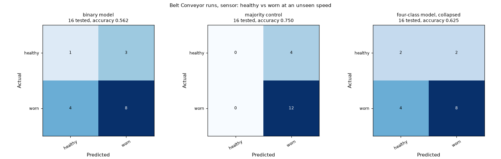
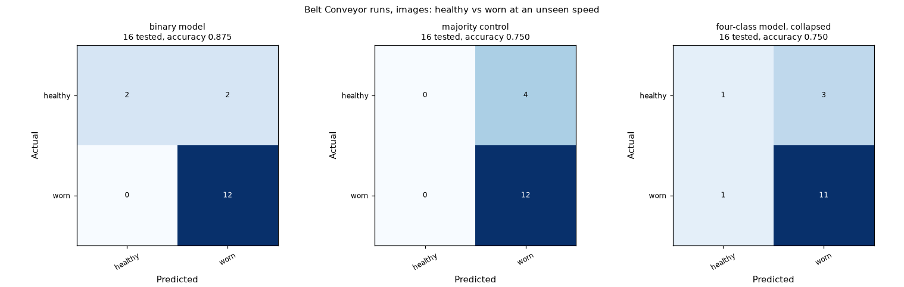

# Follow-up experiments and checks (audit priorities 2 to 6)

PROJ 613 · Group 9 · November 6, 2026 · starting point: `main` at `879e968` (same files as Ganesh's `dc2a8c8`)

This record follows the [20-day audit](proj613_20_day_audit.md). Every number below is read from the saved files in `Results/experiments/` and `Results/deployment/`. The four-class results in `Results/<machine>/` and the saved checkpoints in `Processed_Data/models/` were not changed: every checkpoint and every earlier result and figure file has the same SHA-256 before and after this work (the result hashes are in `Results/experiments/cora_binary/verification.json`, the checkpoint hashes in `Results/deployment/route_check.json`).

## Summary

| Priority | Question | Answer |
|---|---|---|
| 2 | Does a healthy vs worn target help on the CORA gear-wear runs at an unseen speed? | Sensor: no (balanced accuracy 45.8% against 50.0% for the majority control). Images: 75.0% balanced accuracy, above the control and above the four-class model read the same way (58.3%), but the difference is 2 of 4 healthy runs recognised. The conditional random-assignment calculation gives p = 0.05. It does not test the difference between the two models. No model is replaced, and CORA modelling stops here as the audit planned. |
| 3 | Is the Haul Truck ball class confounded with load? | Yes. The load channel is flat in 5/5 ball recordings and in none of the others. Without the ball class, the sensor fair test scores 84.0% accuracy (73.3% balanced) on 25 unseen-bearing recordings. |
| 4 | Is the Drill Rig label mapping source-backed? Is the Pump split an unseen-bearing test? | Partly; no. MFGNet-Gear R0 is "fracture at tooth root" and MCC5-THU has both a crack and a break class, so the crack mapping stays a qualified analogue. The Pump test holds out speed profiles; the source does not give bearing IDs. |
| 5 | Can the Grader be aligned around one component? | Not with the data available. The two Grader experiments stay separate and are not compared. |
| 6 | Do the demo routes work? | 15 of 16 routes ran on this computer; 34 of 36 sample answers matched their label (all samples are training data). The Grader photo route was not tested here (checkpoint not on this computer). |

## Priority 2: CORA gear wear, healthy vs worn

**Plan, fixed before running.** Target: healthy (H) vs worn (W25, W50 and W75 merged). Same 16 Belt Conveyor runs and the same leave-one-speed-out folds (F5, F15, F50, F60) as the four-class test, so each round tests 4 runs (1 healthy, 3 worn). Same methods as the four-class test: sensor features with five candidate classifiers chosen inside the training speeds; images with the fine-tuned ResNet-18 and its epoch count chosen on training runs only. One prediction per held-out run (mean of its window or frame probabilities). Compared with a majority control and with the saved four-class model read as healthy vs any wear. Balanced accuracy is the headline because 12 of 16 runs are worn.

**Data check** (`python Notebook/pdm.py cora-binary verify`):

- All 16 run IDs have a vibration file and 450 infrared frames: True. Codes follow the CORA data descriptor (H healthy, W25/W50/W75 tooth wear, F5 to F60 drive set points in Hz, S stationary 45-minute runs).
- Every exported frame's label matches its file code (Belt Conveyor 450 frames per run, Dozer 150).
- The Dozer reuses the Belt Conveyor exactly: identical sensor feature table (True) and 2400/2400 Dozer frames byte-identical to Belt Conveyor frames. So this experiment covers both mappings and is one result, not two.
- No run appears on both sides of any fold (checked in code for every round).

**Sensor** (4,800 one-second windows from 16 runs):

| Model | Accuracy | Balanced accuracy | Macro F1 | Healthy precision / recall | Worn precision / recall | Confusion [[H→H, H→W], [W→H, W→W]] |
|---|---:|---:|---:|---:|---:|---|
| Binary model (this experiment) | 56.2% | 45.8% | 45.9% | 20.0% / 25.0% | 72.7% / 66.7% | [[1, 3], [4, 8]] |
| Majority control (always the training majority) | 75.0% | 50.0% | 42.9% | 0.0% / 0.0% | 75.0% / 100.0% | [[0, 4], [0, 12]] |
| Existing four-class model, read as healthy vs worn | 62.5% | 58.3% | 56.4% | 33.3% / 50.0% | 80.0% / 66.7% | [[2, 2], [4, 8]] |

**Images** (7,200 infrared frames, device cpu):

| Model | Accuracy | Balanced accuracy | Macro F1 | Healthy precision / recall | Worn precision / recall | Confusion [[H→H, H→W], [W→H, W→W]] |
|---|---:|---:|---:|---:|---:|---|
| Binary model (this experiment) | 87.5% | 75.0% | 79.5% | 100.0% / 50.0% | 85.7% / 100.0% | [[2, 2], [0, 12]] |
| Majority control (always the training majority) | 75.0% | 50.0% | 42.9% | 0.0% / 0.0% | 75.0% / 100.0% | [[0, 4], [0, 12]] |
| Existing four-class model, read as healthy vs worn | 75.0% | 58.3% | 59.0% | 50.0% / 25.0% | 78.6% / 91.7% | [[1, 3], [1, 11]] |

**By held-out speed** (each row is 1 healthy and 3 worn runs):

| Held-out speed | Sensor accuracy | Sensor balanced acc. | Sensor model chosen | Image accuracy | Image balanced acc. | Image epochs chosen |
|---|---:|---:|---|---:|---:|---:|
| F5 | 25.0% | 50.0% | Extra trees on vibration | 75.0% | 50.0% | 2 |
| F15 | 75.0% | 50.0% | Extra trees on vibration | 100.0% | 100.0% | 2 |
| F50 | 50.0% | 33.3% | Extra trees on vibration+temperature | 75.0% | 50.0% | 1 |
| F60 | 75.0% | 50.0% | SVM (RBF) on vibration+temperature | 100.0% | 100.0% | 2 |

**Every run:**

| Run | Speed | True | Sensor: P(worn) → prediction | Image: P(worn) → prediction |
|---|---|---|---:|---:|
| H_F5_S | F5 | healthy | 0.45 → healthy | 0.98 → worn |
| W25_F5_S | F5 | worn | 0.44 → healthy | 0.99 → worn |
| W50_F5_S | F5 | worn | 0.44 → healthy | 0.99 → worn |
| W75_F5_S | F5 | worn | 0.46 → healthy | 0.86 → worn |
| H_F15_S | F15 | healthy | 0.74 → worn | 0.01 → healthy |
| W25_F15_S | F15 | worn | 0.64 → worn | 0.99 → worn |
| W50_F15_S | F15 | worn | 0.66 → worn | 1.00 → worn |
| W75_F15_S | F15 | worn | 0.80 → worn | 0.94 → worn |
| H_F50_S | F50 | healthy | 0.66 → worn | 1.00 → worn |
| W25_F50_S | F50 | worn | 0.41 → healthy | 0.93 → worn |
| W50_F50_S | F50 | worn | 0.65 → worn | 1.00 → worn |
| W75_F50_S | F50 | worn | 0.89 → worn | 0.98 → worn |
| H_F60_S | F60 | healthy | 0.66 → worn | 0.20 → healthy |
| W25_F60_S | F60 | worn | 1.00 → worn | 1.00 → worn |
| W50_F60_S | F60 | worn | 1.00 → worn | 1.00 → worn |
| W75_F60_S | F60 | worn | 1.00 → worn | 1.00 → worn |

**Diagnostic added after seeing the results** (not part of the plan): within each speed, the share of (healthy, worn) pairs where the worn run gets the higher worn probability. 50% is chance, and a shift of all runs at one speed does not change it. Sensor 50.0% (per speed F5 33.3%, F15 33.3%, F50 33.3%, F60 100.0%); images 75.0% (per speed F5 66.7%, F15 100.0%, F50 33.3%, F60 100.0%).

**Exact check.** If a model's predicted-healthy runs were picked at random from the 16 runs, the chance of getting at least as many true healthy runs as observed is: sensor 5 predicted healthy, 1 correct, p = 0.82; images 2 predicted healthy, 2 correct, p = 0.05. This treats the 16 runs as independent, which they are not fully (one rig, one gear set per wear level).

**Reading.** Each modality is compared only with its own majority control and with the four-class model on the same healthy vs worn question; binary accuracy is never compared with four-class accuracy.

- **Sensor:** below the majority control on balanced accuracy. The worn probability moves with the held-out speed (all F5 runs low, all F60 runs high), and within each speed the ranking is at chance. No evidence of improvement.
- **Images:** every worn run is called worn, and 2 of 4 healthy runs (F15 and F60) are called healthy; the F5 and F50 healthy runs are called worn with high confidence. That beats the majority control and the collapsed four-class model by two runs, and the per-speed ranking is above chance at three of four speeds. With 4 healthy runs, each one moves balanced accuracy by 12.5 points, and p = 0.05 is at the edge of chance. It supports a narrower claim (the infrared frames carry some healthy-vs-worn signal across speeds), not a model replacement.
- **Decision:** the four-class deployment checkpoints stay as they are. A confirmatory test would need new healthy and worn runs that were not used here; re-tuning on these 16 runs would only fit them. As the audit planned, CORA modelling stops after this comparison.

Commands: `python Notebook/pdm.py cora-binary verify`, `... cora-binary sensor`, `... cora-binary images` (4 rounds of CNN training; about 2 hours on a laptop CPU). Results: `Results/experiments/cora_binary/`.

## Priority 3: Haul Truck load confounding

The [UODS-VAFDC dataset page](https://data.mendeley.com/datasets/y2px5tg92h/1) states that healthy, inner, outer and cage data were recorded at a nominal 400 N load and ball-fault data at no load, and that the fourth column of each file is the load. In the 30 files used here, the load column is flat (standard deviation 0) for 5/5 ball recordings and for 0/15 healthy, 0/5 inner and 0/5 outer recordings. So in this data, "ball" and "no load" cannot be separated, and the four-class ball recall (80.0%) may partly measure load.

Rerun of the same fair test (3 whole bearings held out per round, model chosen inside the training bearings) on the three loaded classes only (`python Notebook/pdm.py haul-truck-load-check`):

| Test | Recordings | Accuracy | Balanced accuracy | Macro F1 | Recall (healthy / inner / outer) |
|---|---:|---:|---:|---:|---|
| Healthy, inner, outer (all loaded) | 25 | 84.0% | 73.3% | 74.5% | 100.0% / 80.0% / 40.0% |
| Majority control | 25 | 60.0% | 33.3% | 25.0% | 100.0% / 0.0% / 0.0% |
| Saved four-class result (reference, includes ball) | 30 | 80.0% | 73.3% | 74.1% | 93.3% / 60.0% / 60.0% |

The three-class score answers a narrower question and is reported separately; it is not an improvement over the four-class result. The ball class is flagged as load-confounded in the four-class result. The event-camera side (XJTU-DV-Rotor) is a different rig, so this does not affect it.

## Priority 4: Drill Rig label crosswalk and Pump grouping

**Drill Rig.** [MFGNet-Gear](https://huggingface.co/datasets/rsmei/MFGNet-Gear) defines R0 as "root breakage, fracture at tooth root". The MCC5-THU archive has separate `teeth_crack` and `teeth_break` recordings (plus `miss_teeth`). The project maps R0 to `teeth_crack`; `teeth_break` would be an equally plausible match, and the sources do not settle it. So healthy, wear and pitting are the classes that align on both sides, and the fourth class stays a qualified analogue. Reading the saved four-class confusion matrices on the three aligned classes only (no retraining; predictions into the fourth class count as errors):

| Modality | Test units in the three aligned classes | Accuracy on those units | Mean recall of the three classes |
|---|---:|---:|---:|
| sensor | 84 | 78.6% | 70.4% |
| images | 3,600 | 85.2% | 85.2% |

A retrained three-class comparison on both modalities was not run: the image side takes many hours on a CPU, and the restricted reading above already shows the aligned classes are not the weak point.

**Pump.** The [Ottawa data descriptor](https://pmc.ncbi.nlm.nih.gov/articles/PMC6249544/) says the experimental bearing "is replaced by bearings of different health conditions" and defines speed patterns A to D (increasing, decreasing, increasing then decreasing, decreasing then increasing). It does not give bearing IDs, so the C/D recordings may come from the same physical bearings as A/B. The Pump result is therefore an unseen-speed-profile result, not an unseen-bearing result.

## Priority 5: Grader

The sensor data (JUST slewing bearing: healthy, inner ring, outer ring, rolling element) and the image data (Roboflow small-gear tooth crops: good vs damaged) describe different components and labels. No public image source with slewing-bearing fault labels and independent bearing units was found in the earlier review ([Grader investigation](motor_grader_image_investigation.md)). Decision: keep the two Grader experiments separate, report the sensor accuracy and the image balanced accuracy only as separate tasks, and never as a sensor vs image comparison.

## Priority 6: demo route check

`python Notebook/pdm.py route-check` runs `predict()` once per sensor route and once per image class per machine, and saves checkpoint hashes. The original November 6 record is historical. Current runs write to `Processed_Data/deployment/route_check.json`. Shared formats get their machine as a user-confirmed mapping, as in the notebook.

| Machine | Sensor route | Image route |
|---|---|---|
| Pump | PASS · 1/1 sample labels matched | PASS · 4/4 sample labels matched |
| Haul Truck | PASS · 1/1 sample labels matched | PASS · 4/4 sample labels matched |
| Belt Conveyor | PASS · 1/1 sample labels matched | PASS · 4/4 sample labels matched |
| Excavator | PASS · 1/1 sample labels matched | PASS · 3/4 sample labels matched |
| Dozer | PASS · 1/1 sample labels matched | PASS · 4/4 sample labels matched |
| Wheel Loader | PASS · 1/1 sample labels matched | PASS · 4/4 sample labels matched |
| Drill Rig | PASS · 1/1 sample labels matched | PASS · 3/4 sample labels matched |
| Grader | PASS · 1/1 sample labels matched | not tested here |

Input checks: unsupported file → PASS: rejected; CORA file without a mapping → PASS.

The Grader gear-tooth checkpoint is not on this computer, and the local Roboflow archive does not match the SHA-256 of the export it was built from, so that route was not rebuilt or tested here. Ganesh's November 5 record ([deployment verification](deployment_verification.md)) reports it passing on his computer.
