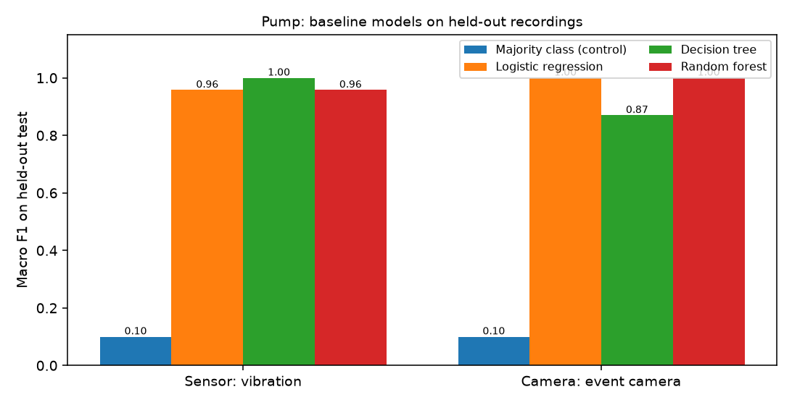
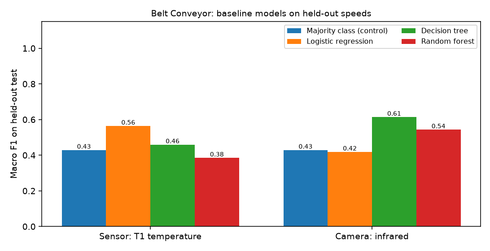
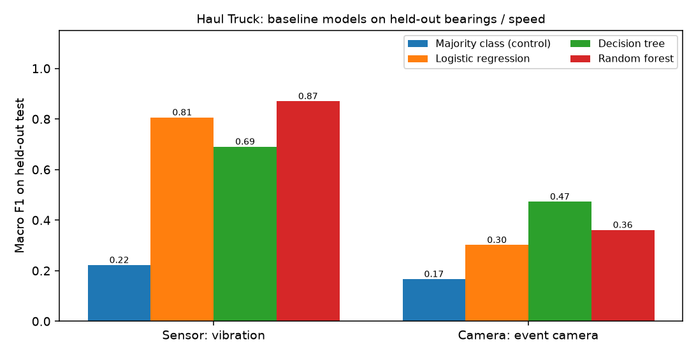

# Week 5 progress: baseline model comparison

**October 9–16, 2026 — Saskatchewan Polytechnic PROJ 613.** The proposal's Week 5
milestone is "baseline ML models: initial logistic regression / decision tree /
random forest results, baseline metrics and confusion matrices". This week applies
that milestone to the three completed equipment comparisons. No new equipment or
dataset was added.

## What was done

- Added a `baselines` command to each equipment file
  (`python Models/pump.py baselines`, `belt_conveyor.py baselines`,
  `haul_truck.py baselines`) and a matching section in each notebook.
- Four model types per branch: a **majority-class control**, **logistic
  regression**, a **decision tree** and a **random forest**. Settings were fixed
  before running and are recorded in each result file. No model or setting was
  chosen from these test results, so the main model of each experiment is
  unchanged.
- Every model is scored on **exactly the same held-out test units** as the main
  experiment (whole recordings, whole bearings or whole speeds), one prediction per
  unit, with accuracy, balanced accuracy, macro precision/recall/F1 and a confusion
  matrix: [`pump_baselines.json`](../Results/pump/pump_baselines.json),
  [`belt_conveyor_baselines.json`](../Results/belt_conveyor/belt_conveyor_baselines.json),
  [`haul_truck_baselines.json`](../Results/haul_truck/haul_truck_baselines.json).
- Pinned the package versions used for this checkpoint in [`requirements-lock.txt`](../requirements-lock.txt).
  This records the environment; it does not guarantee an identical later CNN run. The [Week 6 summary](week_06_professor_remarks.md) documents a Belt Conveyor image rerun that differed from its earlier saved time-split result.
- Sanity check: the model type used in each main experiment reproduces its saved
  score exactly (Pump and Haul Truck random forest; Belt Conveyor logistic regression).

## Results (accuracy / macro F1 on held-out tests)

| Machine and branch | Test units | Majority control | Logistic regression | Decision tree | Random forest |
|---|---:|---:|---:|---:|---:|
| Pump, vibration sensor | 24 recordings | 0.250 / 0.100 | 0.958 / 0.958 | 1.000 / 1.000 | 0.958 / 0.958 |
| Pump, event camera | 24 recordings | 0.250 / 0.100 | 1.000 / 1.000 | 0.875 / 0.870 | 1.000 / 1.000 |
| Belt Conveyor, T1 temperature | 16 runs | 0.750 / 0.429 | 0.625 / 0.564 | 0.562 / 0.459 | 0.625 / 0.385 |
| Belt Conveyor, infrared | 16 runs | 0.750 / 0.429 | 0.500 / 0.418 | 0.688 / 0.614 | 0.688 / 0.543 |
| Haul Truck, vibration sensor | 20 recordings | 0.500 / 0.222 | 0.850 / 0.806 | 0.750 / 0.691 | 0.900 / 0.871 |
| Haul Truck, event camera | 9 recordings | 0.333 / 0.167 | 0.333 / 0.302 | 0.444 / 0.473 | 0.444 / 0.356 |

## What it means

- **Pump:** every model type separates the four bearing conditions (0.875 to 1.000).
  The signal is strong in both modalities; the result does not depend on one model.
  Differences between models are one to three recordings.
- **Belt Conveyor:** no model type reaches the 0.750 majority-class accuracy in
  either branch. The best infrared macro F1 (decision tree, 0.614) still has lower
  accuracy than always predicting "worn". The limit is the data (16 runs, one per
  wear level and speed), not the choice of model.
- **Haul Truck:** all three learnt models clearly beat the control on vibration
  (0.750 to 0.900); the random forest is highest. On the event camera every model
  stays at or near chance (0.333 to 0.444 on 9 recordings), so the camera features
  do not separate the classes; changing the model does not fix it.
- With 9 to 24 test units, one recording changes accuracy by 4 to 11 points, so
  small differences between models are not meaningful.

## Next week (proposal Week 6: advanced ensemble comparison)

- Decide with the professor whether gradient-boosted models (XGBoost/LightGBM, as in
  the proposal) are worth adding given these small test sets, and on the open scope
  questions from Week 4 (lab data per component; CORA reuse for five machines).
- Investigate the weak camera branches (Haul Truck event camera, Belt Conveyor
  infrared) with the same held-out tests, for example using more of each recording
  than the first two seconds.
