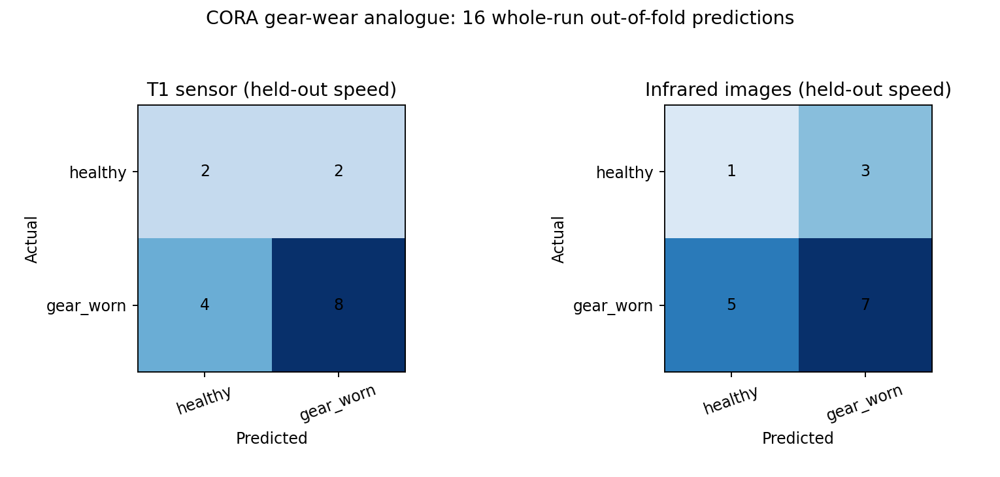

# Equipment #2 — Belt Conveyor geared-drive condition comparison

## Scope and target

The source is one controlled CORA motor/gearbox **laboratory rig**, not a mining conveyor. A geared conveyor drive reducer is mechanically comparable at the component level only; this result says nothing about belt cracks, idlers, or gearless drives. The binary target is **healthy (`H`) versus imposed gear-tooth wear (`W25`, `W50`, `W75`)**. It classifies present condition, not a future maintenance date.

CORA supplies T1 temperature readings and infrared frames from the **same 16 stationary experiment runs**. We train separate models and compare their predictions at the run/fault-label level. We do **not** claim one-to-one frame/sensor-window synchronization, sample-level fusion, or two independent physical machines.

## Leakage-safe evaluation

Each of four folds holds out one complete speed setting (F5, F15, F50 or F60), containing one healthy and three worn runs. Training uses the other 12 whole runs. The run—not a sensor range or infrared frame—is the test unit. Both modalities use the **same four held-out-speed folds and same 16 test runs**. A fixed class-balanced logistic regression is fitted separately inside each fold, with feature scaling learned only on training runs; no test-selected features or hyperparameters. The majority-class control predicts worn in every fold.

| Model / control | Accuracy | Balanced accuracy | Macro precision | Macro recall | Macro F1 |
|---|---:|---:|---:|---:|---:|
| T1 sensor | 0.625 | 0.583 | 0.567 | 0.583 | 0.564 |
| Infrared / OpenCV | 0.500 | 0.417 | 0.433 | 0.417 | 0.418 |
| Most-frequent control | 0.750 | 0.500 | 0.375 | 0.500 | 0.429 |

The scores above use **16 distinct experiment-level out-of-fold predictions per modality**, not thousands of independent frames/windows. Runs reuse one rig and may share a worn gear across speeds, so they are not 16 independent physical machines. The exploratory exact 95% intervals for accuracy are wide: sensor 0.354–0.848; infrared 0.247–0.753. These binomial intervals assume independent trials, an approximation here, and must not be interpreted as mine-fleet confidence bounds.

Both learnt models are **below the 0.750 majority-class accuracy control**. The sensor model's macro F1 is above that control, while the infrared model's macro F1 is below it. Neither result supports reliable deployment or a claim that one modality is inherently superior.

| Held-out speed | Sensor accuracy | Infrared accuracy | Test runs |
|---|---:|---:|---:|
| F5 | 0.750 | 0.500 | 4 |
| F15 | 0.500 | 0.500 | 4 |
| F50 | 0.500 | 0.750 | 4 |
| F60 | 0.750 | 0.250 | 4 |

## Per-class and per-condition performance

| Modality | Actual class | Precision | Recall | F1 | Runs |
|---|---|---:|---:|---:|---:|
| T1 sensor | healthy | 0.333 | 0.500 | 0.400 | 4 |
| T1 sensor | gear_worn | 0.800 | 0.667 | 0.727 | 12 |
| Infrared | healthy | 0.167 | 0.250 | 0.200 | 4 |
| Infrared | gear_worn | 0.700 | 0.583 | 0.636 | 12 |

| Original CORA state | Runs | Sensor correctly classified | Infrared correctly classified |
|---|---:|---:|---:|
| H | 4 | 2/4 | 1/4 |
| W25 | 4 | 3/4 | 3/4 |
| W50 | 4 | 4/4 | 3/4 |
| W75 | 4 | 1/4 | 1/4 |

## Run-level confusion matrices

Rows are actual and columns predicted, in the order **healthy, gear-worn**.

| Modality / actual | Predicted healthy | Predicted gear-worn |
|---|---:|---:|
| Sensor healthy | 2 | 2 |
| Sensor worn | 4 | 8 |
| Infrared healthy | 1 | 3 |
| Infrared worn | 5 | 7 |

## Data and reproducibility

- [CORA version 2.1](https://doi.org/10.34810/DATA2500), CC BY 4.0. The [intake record](belt_conveyor_cora_intake.json) lists exact publisher file IDs, local SHA-256 checksums, source sizes and selected sensor byte ranges. All 16 MAT stacks passed filename/structure checks; H_F5_S also matched the publisher's MD5. The other 15 local SHA-256 values establish future local integrity but were not compared with publisher checksums. All source MAT stacks and sampled values remain in Git-ignored `Raw_Data/` and `Processed_Data/`.
- **Sensor branch:** T1 is a source temperature channel sampled at 1 kHz. For each run we request eight deterministic, equally spaced 256-KiB ranges from the original CSV and retain the first 6,000 complete readings of each range. This is about 4.3% of source bytes and is **not full-signal modelling**. Eight predeclared time/variation features summarize each run.
- **Visual branch:** all 450 published infrared frames per run are converted with OpenCV to grayscale intensity/spatial descriptors and summarized to one run-level vector. Pixel levels are not calibrated degrees Celsius. Publisher MATLAB files are used rather than equipment-identification photographs.
- **No artificial pairing:** the two modalities share an experiment ID and fault condition, but their individual samples are not joined. Both branches have the same held-out speed/experiment units, making the run-level comparison more directly aligned than the earlier Pump cross-rig comparison.

## Limitations and professor-requirement decision

Only four speed settings and **one run per wear state/speed** are available. All 16 runs come from one laboratory rig; there is no unseen gearbox, mine, conveyor, load regime, or dated repair outcome. Reusing this CORA evidence for excavator, dozer, loader, drill, or grader later will **not** create additional independent equipment validations. Scores can compare how these fixed pipelines behave on the same held-out experiments, but are too small to establish sensor/infrared superiority or deployment performance.

**Yes for completing the requested experimental comparison, conditional on the professor accepting a geared-drive laboratory reducer as a mechanically similar conveyor component.** Both real modalities address the same present gear-wear target using whole-run held-out-speed tests, and all requested metrics are reported. **No for an effective or validated predictive-maintenance model:** both accuracies are below the simple majority-class control, infrared healthy-class recall is 0.250, and there is no mining-conveyor test, sample-level fusion, or future-repair outcome. These weak results must be shown to the professor rather than described as a successful detector.
