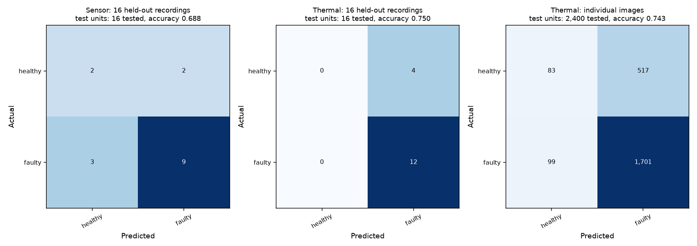

# Excavator: exploratory Healthy vs Faulty follow-up

## Conclusion

The 80% target was **not met**. Sensor recording accuracy is 68.75%; visual recording accuracy is 75%. The visual model predicts every recording as faulty, matching the majority-class baseline, so its balanced accuracy is only 50%. The original four-class experiments remain unchanged.

## Evaluation

- Four whole-speed-held-out folds (F5, F15, F50, F60). Each outer test contains four unseen recordings: one healthy and three faulty.
- Same 16 CORA runs for the two modalities; models are trained separately. There is no synthetic pairing or feature fusion.
- Faulty combines bearing defect, unbalance and misalignment. This binary target is different from four-class fault diagnosis.
- Sensor: 4,800 existing vibration-feature windows, raw order-domain features. Per-speed-normalized columns were excluded because they use held-out distribution information.
- Visual: 2,400 existing thermal frames; frozen ImageNet ResNet18 features with full-frame or fixed central-75% crop. Only the classifier is trained; the CNN is not fine-tuned.
- Inner validation holds out each remaining training speed. Feature set, classifier and threshold are selected using recording-level balanced accuracy, then macro F1. No outer test score is used for selection.
- Candidate classifiers: balanced logistic regression (C=0.1, 1, 10) and a fixed random forest (100 trees). Thresholds 0.35, 0.5, 0.65 are selected within training only.
- This is exploratory benchmark reanalysis: the outer recordings have been examined in earlier experiments. New independent recordings are needed for confirmatory evidence.

## Results

| Model / unit | Tested | Accuracy | Balanced accuracy | Macro precision | Macro recall | Macro F1 |
|---|---:|---:|---:|---:|---:|---:|
| sensor / recordings | 16 | 68.75% | 62.50% | 60.91% | 62.50% | 61.35% |
| visual / recordings | 16 | 75.00% | 50.00% | 37.50% | 50.00% | 42.86% |
| visual / images | 2,400 | 74.33% | 54.17% | 61.15% | 54.17% | 52.95% |

The always-faulty baseline scores 75% accuracy, 50% balanced accuracy and 42.86% macro F1. More correlated frames do not increase the number of independent runs.

## Recording-level per-class results

| Modality | Class | Support | Precision | Recall | F1 |
|---|---|---:|---:|---:|---:|
| sensor | healthy | 4 | 40.00% | 50.00% | 44.44% |
| sensor | faulty | 12 | 81.82% | 75.00% | 78.26% |
| visual | healthy | 4 | 0.00% | 0.00% | 0.00% |
| visual | faulty | 12 | 75.00% | 100.00% | 85.71% |



## Limitations and next step

There are only four healthy recordings. The visual result has zero healthy recall and cannot be called a useful 75%-accurate detector. CORA is a laboratory motor/gearbox analogue, not an excavator. Framing and collection-session confounds can persist across speeds. These results do not meet an 80% requirement for both modalities, and changing the target must be agreed with the professor before it replaces the original task.

Acquire additional independent, labeled healthy and faulty sessions at multiple speeds/loads, then freeze a new held-out evaluation. Do not replace the main result with a higher within-recording time-split score.

## Reproduce and files

```sh
python Notebook/notebook_helpers.py excavator binary
```

- [Code](../../Notebook/notebook_helpers.py)
- [Metrics, selections, provenance and recording predictions](excavator_binary_condition.json)
- Local-only features and sample predictions: `Processed_Data/excavator_binary/`.
- All raw data, feature caches and model weights remain excluded from Git.
