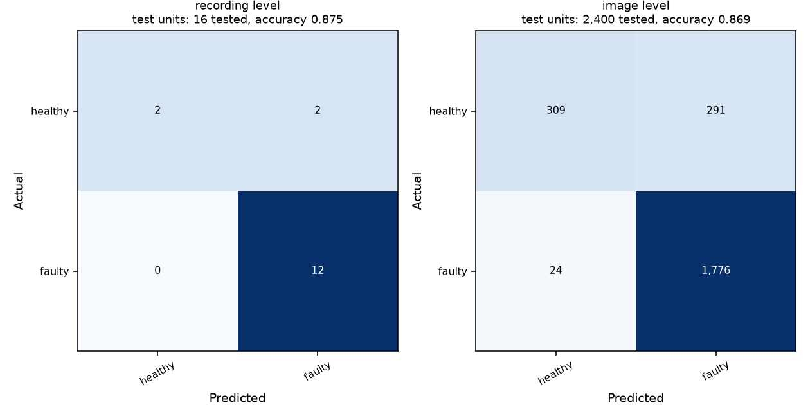

# Excavator binary improvement trials

All attempts below are reported. They are exploratory Healthy vs Faulty diagnoses, not improvements on the original four-class task. The original four-class overview remains unchanged.

## Recording-level results

| Attempt | Accuracy | Balanced accuracy | Macro precision | Macro recall | Macro F1 | Healthy recall | Faulty recall |
|---|---:|---:|---:|---:|---:|---:|---:|
| Window-level sensor | 68.75% | 62.50% | 60.91% | 62.50% | 61.35% | 50.00% | 75.00% |
| Frozen CNN image features | 75.00% | 50.00% | 37.50% | 50.00% | 42.86% | 0.00% | 100.00% |
| Recording sensor summaries | 75.00% | 66.67% | 66.67% | 66.67% | 66.67% | 50.00% | 83.33% |
| Thermal recording summaries | 43.75% | 37.50% | 40.48% | 37.50% | 37.66% | 25.00% | 50.00% |
| Background-only control | 50.00% | 50.00% | 50.00% | 50.00% | 46.67% | 50.00% | 50.00% |
| Healthy speed-reference sensor | 62.50% | 58.33% | 56.67% | 58.33% | 56.36% | 50.00% | 66.67% |
| Fine-tuned equipment-region CNN | 87.50% | 75.00% | 92.86% | 75.00% | 79.49% | 50.00% | 100.00% |

Always-faulty baseline: 75% accuracy, 50% balanced accuracy, 42.86% macro F1. All recording-level tests contain only 16 recordings: 4 healthy and 12 faulty. Frame counts do not increase this sample size.

**Raw visual accuracy target reached:** 14 of 16 held-out recordings were correct (87.5%). This is a binary target, not the original four-class task. Balanced accuracy is 75% because two of the four healthy recordings were falsely flagged faulty. The sensor target remains unmet.

## Fine-tuned visual network

Recording accuracy: 87.50%; balanced accuracy: 75.00%; macro F1: 79.49%. Image accuracy: 86.88% over 2,400 held-out frames. The primary evaluation unit is the recording.

- Existing 2,400 frames; fixed crop of the equipment strip (native y65:155, x15:315), resized to 128x96 and normalized independently per image.
- ImageNet ResNet18. Only layer4 and the new two-class head are fine-tuned; earlier layers and their batch-normalization statistics remain frozen.
- AdamW, learning rate 0.0003, weight decay 0.0001, batch 32, maximum 8 epochs, seed 613. Training-only augmentation: flips, shifts, intensity variation and noise.
- Four whole-speed-held-out outer folds. For each outer fold, three inner folds hold out each training speed in turn. Mean inner recording-level balanced accuracy and macro F1 select the epoch; ties use the earliest epoch. Outer test accuracy is not used to select epochs.
- Completed folds are cached locally with an input/config fingerprint so interruptions can resume. No model binaries or caches are intended for GitHub.



## Sensor speed reference

The sensor follow-up fits a linear trend in log(speed setting) for each median vibration feature using healthy training recordings only. The trend is subtracted before classification. Classifier choice uses inner held-out training speeds. It achieved 62.5% accuracy, 58.33% balanced accuracy and 56.36% macro F1, so it did not improve on the previous 75%-accurate recording-summary method.

## Interpretation

The fine-tuned image model reaches the requested raw accuracy point estimate on this binary benchmark. This does not demonstrate 80% performance for the sensor model or for the original four-class task. Balanced accuracy and per-class recall must also be considered.

The existing four-class all-frame thermal **93.14% image accuracy** is a different, secondary time-split experiment: early and late frames share source recordings. It may be reported only with that scope. The separate thermal-motor 100% result has a known framing/session confound. Neither is a substitute for independent fault validation.

Repeated attempts have exposed these benchmark recordings during development. Results are exploratory, with only four healthy runs from one lab rig, not evidence from actual excavators. Additional independent sessions and a freshly frozen confirmation set are required. A better-supported component benchmark may be necessary. All failed attempts and original results are retained.

## Reproduce

```sh
python Notebook/notebook_helpers.py excavator binary
python Notebook/notebook_helpers.py excavator binary-recording
python Notebook/notebook_helpers.py excavator binary-speed-reference
python Notebook/notebook_helpers.py excavator binary-cnn
```

- [Fine-tuned CNN metrics, plan, selections and recording predictions](excavator_binary_cnn.json)
- [Speed-reference sensor metrics](excavator_binary_speed_reference.json)
- [First binary attempt](excavator_binary_condition.md)
- [Recording-level trial](excavator_binary_recording_followup.md)
- Training progress, fold caches and sample predictions remain under ignored `Processed_Data/`.
- Nothing in this follow-up changes the completed Pump experiment or the eight-equipment scope.
