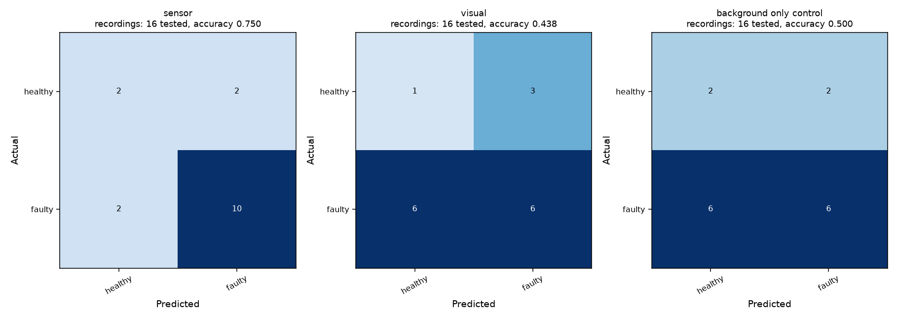

# Excavator: recording-level binary follow-up

## Outcome

**The 80% requirement was not achieved.** Both the failed first binary attempt and this follow-up remain separate from the original four-class results.

| Method | Accuracy | Balanced accuracy | Macro precision | Macro recall | Macro F1 | Test recordings |
|---|---:|---:|---:|---:|---:|---:|
| sensor | 75.00% | 66.67% | 66.67% | 66.67% | 66.67% | 16 |
| visual | 43.75% | 37.50% | 40.48% | 37.50% | 37.66% | 16 |
| background only control | 50.00% | 50.00% | 50.00% | 50.00% | 46.67% | 16 |

Always predicting faulty gives 75% accuracy, 50% balanced accuracy and 42.86% macro F1. Sensor accuracy equals this trivial accuracy baseline but has better balanced accuracy. The visual method is worse than the baseline.

## What was changed

- One example per complete recording, avoiding treating repeated frames/windows as independent training cases.
- Sensor features: within-recording medians, IQRs, late-minus-early differences and linear time trends of raw order-domain vibration features. Shape-only features exclude log RMS.
- Thermal features: all 7,200 native frames from 16 recordings were processed. Fixed motor, gearbox and load regions provide intensity contrasts relative to a background region. These are grayscale intensity features, not calibrated Celsius measurements.
- A second visual feature family reuses the already-cached central-crop frozen ResNet18 features, summarized by mean and late-minus-early changes. No encoder experiment was rerun.
- Background-only intensity/variation is evaluated with the same procedure as a confound control.
- Candidate classifiers: scaled balanced logistic regression C=0.01/0.1/1, scaled balanced RBF SVM C=0.1/1/10, 100-tree random forest and 100-tree extra trees. Seed 613.
- Four outer folds hold out whole speeds. Inner validation holds out each remaining training speed and selects features/classifier by balanced accuracy, then macro F1. The final model choice is not selected by outer test accuracy.
- No new independent runs were added. The primary evaluation has only four healthy and twelve faulty recordings. Seven thousand two hundred frames do not create thousands of independent test cases.
- This is exploratory reuse of an already-analyzed benchmark; future confirmatory testing needs new recordings.

## Per-class performance

| Method | Class | Precision | Recall | F1 | Support |
|---|---|---:|---:|---:|---:|
| sensor | healthy | 50.00% | 50.00% | 50.00% | 4 |
| sensor | faulty | 83.33% | 83.33% | 83.33% | 12 |
| visual | healthy | 14.29% | 25.00% | 18.18% | 4 |
| visual | faulty | 66.67% | 50.00% | 57.14% | 12 |
| background_only_control | healthy | 25.00% | 50.00% | 33.33% | 4 |
| background_only_control | faulty | 75.00% | 50.00% | 60.00% | 12 |



## Interpretation and existing higher scores

The first binary trial scored 68.75% sensor accuracy and 75% visual accuracy (the latter predicted every recording faulty). This follow-up reached 75% and 43.75%, respectively; the worse visual result is retained. No result was substituted into the four-class overview.

The existing four-class all-frame thermal time split scores 93.14% image accuracy, but trains on early frames and tests later frames from the same recordings. It supports only that narrower within-recording setting. It does not establish >80% performance on independent recordings or speeds. The separate thermal-motor 100% result has known framing/session confounds and cannot establish true fault recognition.

**Next step:** obtain additional independent healthy/fault sessions and freeze an evaluation protocol before development. A different, well-labeled component benchmark may be necessary if unseen-speed performance is mandatory. The current evidence does not justify an 80% cross-speed claim.

## Files and reproduction

```sh
python Notebook/notebook_helpers.py excavator binary-recording
```

- [Code](../../Notebook/notebook_helpers.py)
- [Metrics, fold choices, source hashes and predictions](excavator_binary_recording_followup.json)
- [First binary attempt](excavator_binary_condition.md)
- Local-only features/predictions/plan: `Processed_Data/excavator_recording_followup/`.
- No raw data, caches or model weights are intended for GitHub.
