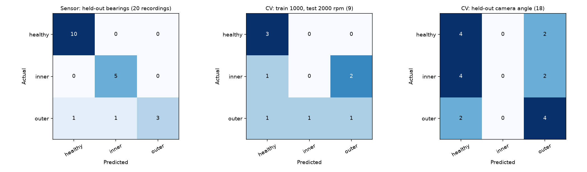

# Haul/Dump Truck wheel-motor bearing: sensor vs event camera

Generated by `Models/haul_truck.py experiment`. Target: present bearing condition (healthy, inner race, outer race). Both sources are **laboratory bearing rigs**, used as an analogue for an electric-drive haul truck's wheel-motor bearing; they are not truck data, are not paired, and are not fused.

| Branch and test | Test recordings | Accuracy | Macro precision | Macro recall | Macro F1 |
|---|---:|---:|---:|---:|---:|
| Sensor: UODS vibration, held-out bearings (5 folds) | 20 | 0.900 | 0.914 | 0.867 | 0.871 |
| Sensor: most-frequent control | 20 | 0.500 | 0.167 | 0.333 | 0.222 |
| Sensor: shuffled training labels | 20 | 0.200 | 0.133 | 0.133 | 0.133 |
| CV: XJTU-Rotor event camera, train 1000 rpm, test 2000 rpm | 9 | 0.444 | 0.311 | 0.444 | 0.361 |
| CV: most-frequent control | 9 | 0.333 | 0.111 | 0.333 | 0.167 |
| CV: shuffled training labels | 9 | 0.333 | 0.333 | 0.333 | 0.333 |
| CV: held-out camera angle (3 folds) | 18 | 0.444 | 0.300 | 0.444 | 0.357 |

## Interpretation

- Sensor (held-out bearings): accuracy 0.900 on 20 recordings, well above the 0.500 most-frequent control.
- Event camera (2000 rpm test): accuracy 0.444 on 9 recordings, only 1 more correct recording than the 0.333 most-frequent control. Never correctly predicted: inner.
- Event camera (held-out camera angle): accuracy 0.444 on 18 recordings, only 2 more correct recordings than the 0.333 most-frequent control. Never correctly predicted: inner.
- The two branches use different rigs and very small test sets, so the gap between them is not evidence that one modality is better in general; it describes these two fixed pipelines on these data.

## Limits

- Both rigs are laboratory bearing rigs; transfer to a haul truck's electric wheel-motor bearing is a component analogy, not demonstrated truck accuracy.
- Sensor and camera data come from different rigs and are compared by fault label only; there are no paired samples and no fusion.
- Small test sets: 20 sensor recordings from 10 bearings, and 9 camera recordings in the primary test, so one error changes accuracy by 5 to 11 points.
- Each UODS bearing has one healthy and one fault recording, so healthy and fault recordings also differ in test stage and date.
- The camera sees rotor-housing motion, not visible bearing damage; only the first 2 s of each recording are used.
- The models classify present condition, not remaining useful life or a repair date.

Data: UODS-VAFDC, DOI 10.17632/y2px5tg92h.1; XJTU-DV, DOI 10.5281/zenodo.17447083; both CC BY 4.0.
