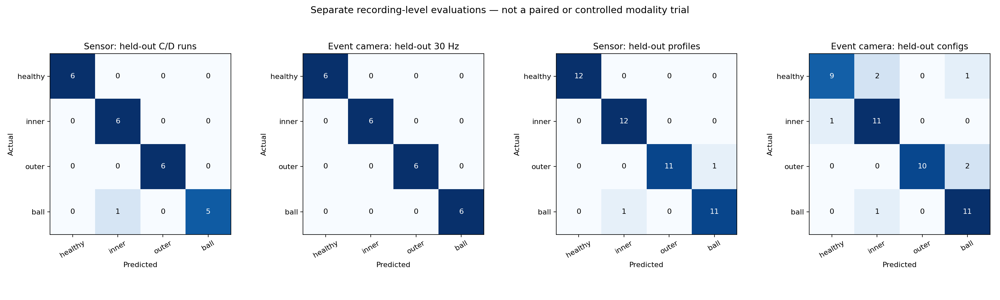

# Pump support-bearing sensor–visual fault comparison

## What is—and is not—being compared

The models predict the same four **present-condition** labels: healthy, inner-race, outer-race, and rolling-element/ball fault. The sensor input is real vibration from a University of Ottawa **bearing test rig**, used as a mechanically comparable *pump support-bearing proxy*. The visual input is real event-camera motion from the XJTU **pump-bearing housing**. The rigs, physical bearings, samples and capture processes differ. No sensor recording is matched to, joined with, or fused with an image recording.

Both primary tests now hold out **entire source recordings**, with 24 train and 24 test recordings and six test recordings per class. That closes the earlier same-file sensor-window leakage gap. It does **not** make this a controlled modality-superiority trial: the sensor split transfers across speed *patterns* (A/B to C/D), while the visual split transfers across fixed speeds (20 to 30 Hz). Scores are descriptive evidence for each branch; **do not subtract them, rank modalities, or call the difference a fusion gain**.

| Branch | Source reality | Training/test recordings | Test unit | Physical-machine holdout? |
|---|---|---:|---|---|
| Vibration | University of Ottawa laboratory rolling-bearing rig, **not a pump** | 24 / 24 | One 10 s recording | No; separate runs, shared rig and possibly same fault specimen |
| Event camera / OpenCV | XJTU laboratory pump support-bearing housing, **not a mining pump** | 24 / 24 | One event recording | No; separate runs, shared rig |

## Sensor branch: recording-held-out test

| Evaluation | Test unit | Accuracy | Macro precision | Macro recall | Macro F1 |
|---|---|---:|---:|---:|---:|
| A/B speed profiles train → C/D test | 24 distinct recordings | 0.958 | 0.964 | 0.958 | 0.958 |
| Four-fold held-out speed profile | 48 fold-held-out run predictions | 0.958 | 0.960 | 0.958 | 0.958 |
| Most-frequent-class control | Same 24 primary test runs | 0.250 | 0.062 | 0.250 | 0.100 |
| Shuffled training-run labels | Same 24 primary test runs | 0.083 | 0.077 | 0.083 | 0.080 |

Primary test: **23/24** correctly classified; an exploratory exact 95% binomial interval is **0.789–0.999**. It treats run outcomes as independent, which may be optimistic on one rig/possibly shared fault specimens, and does not include uncertainty from changing pumps or sites.

### Sensor per-class results on held-out C/D recordings

| Condition | Precision | Recall | F1 | Test runs |
|---|---:|---:|---:|---:|
| healthy | 1.000 | 1.000 | 1.000 | 6 |
| inner | 0.857 | 1.000 | 0.923 | 6 |
| outer | 1.000 | 1.000 | 1.000 | 6 |
| ball | 1.000 | 0.833 | 0.909 | 6 |

## Visual branch: recording-held-out test

| Evaluation | Test unit | Accuracy | Macro precision | Macro recall | Macro F1 |
|---|---|---:|---:|---:|---:|
| 20 Hz train → 30 Hz test | 24 distinct recordings | 1.000 | 1.000 | 1.000 | 1.000 |
| Six-fold held-out camera configuration | 48 fold-held-out run predictions | 0.854 | 0.868 | 0.854 | 0.855 |
| Most-frequent-class control | Same 24 primary test runs | 0.250 | 0.062 | 0.250 | 0.100 |
| Shuffled training-run labels | Same 24 primary test runs | 0.208 | 0.196 | 0.208 | 0.202 |

Primary test: **24/24** correctly classified; an exploratory exact 95% binomial interval is **0.858–1.000**. It treats run outcomes as independent despite one shared rig; the harder camera-configuration check is not a second independent dataset.

### Visual per-class results on held-out 30 Hz recordings

| Condition | Precision | Recall | F1 | Test runs |
|---|---:|---:|---:|---:|
| healthy | 1.000 | 1.000 | 1.000 | 6 |
| inner | 1.000 | 1.000 | 1.000 | 6 |
| outer | 1.000 | 1.000 | 1.000 | 6 |
| ball | 1.000 | 1.000 | 1.000 | 6 |

### Visual per-class sensitivity to held-out camera configurations

| Condition | Precision | Recall | F1 | Fold-held-out runs |
|---|---:|---:|---:|---:|
| healthy | 0.900 | 0.750 | 0.818 | 12 |
| inner | 0.786 | 0.917 | 0.846 | 12 |
| outer | 1.000 | 0.833 | 0.909 | 12 |
| ball | 0.786 | 0.917 | 0.846 | 12 |

## Confusion matrices

Rows are actual classes and columns predicted classes, ordered healthy / inner / outer / ball. The secondary fold matrices reuse the same 48 source recordings across different training fits; they are sensitivity checks, not extra independent tests.

### Sensor: held-out C/D speed-profile recordings

| Actual \ predicted | Healthy | Inner | Outer | Ball |
|---|---:|---:|---:|---:|
| healthy | 6 | 0 | 0 | 0 |
| inner | 0 | 6 | 0 | 0 |
| outer | 0 | 0 | 6 | 0 |
| ball | 0 | 1 | 0 | 5 |

### Visual: held-out 30 Hz event recordings

| Actual \ predicted | Healthy | Inner | Outer | Ball |
|---|---:|---:|---:|---:|
| healthy | 6 | 0 | 0 | 0 |
| inner | 0 | 6 | 0 | 0 |
| outer | 0 | 0 | 6 | 0 |
| ball | 0 | 0 | 0 | 6 |

### Sensor: held-out speed-profile folds

| Actual \ predicted | Healthy | Inner | Outer | Ball |
|---|---:|---:|---:|---:|
| healthy | 12 | 0 | 0 | 0 |
| inner | 0 | 12 | 0 | 0 |
| outer | 0 | 0 | 11 | 1 |
| ball | 0 | 1 | 0 | 11 |

### Visual: held-out camera-configuration folds

| Actual \ predicted | Healthy | Inner | Outer | Ball |
|---|---:|---:|---:|---:|
| healthy | 9 | 2 | 0 | 1 |
| inner | 1 | 11 | 0 | 0 |
| outer | 0 | 0 | 10 | 2 |
| ball | 0 | 1 | 0 | 11 |

## Method and provenance

- **Sensor source:** [Huang and Baddour, University of Ottawa bearing vibration V2](https://data.mendeley.com/datasets/v43hmbwxpm/2), DOI 10.17632/v43hmbwxpm.2, CC BY 4.0. Four single-condition classes, four speed profiles and three trials per profile yield 48 source MAT files. The [verified intake record](pump.json) contains publisher SHA-256 values for every file. The compound-fault fifth class is excluded.
- **Sensor preprocessing:** only accelerometer `Channel_1` at 200 kHz is used; encoder `Channel_2` and file names are not predictors. Each 10 s run becomes 100 non-overlapping 0.1 s windows, with 16 time/spectral features. A fixed random forest is fit only on A/B runs. Window probabilities are averaged before **one prediction per held-out C/D recording**; no window from a test recording appears in training. Hyperparameters were not selected on the test runs.
- **Visual source and unchanged experiment:** [XJTU-DV-Pump](https://zenodo.org/records/17447083), CC BY 4.0. The first two seconds of each of 48 relevant released recordings become eight 250 ms polarity-count event images. OpenCV HOG feeds a fixed random forest trained on 20 Hz runs; average frame probabilities produce one prediction per separate 30 Hz recording. These are event-camera motion images, **not RGB photographs of visible surface damage**. Full-file CRCs were not checked because only bounded intervals were read remotely.
- **Original pump-vibration source:** [Jiang centrifugal-pump multi-fault V1](https://data.mendeley.com/datasets/63gjxpn7s6/1) was retained as a pump-domain pipeline diagnostic, but it has one file per selected class. Its within-file window score is **excluded from the independent comparison**. The Ottawa rig supplies repeat-run evidence at the same bearing-fault taxonomy, not direct pump-domain validation.
- **Limits:** none of these evaluations holds out a new physical pump or mine. The Ottawa data do not establish independent fault-bearing specimens across all trials. Different source rigs and operating shifts preclude a causal claim that one modality is better. No matching timestamps, sample-level pairing, multimodal fusion, maintenance dates, failure horizon, or remaining-useful-life target exist.

## Professor-requirement decision

**Yes, for the professor's explicitly allowed component/fault-level comparison using sufficiently similar machines:** real vibration and real event-camera images both classify healthy/inner/outer/ball bearing conditions, and both now have recording-held-out Accuracy, Precision, Recall, F1, per-class results and confusion matrices. **No**, if the requirement means paired sensor-plus-camera observations from the *same physical mining pump*, a controlled modality-superiority experiment, image–sensor fusion, or prediction of a future repair date. The sensor proxy is a bearing rig, so this is a defensible component-level Pump proof of concept, **not validated mining-pump deployment**. Confirm that scope with the professor before describing the project as fully predictive maintenance.

