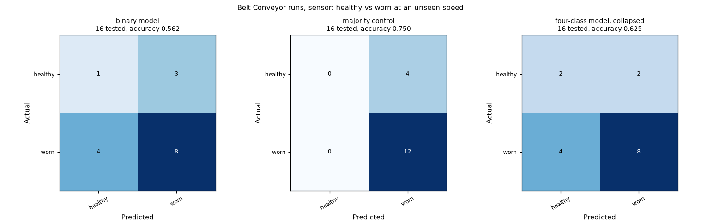
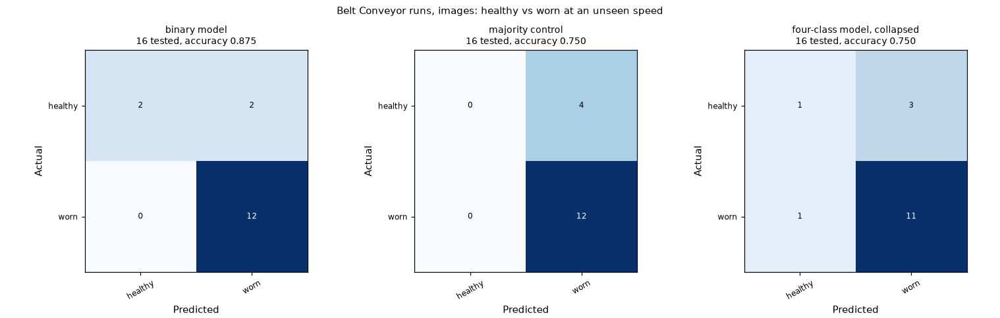

# Experiment archive

Original plans, investigations and verification records are preserved below. They describe dated experiments, not new performance claims. Current setup is in the repository README; primary metrics remain in Results/.

## Contents
- [Follow-up experiments and checks (audit priorities 2 to 6)](#record-followup-experiments)
- [Planned attempt G: gain-independent Grader sensor features (written before running)](#record-grader-gain-invariant-plan)
- [Attempt G results: gain-independent Grader sensor features](#record-grader-gain-invariant-results)
- [Grader with matched classes: plan (written before running)](#record-grader-matched-classes-plan)
- [Grader with matched classes: results](#record-grader-matched-classes-results)
- [Improvement attempts: results](#record-improvement-results)
- [Motor Grader gear-tooth comparison feasibility](#record-motor-grader-gear-comparison)
- [Motor Grader image model investigation](#record-motor-grader-image-investigation)
- [Phase 1 enhancement and verification report](#record-phase-1-enhancement-report)


<a id="record-followup-experiments"></a>

# Follow-up experiments and checks (audit priorities 2 to 6)

AI-Based Predictive Maintenance for Mining Equipment · Group 9 · November 6, 2026 · starting point: `main` at `879e968` (same files as Ganesh's `dc2a8c8`)

This record follows the [20-day audit](experiment_archive.md#record-phase-1-enhancement-report). Every number below is read from the saved files in `Results/experiments/` and `Results/deployment/`. The four-class results in `Results/<machine>/` and the saved checkpoints in `Processed_Data/models/` were not changed: every checkpoint and every earlier result and figure file has the same SHA-256 before and after this work (the result hashes are in `Results/experiments/cora_binary/verification.json`, the checkpoint hashes in `Results/deployment/route_check.json`).

## Summary

| Priority | Question | Answer |
|---|---|---|
| 2 | Does a healthy vs worn target help on the CORA gear-wear runs at an unseen speed? | Sensor: no (balanced accuracy 45.8% against 50.0% for the majority control). Images: 75.0% balanced accuracy, above the control and above the four-class model read the same way (58.3%), but the difference is 2 of 4 healthy runs recognised. The conditional random-assignment calculation gives p = 0.05. It does not test the difference between the two models. No model is replaced, and CORA modelling stops here as the audit planned. |
| 3 | Is the Haul Truck ball class confounded with load? | Yes. The load channel is flat in 5/5 ball recordings and in none of the others. Without the ball class, the sensor fair test scores 84.0% accuracy (73.3% balanced) on 25 unseen-bearing recordings. |
| 4 | Is the Drill Rig label mapping source-backed? Is the Pump split an unseen-bearing test? | Partly; no. MFGNet-Gear R0 is "fracture at tooth root" and MCC5-THU has both a crack and a break class, so the crack mapping stays a qualified analogue. The Pump test holds out speed profiles; the source does not give bearing IDs. |
| 5 | Can the Grader be aligned around one component? | Not with the data available. The two Grader experiments stay separate and are not compared. |
| 6 | Do the demo routes work? | 15 of 16 routes ran on this computer; 34 of 36 sample answers matched their label (all samples are training data). The Grader photo route was not tested here (checkpoint not on this computer). |

## Priority 2: CORA gear wear, healthy vs worn

**Plan, fixed before running.** Target: healthy (H) vs worn (W25, W50 and W75 merged). Same 16 Belt Conveyor runs and the same leave-one-speed-out folds (F5, F15, F50, F60) as the four-class test, so each round tests 4 runs (1 healthy, 3 worn). Same methods as the four-class test: sensor features with five candidate classifiers chosen inside the training speeds; images with the fine-tuned ResNet-18 and its epoch count chosen on training runs only. One prediction per held-out run (mean of its window or frame probabilities). Compared with a majority control and with the saved four-class model read as healthy vs any wear. Balanced accuracy is the headline because 12 of 16 runs are worn.

**Data check** (`python Notebook/predictive_maintenance.py cora-binary verify`):

- All 16 run IDs have a vibration file and 450 infrared frames: True. Codes follow the CORA data descriptor (H healthy, W25/W50/W75 tooth wear, F5 to F60 drive set points in Hz, S stationary 45-minute runs).
- Every exported frame's label matches its file code (Belt Conveyor 450 frames per run, Dozer 150).
- The Dozer reuses the Belt Conveyor exactly: identical sensor feature table (True) and 2400/2400 Dozer frames byte-identical to Belt Conveyor frames. So this experiment covers both mappings and is one result, not two.
- No run appears on both sides of any fold (checked in code for every round).

**Sensor** (4,800 one-second windows from 16 runs):

| Model | Accuracy | Balanced accuracy | Macro F1 | Healthy precision / recall | Worn precision / recall | Confusion [[H→H, H→W], [W→H, W→W]] |
|---|---:|---:|---:|---:|---:|---|
| Binary model (this experiment) | 56.2% | 45.8% | 45.9% | 20.0% / 25.0% | 72.7% / 66.7% | [[1, 3], [4, 8]] |
| Majority control (always the training majority) | 75.0% | 50.0% | 42.9% | 0.0% / 0.0% | 75.0% / 100.0% | [[0, 4], [0, 12]] |
| Existing four-class model, read as healthy vs worn | 62.5% | 58.3% | 56.4% | 33.3% / 50.0% | 80.0% / 66.7% | [[2, 2], [4, 8]] |

**Images** (7,200 infrared frames, device cpu):

| Model | Accuracy | Balanced accuracy | Macro F1 | Healthy precision / recall | Worn precision / recall | Confusion [[H→H, H→W], [W→H, W→W]] |
|---|---:|---:|---:|---:|---:|---|
| Binary model (this experiment) | 87.5% | 75.0% | 79.5% | 100.0% / 50.0% | 85.7% / 100.0% | [[2, 2], [0, 12]] |
| Majority control (always the training majority) | 75.0% | 50.0% | 42.9% | 0.0% / 0.0% | 75.0% / 100.0% | [[0, 4], [0, 12]] |
| Existing four-class model, read as healthy vs worn | 75.0% | 58.3% | 59.0% | 50.0% / 25.0% | 78.6% / 91.7% | [[1, 3], [1, 11]] |




**By held-out speed** (each row is 1 healthy and 3 worn runs):

| Held-out speed | Sensor accuracy | Sensor balanced acc. | Sensor model chosen | Image accuracy | Image balanced acc. | Image epochs chosen |
|---|---:|---:|---|---:|---:|---:|
| F5 | 25.0% | 50.0% | Extra trees on vibration | 75.0% | 50.0% | 2 |
| F15 | 75.0% | 50.0% | Extra trees on vibration | 100.0% | 100.0% | 2 |
| F50 | 50.0% | 33.3% | Extra trees on vibration+temperature | 75.0% | 50.0% | 1 |
| F60 | 75.0% | 50.0% | SVM (RBF) on vibration+temperature | 100.0% | 100.0% | 2 |

**Every run:**

| Run | Speed | True | Sensor: P(worn) → prediction | Image: P(worn) → prediction |
|---|---|---|---:|---:|
| H_F5_S | F5 | healthy | 0.45 → healthy | 0.98 → worn |
| W25_F5_S | F5 | worn | 0.44 → healthy | 0.99 → worn |
| W50_F5_S | F5 | worn | 0.44 → healthy | 0.99 → worn |
| W75_F5_S | F5 | worn | 0.46 → healthy | 0.86 → worn |
| H_F15_S | F15 | healthy | 0.74 → worn | 0.01 → healthy |
| W25_F15_S | F15 | worn | 0.64 → worn | 0.99 → worn |
| W50_F15_S | F15 | worn | 0.66 → worn | 1.00 → worn |
| W75_F15_S | F15 | worn | 0.80 → worn | 0.94 → worn |
| H_F50_S | F50 | healthy | 0.66 → worn | 1.00 → worn |
| W25_F50_S | F50 | worn | 0.41 → healthy | 0.93 → worn |
| W50_F50_S | F50 | worn | 0.65 → worn | 1.00 → worn |
| W75_F50_S | F50 | worn | 0.89 → worn | 0.98 → worn |
| H_F60_S | F60 | healthy | 0.66 → worn | 0.20 → healthy |
| W25_F60_S | F60 | worn | 1.00 → worn | 1.00 → worn |
| W50_F60_S | F60 | worn | 1.00 → worn | 1.00 → worn |
| W75_F60_S | F60 | worn | 1.00 → worn | 1.00 → worn |

**Diagnostic added after seeing the results** (not part of the plan): within each speed, the share of (healthy, worn) pairs where the worn run gets the higher worn probability. 50% is chance, and a shift of all runs at one speed does not change it. Sensor 50.0% (per speed F5 33.3%, F15 33.3%, F50 33.3%, F60 100.0%); images 75.0% (per speed F5 66.7%, F15 100.0%, F50 33.3%, F60 100.0%).

**Exact check.** If a model's predicted-healthy runs were picked at random from the 16 runs, the chance of getting at least as many true healthy runs as observed is: sensor 5 predicted healthy, 1 correct, p = 0.82; images 2 predicted healthy, 2 correct, p = 0.05. This treats the 16 runs as independent, which they are not fully (one rig, one gear set per wear level).

**Reading.** Each modality is compared only with its own majority control and with the four-class model on the same healthy vs worn question; binary accuracy is never compared with four-class accuracy.

- **Sensor:** below the majority control on balanced accuracy. The worn probability moves with the held-out speed (all F5 runs low, all F60 runs high), and within each speed the ranking is at chance. No evidence of improvement.
- **Images:** every worn run is called worn, and 2 of 4 healthy runs (F15 and F60) are called healthy; the F5 and F50 healthy runs are called worn with high confidence. That beats the majority control and the collapsed four-class model by two runs, and the per-speed ranking is above chance at three of four speeds. With 4 healthy runs, each one moves balanced accuracy by 12.5 points, and p = 0.05 is at the edge of chance. It supports a narrower claim (the infrared frames carry some healthy-vs-worn signal across speeds), not a model replacement.
- **Decision:** the four-class deployment checkpoints stay as they are. A confirmatory test would need new healthy and worn runs that were not used here; re-tuning on these 16 runs would only fit them. As the audit planned, CORA modelling stops after this comparison.

Commands: `python Notebook/predictive_maintenance.py cora-binary verify`, `... cora-binary sensor`, `... cora-binary images` (4 rounds of CNN training; about 2 hours on a laptop CPU). Results: `Results/experiments/cora_binary/`.

## Priority 3: Haul Truck load confounding

The [UODS-VAFDC dataset page](https://data.mendeley.com/datasets/y2px5tg92h/1) states that healthy, inner, outer and cage data were recorded at a nominal 400 N load and ball-fault data at no load, and that the fourth column of each file is the load. In the 30 files used here, the load column is flat (standard deviation 0) for 5/5 ball recordings and for 0/15 healthy, 0/5 inner and 0/5 outer recordings. So in this data, "ball" and "no load" cannot be separated, and the four-class ball recall (80.0%) may partly measure load.

Rerun of the same fair test (3 whole bearings held out per round, model chosen inside the training bearings) on the three loaded classes only (`python Notebook/predictive_maintenance.py haul-truck-load-check`):

| Test | Recordings | Accuracy | Balanced accuracy | Macro F1 | Recall (healthy / inner / outer) |
|---|---:|---:|---:|---:|---|
| Healthy, inner, outer (all loaded) | 25 | 84.0% | 73.3% | 74.5% | 100.0% / 80.0% / 40.0% |
| Majority control | 25 | 60.0% | 33.3% | 25.0% | 100.0% / 0.0% / 0.0% |
| Saved four-class result (reference, includes ball) | 30 | 80.0% | 73.3% | 74.1% | 93.3% / 60.0% / 60.0% |

The three-class score answers a narrower question and is reported separately; it is not an improvement over the four-class result. The ball class is flagged as load-confounded in the four-class result. The event-camera side (XJTU-DV-Rotor) is a different rig, so this does not affect it.

## Priority 4: Drill Rig label crosswalk and Pump grouping

**Drill Rig.** [MFGNet-Gear](https://huggingface.co/datasets/rsmei/MFGNet-Gear) defines R0 as "root breakage, fracture at tooth root". The MCC5-THU archive has separate `teeth_crack` and `teeth_break` recordings (plus `miss_teeth`). The project maps R0 to `teeth_crack`; `teeth_break` would be an equally plausible match, and the sources do not settle it. So healthy, wear and pitting are the classes that align on both sides, and the fourth class stays a qualified analogue. Reading the saved four-class confusion matrices on the three aligned classes only (no retraining; predictions into the fourth class count as errors):

| Modality | Test units in the three aligned classes | Accuracy on those units | Mean recall of the three classes |
|---|---:|---:|---:|
| sensor | 84 | 78.6% | 70.4% |
| images | 3,600 | 85.2% | 85.2% |

A retrained three-class comparison on both modalities was not run: the image side takes many hours on a CPU, and the restricted reading above already shows the aligned classes are not the weak point.

**Pump.** The [Ottawa data descriptor](https://pmc.ncbi.nlm.nih.gov/articles/PMC6249544/) says the experimental bearing "is replaced by bearings of different health conditions" and defines speed patterns A to D (increasing, decreasing, increasing then decreasing, decreasing then increasing). It does not give bearing IDs, so the C/D recordings may come from the same physical bearings as A/B. The Pump result is therefore an unseen-speed-profile result, not an unseen-bearing result.

## Priority 5: Grader

The sensor data (JUST slewing bearing: healthy, inner ring, outer ring, rolling element) and the image data (Roboflow small-gear tooth crops: good vs damaged) describe different components and labels. No public image source with slewing-bearing fault labels and independent bearing units was found in the earlier review ([Grader investigation](experiment_archive.md#record-motor-grader-image-investigation)). Decision: keep the two Grader experiments separate, report the sensor accuracy and the image balanced accuracy only as separate tasks, and never as a sensor vs image comparison.

## Priority 6: demo route check

`python Notebook/predictive_maintenance.py route-check` runs `predict()` once per sensor route and once per image class per machine, and saves checkpoint hashes. The original November 6 record is historical. Current runs write to `Processed_Data/deployment/route_check.json`. Shared formats get their machine as a user-confirmed mapping, as in the notebook.

| Machine | Sensor route | Image route |
|---|---|---|
| Pump | PASS · 1/1 sample labels matched | PASS · 4/4 sample labels matched |
| Haul Truck | PASS · 1/1 sample labels matched | PASS · 4/4 sample labels matched |
| Belt Conveyor | PASS · 1/1 sample labels matched | PASS · 4/4 sample labels matched |
| Excavator | PASS · 1/1 sample labels matched | PASS · 3/4 sample labels matched |
| Dozer | PASS · 1/1 sample labels matched | PASS · 4/4 sample labels matched |
| Wheel Loader | PASS · 1/1 sample labels matched | PASS · 4/4 sample labels matched |
| Drill Rig | PASS · 1/1 sample labels matched | PASS · 3/4 sample labels matched |
| Grader | PASS · 1/1 sample labels matched | not tested here |

Input checks: unsupported file → PASS: rejected; CORA file without a mapping → PASS.

The Grader gear-tooth checkpoint is not on this computer, and the local Roboflow archive does not match the SHA-256 of the export it was built from, so that route was not rebuilt or tested here. Ganesh's November 5 record ([deployment verification](experiment_archive.md#record-phase-1-enhancement-report)) reports it passing on his computer.


<a id="record-grader-gain-invariant-plan"></a>

# Planned attempt G: gain-independent Grader sensor features (written before running)

AI-Based Predictive Maintenance for Mining Equipment · Group 9 · November 16, 2026 · committed before any result of this attempt existed

## Why

The final Phase 1 verification found that the Motor Grader sensor model (JUST slewing bearing) depends on the absolute vibration level: halving or doubling the held-out signals cut its fair-test accuracy from 84.2% to 29.2% and 36.7% ([report](experiment_archive.md#record-phase-1-enhancement-report), section 8). A different accelerometer, gain setting or mounting would change that level, so the deployed model would fail on a correctly labelled but differently scaled recording. Three of its 14 features per channel are absolute levels in m/s²: RMS, standard deviation and peak. The other 11 do not change when the signal is multiplied by a constant: crest factor, skewness, kurtosis and the 8 relative log band energies.

## G. Grader sensor, gain-independent feature set

- **Data and test:** unchanged from the archived result: 120 JUST recordings, 1 s windows, hold out one working condition at a time (6 rounds of 20 recordings), the same five candidate models chosen inside the training conditions, one prediction per recording, majority control.
- **Only change:** the feature set offered is the 66 gain-independent features (crest, skewness, kurtosis and band0 to band7 for each of the 6 channels). RMS, standard deviation and peak are not offered. The feature extractor itself is unchanged.
- **Robustness:** the same disturbances as the final verification (seed 613, refit per round on the training conditions, only held-out recordings disturbed): Gaussian noise at 10% of RMS, half and double amplitude, 5% of samples removed, first half only, 90% rate read as full rate.
- **Runs once.** No change to the feature list, models or rule after seeing the result.

## Decision rule (fixed now)

The gain-independent model replaces the Grader sensor route only if **all** of these hold:

1. Fair-test accuracy is at least 82.5% (99 of 120, at most two recordings below the archived 84.2%).
2. Accuracy under half amplitude and under double amplitude are each at least 80%.
3. No other disturbance drops accuracy more than 5 points below the archived model's result for that disturbance (noise 84.2, 5% removed 89.2, first half 86.7, 90% rate 75.0).

If all hold, the same selection is fitted on all 120 recordings and saved as a **new file**, `grader_sensor_gain_invariant.joblib`, registered in the local trust list. `predict` uses it for JUST CSVs. The existing `grader_sensor.joblib` stays on disk, unchanged, for comparison and rollback. The archived result in `Results/grader/sensor.json` is not changed; the new result is reported next to it.

If any condition fails, the result is reported and nothing is deployed.

Results go to `Results/experiments/grader_gain_invariant.json`.


<a id="record-grader-gain-invariant-results"></a>

# Attempt G results: gain-independent Grader sensor features

AI-Based Predictive Maintenance for Mining Equipment · Group 9 · November 16, 2026

Planned in [grader_gain_invariant_plan.md](experiment_archive.md#record-grader-gain-invariant-plan), committed before the run (77d9bca), and run once. The completed experiment used the [archived verification runner](https://github.com/theganeshmishra/ai-based-predictive-maintenance-mining-equipment/blob/48d95c50ad615eb4caa7f779d471ec981ea23058/Notebook/phase1_final_verification.py) with the `grader_gain` stage. Restore that recorded revision to reproduce it. Result file: [grader_gain_invariant.json](../Results/experiments/grader_gain_invariant.json).

## Result

Same fair test as the archived Grader sensor result: 120 JUST recordings, one working condition held out at a time, model chosen inside the training conditions. The only change is the feature set: 66 gain-independent features (crest factor, skewness, kurtosis and 8 relative band energies per channel), without RMS, standard deviation and peak. Logistic regression was chosen in all six rounds.

| | Archived model (all 84 features) | Attempt G (66 gain-independent features) |
|---|---:|---:|
| Accuracy (95% interval) | 84.2% (76.6–89.6) | **86.7% (79.4–91.6)** |
| Balanced accuracy / macro F1 | 84.2% / 84.7% | 86.7% / 86.6% |
| Recall: healthy, inner ring, outer ring, rolling element | 25/30, 25/30, 26/30, 25/30 | 30/30, 25/30, 27/30, 22/30 |
| Brier / ECE | 0.17 / 0.13 | 0.18 / 0.10 |

Disturbances on the held-out recordings (accuracy; same disturbances and seed as the final verification):

| Disturbance | Archived | Attempt G | Rule |
|---|---:|---:|---|
| Half amplitude | 29.2% | **86.7%** | at least 80%: pass |
| Double amplitude | 36.7% | **86.7%** | at least 80%: pass |
| Gaussian noise, 10% of RMS | 84.2% | **75.0%** | within 5 points: **fail** (−9.2) |
| 5% of samples removed | 89.2% | 85.8% | within 5 points: pass |
| First half only | 86.7% | 88.3% | pass |
| 90% rate read as full rate | 75.0% | 79.2% | pass |

## Decision (rule fixed in the plan)

Rule 1 (accuracy at least 82.5%) and rule 2 (half and double amplitude at least 80%) pass. **Rule 3 fails**: under added noise, accuracy falls 9.2 points below the archived model, more than the 5 points allowed. So nothing is deployed. `grader_sensor.joblib` and the Grader sensor route are unchanged, and the archived 84.2% stays the official result.

## What it shows

- The archived model's gain sensitivity comes from the three absolute-level features. Without them, a recording at half or double the level gives the same answer as the original (100% of recordings unchanged).
- The level features also carried useful information under noise. Without them, the shape statistics (kurtosis, crest factor) and the high-frequency bands are diluted by added noise, and accuracy drops to 75.0%.
- So the choice is a trade-off: the archived model needs a calibrated sensor with the same gain; attempt G needs a clean signal. Neither is robust to both. This was not resolved by tuning, because changing the features or the rule after seeing this result would make the test meaningless.
- A field system would need either a calibrated, fixed-gain accelerometer (archived model) or a noise level close to the laboratory recordings (attempt G). Choosing between them needs field data on which disturbance actually occurs.

## Input requirements this leaves in place

Neither the Grader nor the Drill Rig route can tell from the file whether the sampling rate or the units are right: the JUST and MCC5-THU CSVs carry no rate the routes use, and a wrong rate still looks like a plausible signal. Uploads must use the publisher's sampling rate (JUST 50 kHz, MCC5-THU 12.8 kHz) and units (m/s² for JUST). Non-finite values are already rejected by every sensor route.


<a id="record-grader-matched-classes-plan"></a>

# Grader with matched classes: plan (written before running)

AI-Based Predictive Maintenance for Mining Equipment · Group 9 · November 7, 2026 · committed before any of these results existed

## Why

The Grader sensor model classifies a slewing bearing (healthy, inner ring, outer ring, rolling element). The Grader images are gear-tooth photos (good vs damaged tooth), so the two sides do not share classes. Web searches on November 5 and 7 found no public, licensed photo or thermal-image set with the four bearing classes (see the [image investigation](experiment_archive.md#record-motor-grader-image-investigation)). The other way to match the classes is to change the sensor side to the image side's task. The motor grader circle drive is turned by a pinion gear, so **healthy gear vs damaged tooth** is a mechanically relevant shared task.

The archived Grader results and the deployment checkpoints stay unchanged. The new results go to `Results/experiments/grader_gear/`.

## Classes on both sides

| Side | healthy | damaged tooth |
|---|---|---|
| Images (existing, Roboflow GearBox_adddingImg v1) | `good_tooth` crops | `damaged_tooth` crops (broken, damaged, pitting and wear labels) |
| Sensor 1: MCC5-THU (already local) | `health_*` (12 recordings) | `teeth_break_L/M/H_*` (36) and `miss_teeth_*` (12) |
| Sensor 2: Aalto Gear Failure Dataset 3012 Hz v2 (Mendeley fywnj597d8, CC BY 4.0, 9.26 GB) | healthy baseline runs | runs with tooth damage (fracture, pitting or wear), as labelled by the source |

Compound faults (tooth break with a bearing fault), gear wear, pitting and crack are left out of MCC5-THU: the first are not single-fault, and the rest are the Drill Rig's classes.

## Test

- **MCC5-THU:** the Drill Rig's fair test, holding out 1000, 2000 and 3000 rpm in turn (4 healthy and 16 damaged recordings per round). The same 1 s windows and the feature sets `vibration`, `orders` and `vibration+orders` from attempt A. Feature set and model are chosen inside the training speeds with the existing five candidates (class-balanced). One prediction per recording.
- **Aalto:** after extraction, the folder and file structure will be recorded first. The held-out group will be the gear pair if the files identify it, otherwise the run or session. The baseline and damaged runs of one pair stay together. The same window features (without the tachometer orders unless an encoder speed is available), the same candidates, one prediction per run. Any change to this plan forced by the file structure is written into the results file before modelling.
- **Headline metric:** balanced accuracy, because damaged recordings outnumber healthy ones. Also accuracy, macro F1, the confusion matrix and the majority control.
- **Images:** the existing good vs damaged tooth result (balanced accuracy per tooth crop) is reused, not retrained.

## What can be claimed

The two sides would then answer the same question (is a gear tooth damaged?) on different gears and rigs. They are not paired samples, so there is no fusion and no claim that the sensor and the camera saw the same gear. MCC5-THU shares its rig and healthy recordings with the Drill Rig, so it is not independent of that result; Aalto is. The Grader's bearing route is not replaced, and none of this is a field result.


<a id="record-grader-matched-classes-results"></a>

# Grader with matched classes: results

AI-Based Predictive Maintenance for Mining Equipment · Group 9 · November 7, 2026 · [plan](experiment_archive.md#record-grader-matched-classes-plan) committed before running (c92b686)

## Why

The Grader sensor model (slewing bearing: healthy, inner ring, outer ring, rolling element) and the Grader images (gear teeth: good vs damaged) answer different questions. On November 7 we searched the web again for photo or thermal-image data with the four bearing classes and found none with a public licence. The search turned up papers with thermal images (for example [Mehta et al. 2021](https://onlinelibrary.wiley.com/doi/10.1155/2021/9947300)) but no released data, and [BD-DET](https://ieee-dataport.org/documents/bearing-defect-dataset), which covers seal-cover scratches rather than ring or rolling-element faults. So the sensor side was moved to the image side's task instead: **healthy gear vs damaged tooth**. The circle drive of a motor grader is turned by a pinion gear, so this is a relevant analogue.

The archived Grader results and the deployment checkpoints are unchanged. The new results are in `Results/experiments/grader_gear/` and the figures in `Figures/experiments/grader_gear/`. Rerun with `python Notebook/predictive_maintenance.py grader-gear mcc5` and `grader-gear aalto`.

## Results (each run once)

| Side | Data | Test | Units | Balanced accuracy | Accuracy | Macro F1 | Majority control (balanced / accuracy) |
|---|---|---|---|---|---|---|---|
| Images (existing) | Roboflow GearBox_adddingImg v1, real photos | each video or photo set held out (55 sets) | 2,879 tooth crops | **82.6%** | 97.2% | 85.8% | n/a |
| Sensor | Aalto Gear Failure Dataset 3012 Hz, thruster rig | **unseen gear pair** (8 rounds) | 425 runs | **77.8%** | 78.3% | 76.6% | 50.0% / 66.6% |
| Sensor | MCC5-THU gearbox | unseen speed (3 rounds) | 60 recordings | **70.8%** | 88.3% | 76.0% | 50.0% / 80.0% |

Confusion matrices (rows actual, columns predicted; healthy, damaged):

- Aalto: `[[108, 34], [58, 225]]`. Healthy recall 76.1% (108 of 142), damaged recall 79.5% (225 of 283).
- MCC5-THU: `[[5, 7], [0, 48]]`. All 48 damaged recordings caught, but only 5 of 12 healthy ones.
- Images: `[[2690, 24], [56, 109]]`. Good teeth 99.1%, damaged teeth 66.1%.

## Details

**Aalto** (Dahl et al., [Mendeley fywnj597d8 v2](https://data.mendeley.com/datasets/fywnj597d8/2), CC BY 4.0, [data paper](https://doi.org/10.1016/j.dib.2024.111171)):
- 8 gear pairs (GP1–7, GP9). Each has about 18 healthy runs (6 drive speeds, 250–1500 rpm, × 3 loads) and one replicated fault installed twice.
- The faults are tooth flank fracture, pitting, micropitting and wear, each mild or severe. All are counted as damaged.
- 30 evenly spaced 1 s windows per run, after the first 10 s.
- Each round holds out one gear pair, with all of its healthy and faulty runs. The feature set and model are chosen inside the remaining 7 pairs.
- Chosen per round: acceleration + shaft orders + torque in 6 of 8 rounds (extra trees, SVM or logistic regression); acceleration + orders once; acceleration alone once.

**MCC5-THU:**
- Damaged = tooth break (light, medium, heavy) and missing tooth. 12 healthy and 48 damaged recordings.
- The same 1 s window and shaft-order features as improvement attempt A. Chosen per round: vibration (twice) and vibration + orders.

## What this shows, and what it does not

- Both sides address tooth damage at different scales. A sensor run describes the gear pair, while a photo crop describes only the visible tooth. The two sensor results come from different rigs, and both beat the majority control by a clear margin on held-out gears (Aalto) or speeds (MCC5-THU).
- **Aalto is the stronger sensor test.** It holds out whole physical gear pairs, has 425 runs, covers four fault types, and is independent of every other machine in the project. Its 77.8% balanced accuracy is close to the image side's 82.6%, but under 80%.
- **MCC5-THU** shares its rig and healthy recordings with the Drill Rig, so it is not independent. Healthy gears at an unseen speed are its weak spot, as in the Drill Rig result.
- On Aalto, each pair's healthy runs and fault runs are separate installations, and the data paper notes installation-dependent amplitude. The model may partly detect a re-installation rather than the damage. Holding out whole pairs prevents memorising a pair, but it does not remove this effect.
- The sensor and image sides use different gears and rigs. They are not paired samples, so there is no fusion. An image unit is one tooth crop; a sensor unit is one recording. The numbers sit side by side, not as one combined score.
- The Grader's slewing-bearing route and its checkpoints are not replaced. None of this is a field result from a motor grader.

## Deployment decision · November 8, 2026

Aalto is the primary gear-sensor candidate. The saved confusion matrices reproduce the published accuracy, balanced accuracy and macro F1, and the implementation groups outer and inner folds by physical gear pair. Each outer fold fits its own model. The experiment exports scores and figures without exporting a final inference estimator or its selected feature configuration. Neither the extracted Aalto data nor the cached features were available in the verification checkout. The MCC5-THU archive was also absent. The evaluations were reviewed from saved artifacts and were not rerun.

The next step is to obtain the verified Aalto archive or its provenance-checked feature cache and representative raw CSVs. Select the final feature set and estimator using grouped validation, fit the deployment artifact separately, and save its class order, feature order, channel schema, sampling rate and window configuration. Verify predictions using the exact Aalto preprocessing before adding a source-confirmed route. Treat the existing outer-fold score as an estimate for the model-selection procedure. A separate unseen gear pair would be needed to independently validate the final all-data artifact. Keep the JUST bearing route available as a separate diagnostic task.

The binary crosswalk is `healthy` to `good_tooth` and `tooth_damage` to `damaged_tooth` at the condition-category level. A good tooth does not certify the full gear as healthy. Aalto and the image dataset contain different physical gears. Same-grader field evidence remains an open requirement. See the [eight-equipment evidence matrix](project_guide.md#section-equipment-evidence-matrix).

## Deployment model · November 10, 2026

The step above is done. `python Notebook/predictive_maintenance.py grader-gear train-final` builds `Processed_Data/models/grader_gear_sensor.joblib` from all 425 Aalto runs of the 8 gear pairs. It is saved next to the Grader slewing-bearing model and does not replace it.

- **Selection:** the same three feature sets and five candidate models, chosen by macro F1 with grouped validation over gear pairs (4 inner splits, 2 pairs held out each time). Chosen: logistic regression on acceleration + shaft orders + torque (100 features). Its validation macro F1 is 0.892, but this score was used to make the choice, so it is optimistic. **The accuracy estimate stays the leave-one-gear-pair-out result above (77.8% balanced, 76.6% macro F1).** No gear pair is left to test the final fit on its own.
- **Saved with the model:** class order, feature order, the CSV columns (`time, enc1_ang, acc1..acc4, Torq1, Torq2`), 3012 Hz, 30 windows of 1 s after the first 10 s, mean window probability, the source and its licence, and the caveats.
- **Route:** an original Aalto 3012 Hz CSV is recognised by its columns and sent to this model by `predict`, the upload page and the integrated notebook. The answer says it is the gear-tooth task, not the slewing bearing. It has its own SHA-256 in the local trust list.
- **Smoke test (training data, so not an accuracy test):** `GP1.csv` (healthy, 250 rpm) → healthy 0.987; `Mild_Micropitting_GP4.csv` (1000 rpm) → tooth damage 1.000. `route-check` passed all 39 routes, including the Grader tooth-photo route.
- **Still open:** independent validation on a gear pair the final model has never seen, and any field data from a motor grader. The installation caveat above applies to this model too.


<a id="record-improvement-results"></a>

# Improvement attempts: results

AI-Based Predictive Maintenance for Mining Equipment · Group 9 · November 6, 2026

The team asked whether more machines can reach 80% accuracy. The three attempts were fixed in advance in the [improvement plan](experiment_archive.md#record-improvement-results) (committed before any were run), and each was run once. All three results are reported below. The archived fair-test results and the deployment checkpoints are unchanged. The new results are in `Results/experiments/improvement/` and the figures in `Figures/experiments/improvement/`.

Attempt D was added on November 10, 2026, planned in a [second plan](experiment_archive.md#record-improvement-results) committed before it ran.

Rerun commands: `python Notebook/predictive_maintenance.py attempt drill-orders`, `attempt drill-envelope`, `attempt haul-frames`, `attempt cora-transient`.

## Summary

| Attempt | Test | Before | After | Reaches 80%? | Decision |
|---|---|---|---|---|---|
| A. Drill Rig sensor, tachometer-order features | unseen speed (same fair test) | 73.3% acc, 68.1% bal | **77.5% acc, 75.7% bal**, macro F1 78.2% | no | better under the same protocol; recommended, checkpoint not replaced |
| B. Haul Truck images, speed-scaled frames | unseen speed (same fair test) | 58.3% archived; 66.7% rerun | 50.0% | no | no gain; archived 58.3% stays official |
| C. CORA transient runs | unseen repetition at a trained speed (narrower test) | n/a | Belt Conveyor 100%, Excavator 100%, Wheel Loader 97.5% | yes, under this narrower test only | reported separately; does not replace the fair test |
| D. Drill Rig sensor, envelope order features | unseen speed (same fair test) | 73.3% archived; 77.5% attempt A | 75.0% acc, 72.2% bal, macro F1 74.7% | no | not deployed; no further Drill Rig sensor attempts on this data |

## A. Drill Rig sensor: tachometer-order features

- **Data:** 120 MCC5-THU recordings, 7,080 one-second windows. The `speed` column gives one pulse per shaft revolution. Each window's shaft rate is interpolated from the pulse times, and each vibration channel's spectrum is summed in shaft-order bands (0.5–1.5, 1.5–2.5, 2.5–4.5, 4.5–8.5, 8.5–16.5, 16.5–32.5, 32.5–64.5, 64.5–120.5). The shaft rate itself is not a feature.
- **Test:** the archived fair test, holding out 1000, 2000 and 3000 rpm in turn. The feature set (`vibration`, `orders` or `vibration+orders`) and the model are chosen inside the training speeds.
- **Result:** 93 of 120 recordings correct. Accuracy 77.5%, balanced accuracy 75.7%, macro F1 78.2%. The majority control scores 30.0%.
- **Confusion matrix** (rows actual, columns predicted; healthy, gear wear, gear pitting, tooth crack): `[[8,4,0,0],[0,36,0,0],[0,9,24,3],[0,10,1,25]]`. Healthy recall rose from 5 of 12 to 8 of 12. Most remaining errors are pitting or crack called gear wear.
- **Chosen per round:** vibration+orders with gradient boosting, vibration+orders with logistic regression, and vibration with gradient boosting. So the order features were picked in two of the three rounds.
- **Decision:** a real improvement under the same protocol (+4.2 points accuracy, +7.6 points balanced), but still under 80%, and on only 120 recordings. Under the team's no-retrain rule, the deployment checkpoint is not replaced. We recommend order features for any future retraining.
- **Retraining check (November 10, 2026):** we fitted a deployment model on all 120 recordings with the same selection (feature set and model chosen by grouped validation over speeds, order features offered). It chose logistic regression on the **vibration** features only (validation macro F1 0.758), the same choice as the existing checkpoint. The order features help in two of the three held-out rounds but not when all speeds are used to choose. So retraining with order features offered gives no different model, and nothing was deployed. Using the order features anyway would mean choosing after seeing the test results, so we did not.

## D. Drill Rig sensor: envelope order features

- **Plan:** [improvement_results.md#improvement-plan-d](experiment_archive.md#record-improvement-results), committed before running. Motivated by attempt A's errors: 19 of 72 pitting and tooth-crack recordings were called gear wear.
- **Features added:** per channel and 1 s window, the Hilbert envelope of the 1 kHz high-passed vibration, summed in attempt A's shaft-order bands, plus the high-passed kurtosis (54 features). Offered sets: `vibration`, `vibration+orders`, `vibration+orders+envelope`.
- **Result (unseen speed, 120 recordings):** 75.0% accuracy (90 of 120), 72.2% balanced, macro F1 74.7%; majority control 30%. Recall: healthy 7/12, gear wear 36/36, pitting 24/36, tooth crack 23/36.
- **Chosen per round:** vibration+orders+envelope with gradient boosting, vibration+orders+envelope with logistic regression, vibration with gradient boosting.
- **Decision (fixed in the plan):** under 80%, so nothing is deployed and no further Drill Rig sensor attempts are made with this data. It is 2.5 points below attempt A (3 recordings); the same 19 pitting and crack recordings are still mostly called gear wear, so the envelope features did not fix that confusion.

## B. Haul Truck images: frames covering the same number of turns

- **Change:** the 2000 rpm test recordings were cut into 62.5 ms frames instead of 125 ms, so each frame covers about 2.1 revolutions at both speeds. Training frames (1000 rpm, 125 ms) are unchanged.
- **Baseline rerun with the current code (125 ms):** 8 of 12 test recordings correct, 66.7% accuracy, macro F1 67.6%.
- **Speed-scaled frames:** 6 of 12 correct, 50.0% accuracy, macro F1 47.5%. Healthy stays 3 of 3. More faulty recordings are now called healthy.
- **Archived result:** 58.3% (7 of 12). The rerun differs from the archive by one recording. The difference is run-to-run variation, not an improvement, so the archived number stays official.
- **Finding found while checking this run:** the epoch choice uses one training recording per class as validation, and each of those is a camera angle that its class never shows in the remaining training data. At every epoch the model gets all 8 remaining training recordings right and all 4 validation recordings wrong (image accuracy 0.0–0.4%). In this rerun, all validation epochs tied at the recording level and the selection rule picked one epoch. The validation recordings introduce both a recording and camera-angle change. The result is consistent with scene dependence, but the experiment does not isolate angle effects or establish the cause of errors in the archived run.
- **Decision:** no gain. No change to the model or the archive.

## C. CORA transient runs: unseen repetition at a known speed

- **Data:** CORA transient start-up runs from CSUC Dataverse doi 10.34810/DATA2500 (CC BY 4.0). There are 5 repetitions per class and speed, each 30 s of Vx at 3 kHz with the output-shaft RPM at about 100 Hz. Each 1 s window is normalised by its measured speed, and windows below half the steady speed are dropped. The 396 files are listed with SHA-256 in [`cora_transient_files.json`](../datasets/cora_transient_files.json).
- **Test:** five rounds, each holding out repetition k at all four speeds (16 runs per round, 80 in total). The model is chosen inside the training repetitions. One prediction per run.

| Machine (classes) | Runs | Accuracy | Balanced | Macro F1 | Majority control | Errors |
|---|---|---|---|---|---|---|
| Belt Conveyor (healthy, W25, W50, W75) | 80 | 100% | 100% | 100% | 25% | none |
| Excavator (healthy, bearing, unbalance, misalignment) | 80 | 100% | 100% | 100% | 25% | none |
| Wheel Loader (healthy, bearing, half-broken bar, broken bar) | 80 | 97.5% | 97.5% | 97.5% | 25% | 2 half-broken-bar runs called broken bar |

- **What it shows:** the CORA features separate the classes well when the model has seen the class at that speed. The stationary unseen-speed scores remain 18.75–56.25%. Because acquisition and preprocessing also differ, the gap cannot be attributed to speed alone.
- **What it does not show:** this is not the unseen-speed claim. The repetitions use the same physical gear set or fault and the same session, so session effects cannot be ruled out. It is not a new-specimen test either. The Dozer reuses the Belt Conveyor runs, so its result is the Belt Conveyor's.

## Which machines reach 80%, and under which test

The official headline for each machine stays its fair test (recordings grouped by speed, bearing ID, design or operating condition). The other tests answer narrower questions and must be labelled as such.

| Machine | Fair test, sensor | Fair test, images | ≥ 80% on the fair test? | Narrower tests that reach 80% |
|---|---|---|---|---|
| Pump | 95.8% | 100% | yes (both) | |
| Grader | 84.2% | 97.2% acc, 82.6% bal (per tooth crop) | yes (both; separate tasks) | |
| Drill Rig | 73.3% (attempt A: 77.5%) | 88.9% (CAD renders) | images only | |
| Haul Truck | 80.0% acc, 73.3% bal | 58.3% | sensor accuracy only, just at the line; balanced is below | without the load-confounded ball class: 84.0% acc, 73.3% bal |
| Belt Conveyor | 43.8% | 50.0% | no | time split 100% / 100%; transient repetition 100% |
| Dozer (= Belt Conveyor runs) | 43.8% | 56.3% | no | time split 100% / 93.8%; transient = Belt Conveyor |
| Excavator | 25.0% | 25.0% | no | time split 93.8% / 100%; transient repetition 100% |
| Wheel Loader | 31.3% | 18.8% | no | time split 93.8% / 100%; transient repetition 97.5% |

**Bottom line:** under the fair test, four of eight machines reach 80% on at least one modality (Pump, Grader, Drill Rig images, and Haul Truck sensor accuracy at exactly 80%). The four CORA machines do not, and none of the planned attempts changes that. CORA reaches 97.5–100% only when the test speed was seen in training. We report that as a separate, narrower result, not as the headline.

## Preregistered experiment plans

These records retain their original observations and decision criteria. Archived result files may cite their original filenames.

### Improvement plans A to C

AI-Based Predictive Maintenance for Mining Equipment · Group 9 · November 6, 2026 · committed before any of these results existed

The team asked whether more machines can reach 80% accuracy. This file fixes the attempts in advance so the results cannot be tuned to the test. Each attempt runs once. Every result is reported, whether it reaches 80% or not. The archived fair-test results and the deployment checkpoints stay unchanged; new results go to `Results/experiments/`.

#### A. Drill Rig sensor: speed-normalised (order) features

- **Why:** the fair test holds out one speed (1000, 2000 or 3000 rpm). The current band features are in hertz, so gear-mesh energy moves to another band when the speed changes. Healthy recall is 5 of 12.
- **Change:** each MCC5-THU file has a `speed` channel (a tachometer pulse). For every 1 s window, the pulse rate is measured from that channel, and each vibration channel's spectrum is summed in bands of multiples of that rate (tachometer orders) instead of fixed hertz bands. The pulse rate itself is not a feature, so the model cannot use speed as a shortcut.
- **Test:** the same three folds (leave one speed out), the same five candidate models, chosen inside the training speeds. The feature sets offered are the existing `vibration` set, `orders` and `vibration+orders`.
- **Result:** one prediction per recording; accuracy, balanced accuracy and macro F1, with the majority control. It is compared with the archived 73.3%.

#### B. Haul Truck images: frames that cover the same number of shaft turns

- **Why:** the image model trains on 1000 rpm recordings and tests on 2000 rpm. With fixed 125 ms frames, a test frame covers twice as many revolutions as a training frame.
- **Change:** 2000 rpm recordings are cut into 62.5 ms frames, so every frame covers about 2.1 revolutions at both speeds. The training frames (1000 rpm, 125 ms) are unchanged. The speed comes from the recording's operating condition, not from its label.
- **Test:** the same 12 training and 12 test recordings and the same fine-tuned ResNet-18 settings. The baseline (125 ms test frames) is rerun with the current code first, so both use identical code.
- **Result:** one prediction per test recording; accuracy and macro F1 for both runs. It is compared with the rerun baseline and the archived 58.3%.

#### C. CORA: unseen repetition at a known speed (a different, narrower question)

- **Why:** the CORA fair test holds out a whole speed, with one stationary run per class and speed. The CORA data also has transient runs: 5 repetitions per class and speed.
- **Data:** the transient `Vx` vibration, `RPM` and `TimeVi` files from CSUC Dataverse doi 10.34810/DATA2500 (about 230 MB), saved in `Raw_Data/cora_transient/`.
- **Test:** for each CORA machine, its four classes. Five rounds, each holding out repetition k at all four speeds, so 16 test runs per round and 80 in total. The features are the existing CORA order features, normalised with the measured speed of each window when the RPM file allows it, otherwise with the nominal speed. The model is chosen inside the training repetitions. One prediction per run, with the majority control.
- **Claim if it scores well:** the model recognises a repeated run of a known class at a speed it has trained on. This is not the unseen-speed claim, and it does not replace the fair-test number. The repetitions use the same physical gear set or fault, so it is not a new-specimen test either.

#### Reporting rule

All three results go into the final report with their protocol next to the number. A model is promoted to the demo only if it improves its own fair test under the same protocol (A and B). C is reported as a separate test.

### Improvement plan D

AI-Based Predictive Maintenance for Mining Equipment · Group 9 · November 10, 2026 · committed before any result of this attempt existed

The team wants at least 80% accuracy. Under the fair test, the Drill Rig sensor model is the closest miss: 73.3% archived, 77.5% with attempt A's shaft-order features. 80% means 96 of the 120 recordings correct, 3 more than attempt A. This file fixes one more attempt in advance. It runs once and is reported whatever the result. The archived results and the deployed checkpoint stay unchanged; new results go to `Results/experiments/improvement/`.

#### Why this attempt

Attempt A's confusion matrix (an existing result, used here only to choose what to try): 19 of the 72 pitting and tooth-crack recordings were called gear wear. Pitting and cracks are local faults that hit once per turn of the damaged gear; wear is spread around the gear. The standard way to see such repeated impacts is the envelope spectrum: high-pass the vibration, take its envelope, and look at which shaft orders the envelope repeats at.

#### D. Drill Rig sensor: envelope order features

- **Data:** the same 120 single-fault MCC5-THU recordings and the same 1 s windows (12,800 samples) as attempt A.
- **New features, per vibration channel and window (9 per channel, 54 in all):**
  - The whole recording is high-pass filtered (4th-order Butterworth, 1 kHz cutoff, zero-phase), then its Hilbert envelope is taken. The cutoff is fixed here and is not tuned.
  - Per window, the envelope's mean is removed, a Hann window applied, and its power summed in the same shaft-order bands as attempt A (0.5–1.5 … 64.5–120.5), using attempt A's shaft rate from the `speed` tachometer. Each band is a log share of the total, like attempt A. The shaft rate itself is not a feature.
  - The kurtosis of the high-passed signal in the window.
- **Feature sets offered (fixed now):** `vibration` (archived), `vibration+orders` (attempt A) and `vibration+orders+envelope`.
- **Test:** the same fair test as before: hold out 1000, 2000 and 3000 rpm in turn. The same five candidate models. The feature set and model are chosen inside the training speeds by macro F1 on validation groups. One prediction per recording (mean window probability). Accuracy, balanced accuracy and macro F1, with the majority control, compared with the archived 73.3% and attempt A's 77.5%.
- **Runs once.** No change to the cutoff, bands, feature sets or models after seeing the result.

#### Decision rule (fixed now)

- **If the fair test reaches at least 80% accuracy** and its balanced accuracy is above the archived 68.1%: the same procedure is fitted on all 120 recordings and saved as a separate file, `drill_rig_sensor_envelope.joblib`. `predict` uses it only for MCC5-THU CSVs that have the `speed` column, and says so in its answer. The fair-test number is the accuracy estimate for that procedure. If the all-data selection picks a feature set without the new features, the result is the existing model and nothing is deployed (as happened after attempt A). `drill_rig_sensor.joblib` is not changed in any case.
- **If it stays under 80%:** the result is reported next to attempts A and the archived number, nothing is deployed, and no further Drill Rig sensor attempts are made with this data.


<a id="record-motor-grader-gear-comparison"></a>

# Motor Grader gear-tooth comparison feasibility

AI-Based Predictive Maintenance for Mining Equipment · November 5, 2026

## Decision

Gear-tooth damage is a mechanically relevant target for a Motor Grader circle-drive analogue. Caterpillar documents a circle-drive pinion for its motor graders. The public sources below support a candidate research design, but I could not establish a gear-level image test set with verified physical gear IDs and comparable fault labels. The existing Grader routes therefore remain separate experiments. The sensor route measures slewing-bearing condition and the image route inspects an individual gear tooth. [Caterpillar circle-drive pinion](https://parts.cat.com/en/catcorp/product/261-8554)

| Candidate | Fault coverage and data quality | License and evaluation groups |
|---|---|---|
| [Aalto Gear Failure Dataset 3012 Hz, v2](https://data.mendeley.com/datasets/fywnj597d8/2) | Real multichannel signals from a scaled maritime thruster rig. Includes healthy baselines and replicated tooth-flank fracture, pitting and wear. The authors report installation-dependent amplitude variation and missing runs. | CC BY 4.0. The data paper documents gear-pair IDs and pre-damage baselines for each pair. Keep all states and runs of each pair together and verify per-class pair counts before freezing splits. [Data paper](https://acris.aalto.fi/ws/portalfiles/portal/167426184/1-s2.0-S2352340924011338-main.pdf) |
| [MCC5-THU v2](https://data.mendeley.com/datasets/p92gj2732w/2) | Vibration, speed and torque on a two-stage gearbox with healthy, missing-tooth, wear, pitting, crack and break conditions. Compound bearing faults are separately labeled. The seeded faults and rig differ from a grader. | CC BY 4.0. Speed/load runs support condition holdout. The documented conditions alone do not establish independent physical gear replication for every class. [Data paper](https://pmc.ncbi.nlm.nih.gov/articles/PMC11070670/) |
| [GearBox_adddingImg v1](https://universe.roboflow.com/vjs-jek7v/gearbox_adddingimg) | 838 real source images with tooth boxes. The capstone uses 2,714 good and 165 damaged tooth crops. An audit of the local COCO export found only five pitting annotations across two inferred source groups and three wear annotations in one group. The damage class also includes generic damage and breakage labels. | CC BY 4.0. The existing evaluation uses 55 filename-derived source groups. They are not verified physical gear IDs. Twelve inferred source groups overlap between the publisher train and test folders. A good tooth crop also cannot establish that the whole gear is healthy. |
| [Industrial helical gear scans](https://www.mdpi.com/1424-8220/23/20/8541) | Real full-gear scans with no-defect and damaged-tooth cases. The paper reports 30 damaged-tooth test scans, 99 no-defect scans from one station and 95 no-defect scans from another. This is the stronger image design because it inspects the full gear. | The data require permission from the industrial partner. The article’s open license does not establish dataset access or reuse rights. |
| [Gear pitting vibration-and-vision study](https://doi.org/10.1016/j.rineng.2026.109849) | Vibration and camera images were acquired synchronously on a dedicated gear rig. | The authors identify the underlying data as confidential. |

## Candidate experiment before implementation

Start with Aalto vibration and real full-gear inspection scans, subject to access and label verification. Use **healthy gear** versus **gear with verified tooth damage**. Include only fault types covered and verified in both sources. A pitting-only or wear-only comparison would need more independently identified image gears than the current export documents. Exclude compound bearing faults, ambiguous annotations and incomplete image coverage from this benchmark.

1. Record physical gear IDs or gear-pair IDs, label evidence, available views, and permitted uses. Count independent groups per class. Hold out complete gears on the image side and complete gear pairs on the vibration side. Keep baseline and damaged recordings of the same pair together.
2. Compare a simple vibration baseline using gear-mesh harmonics and sidebands against a tree model. For images, compare HOG with a linear classifier against ResNet18 features. Aggregate windows or tooth views into one result per gear or gear pair. Choose preprocessing, hyperparameters and thresholds on training groups only.
3. Report class support, balanced accuracy, macro F1 and confusion matrices on each independent test set. Different rigs and specimens permit a comparison of two approaches on a common condition, with no sample pairing or fusion. The result would remain a laboratory analogue because gear geometry, speed, load, fault creation and image access differ from actual grader operation.

The current 8 sensor and 8 image routes and their checkpoints were left intact. No model training or replacement was performed in this feasibility review.


<a id="record-motor-grader-image-investigation"></a>

# Motor Grader image model investigation

AI-Based Predictive Maintenance for Mining Equipment · Group 9 · November 5, 2026

**Decision.** Keep the Motor Grader slewing-bearing route sensor-only. The reviewed sources did not establish a reusable set of genuine inspection images with all four target labels and independent bearing IDs. The gear-tooth experiment remains a separate visual task.

| Source and provenance | Modality and labels | Independent bearing evidence | Access and licensing |
|---|---|---|---|
| [JUST Slewing Bearing, parts 1](https://data.mendeley.com/datasets/hwg8v5j8t6/1) [and 2](https://data.mendeley.com/datasets/rcxgmdxhbr/1), Xiaodie Ren, Jiangsu University of Science and Technology | Laboratory vibration and acoustic emission. Healthy, inner-ring, outer-ring and rolling-element faults. | The publisher describes four physical supports, one per condition. Load, speed and repeat measurements reuse those supports. | CC BY 4.0. The second part’s file listing contains three additional condition archives. Neither part lists an inspection image dataset. |
| [Bearing-TFUNet Bearing-Dataset](https://www.mdpi.com/2076-3417/16/16/7907), authors’ industrial acquisition | 1,250 camera images of small 620-series bearings. Segmentation labels cover scratches, pits and wear. | Image count is published. Independent bearing counts and bearing IDs could not be verified from the available description. | Available from the corresponding author on reasonable request. Dataset reuse terms were not verified. |
| [Industrial bearing-ring inspection study](https://pmc.ncbi.nlm.nih.gov/articles/PMC10490562/), authors’ production-line acquisition | Camera crops of manufacturing defects such as dents, helical marks and scratches. The paper reports 5,660 after augmentation. | Independent bearing counts and IDs could not be verified. Augmented images do not add bearing units. | Available on reasonable request. Dataset reuse terms were not verified. |
| [Bearing-Defects repository](https://github.com/alireza768/-Bearing-Defects), repository maintainer | README describes 500 source images for scratching and pitting. The public file tree exposes two PNG examples and code. | No bearing-level label manifest was found in the public tree. | No repository license was detected. Training data access and reuse terms were not verified. |
| [CITEF isolated bearing cases](https://zenodo.org/records/8241764), Universidad Politécnica de Madrid | Vibration records for normal, inner-race, outer-race and rolling-element conditions on a spherical roller bearing test bench. | The repository lists vibration recordings. It does not supply labeled inspection views grouped by bearing. | Public record. No image corpus was listed for licensing review. |
| [GearBox_adddingImg](https://universe.roboflow.com/vjs-jek7v/gearbox_adddingimg), Vjs, existing project export | Real images of small gears. The existing experiment uses good-tooth and damaged-tooth crops. | The saved experiment contains 2,879 crops across 55 source groups. Those groups are gear-image sources. | CC BY 4.0 as recorded for the project’s version 1 export. |

The missing input is a set of genuine inspection images of the Motor Grader slewing bearing or a documented mechanically comparable bearing. It needs verified healthy, inner-ring fault, outer-ring fault and rolling-element fault labels, physical bearing IDs, multiple independent bearings per class, and permission for training and evaluation. Every class must have separate bearings available for training and testing. Repeated angles, crops and frames from one bearing belong in one split. Spectrograms and other vibration-derived images belong to the sensor modality.

With qualifying data, compare a transfer-learning CNN such as ResNet18 against a simple image-feature baseline such as HOG with a linear SVM. Use the same bearing-level held-out split, choose settings on training bearings only, and report the per-class bearing counts, macro F1, balanced accuracy and confusion matrix. The four supports in JUST would put a class entirely on one side of a bearing-level split, even if inspection photos of those same supports became available.

## Scope for professor approval

We request approval to demonstrate eight sensor routes and seven component-image routes, with Motor Grader shown as sensor-only for slewing-bearing diagnosis. The Grader sensor model demonstrates current-condition classification on laboratory measurements. The separate gear-tooth experiment demonstrates visible tooth damage on small gears and will be presented under its own labels. We could not verify a licensed inspection dataset with multiple independently labeled slewing bearings for each of the four fault conditions. We will report the Grader image route as unavailable and keep the existing gear-tooth result separate from bearing diagnosis.


<a id="record-phase-1-enhancement-report"></a>

# Phase 1 enhancement and verification report

AI-Based Predictive Maintenance for Mining Equipment · Ganesh Mishra, Lakshya Sharma and Sagar Patel

**Final verdict (November 11) · Phase 1 Complete With Scientific Limitations.** See the final verification section at the end. **Earlier verdict · Ready for Phase 2 With Limitations.** The local system is ready for application development. The remaining limits concern held-out generalization, input provenance, and the availability of full research archives.

## Baseline and changes

The work started from `044d428ab85bf46631fad34f5f5c2722481d42f7` on GitHub main. The baseline rerun had 53 passed tests, zero failures or skips, and 39 successful prediction checks. Pyflakes passed. The existing application already supported eight mappings, three prediction interfaces, separate Grader bearing and gear tasks, and checkpoint trust verification. [Coding audit](experiment_archive.md#record-phase-1-enhancement-report) · [Scientific validation](project_guide.md#section-scientific-validation)

This phase adds separate signal diagnostics, a reproducible experiment runner, controlled robustness probes, and a two-entry cache for the weights-only CPU ResNet18 models. The cache invalidates on file identity, size or timestamp changes. The Pump extractor now rejects non-finite samples before feature calculations. Short MCC5-THU recordings produce a minimum-length error. The validation script, test fixtures and new results are separate from the archived evaluations and deployment fits.

## Equipment-wise model results

Cells report accuracy / balanced accuracy / macro F1, in percent. The experiment budget was one candidate procedure on the three distinct, weak stationary CORA sensor tasks. Dozer shares the Belt Conveyor benchmark. The procedure summarizes the 10th, 50th and 90th percentiles of each existing window feature except log RMS and scores one row per run. For each held-out drive setting, it chooses one of four fixed models by mean inner macro F1 across the remaining settings. Candidates are standardized logistic regression, standardized RBF SVM (C 1), Random Forest and Extra Trees (200 trees, minimum leaf 2, seed 42). There are four outer groups and 16 scored runs per task. The archived Belt/Dozer pipeline could use T1 temperature. The candidate uses Vx alone, so the comparison evaluates complete pipelines and cannot isolate the effect of the new aggregation.

| Mapping | Archived sensor | Archived image | Phase 1 sensor candidate |
|---|---:|---:|---:|
| Pump | 95.83 / 95.83 / 95.80 | 100.00 / 100.00 / 100.00 | Existing sensor reproduced for robustness |
| Haul Truck | 80.00 / 73.33 / 74.10 | 58.33 / 58.33 / 56.55 | — |
| Belt Conveyor | 43.75 / 43.75 / 35.00 | 50.00 / 50.00 / 43.18 | 43.75 / 43.75 / 42.08 |
| Dozer | 43.75 / 43.75 / 35.00 | 56.25 / 56.25 / 52.08 | Same CORA result as Belt Conveyor |
| Excavator | 25.00 / 25.00 / 18.33 | 25.00 / 25.00 / 21.67 | 31.25 / 31.25 / 32.14 |
| Wheel Loader | 31.25 / 31.25 / 32.54 | 18.75 / 18.75 / 20.56 | 31.25 / 31.25 / 32.34 |
| Drill Rig | 73.33 / 68.06 / 70.54 | 88.94 / 88.94 / 88.81 | — |
| Motor Grader | JUST 84.17 / 84.17 / 84.70. Aalto 78.35 / 77.78 / 76.58. | Tooth crops 97.22 / 82.59 / 85.84 | — |

All checkpoints are retained. Excavator gained one of 16 correct runs. Belt Conveyor tied on accuracy and gained 7.08 points of macro F1, while Wheel Loader tied on accuracy and slightly declined on macro F1. The small, reused benchmark provides limited evidence for promotion. The candidate scores are follow-up comparisons on a familiar benchmark. The score JSON includes confusion matrices, selected models, and class order. [Phase 1 evidence](../Results/experiments/phase_1/verification.json)

Other mappings were reviewed using the archived results, follow-ups and deployment checks. Haul Truck’s image error depends on a small test and possible scene effects. More candidate tuning on those same images would give weak promotion evidence. The Drill Rig sensor improvement remains the archived 77.5% order-feature follow-up and uses a distinct protocol from the deployment fit. A calibrated field confidence estimate would require representative independent data. No calibration claim is made.

## Advanced signal diagnostics

`signal_diagnostics` reports a waveform, mean-removed single-sided FFT amplitude, Hann-windowed Welch density, band-integrated power, RMS, population variance and standard deviation, skewness, excess kurtosis, crest factor, peak-to-peak, and a constant-RPM shaft-order axis. Supply the sampling rate and units from source metadata. Constant RPM gives orders as frequency divided by rotation frequency. Variable-speed order tracking requires a measured speed trace and a separate method.

A 2-unit, 50 Hz sinusoid at 1,500 rpm returned FFT amplitude 2, RMS √2, variance 2, and peak order 2 in synthetic tests. The real JUST example uses the first second of channel `AI 1 (m/s2)` at 50 kHz and a nominal 2 rpm. RMS was 0.001658 m/s², peak-to-peak was 0.016288 m/s², and the strongest FFT bin was 30 Hz. One second provides 1 Hz resolution, equivalent to 30 orders at that speed. The order axis cannot resolve 1× rotation here. Band-integrated Welch estimates and all reported moments are in the score JSON. [Diagnostic figure](../Figures/experiments/phase_1/just_signal_diagnostics.png)

## Robustness

The archived Pump Extra Trees model was refit with its fixed settings on profiles A/B. Only the 24 held-out C/D recordings received disturbances. The clean score reproduced the archived result. Noise used seed 613 and Gaussian standard deviation equal to 10% of recording RMS. The 5% removal is random sample deletion followed by concatenation. The wrong-rate case resampled to 180 kHz and still presented the signal to the 200 kHz extractor.

| Disturbance | Accuracy | Balanced accuracy | Macro F1 |
|---|---:|---:|---:|
| Clean | 95.83% | 95.83% | 95.80% |
| Gaussian noise | 95.83% | 95.83% | 95.80% |
| Half amplitude | 95.83% | 95.83% | 95.80% |
| Double amplitude | 91.67% | 91.67% | 91.88% |
| 5% of samples removed | 70.83% | 70.83% | 62.47% |
| First half of recording | 91.67% | 91.67% | 91.43% |
| 180 kHz signal interpreted as 200 kHz | 70.83% | 70.83% | 62.47% |

All disturbed Pump recordings returned a class. The schema cannot independently infer the sampling rate of an incorrectly prepared upload. Correct publisher rates and continuous samples matter. The results apply to this laboratory holdout. [Robustness figure](../Figures/experiments/phase_1/pump_sensor_robustness.png)

The deployment probes separately rejected short Pump and Drill Rig inputs, NaN, infinity, malformed CSV/MAT/PNG, an unsupported extension, JPEG compression and resizing of the indexed Pump frame, and missing and untrusted checkpoints. JPEG and resize change the format fingerprint or pixel constraints. These checks cover safe routing and error messages. They provide no image-accuracy estimate on transformed samples. Per-case outcomes and confusion matrices are in the [verification JSON](../Results/experiments/phase_1/verification.json).

## Cross-validation and reproducibility

The grouped candidate checks recording IDs and keeps each complete drive setting on one side. Standardization fits inside each training split. The scientific review independently recalculated 111 archived confusion-matrix blocks and documented which groups were held out. Pump speed profiles do not establish unseen-bearing performance. Haul Truck ball faults are load-confounded. CORA reuses runs across mappings and provides no verified frame-window synchronization or fused model. Drill Rig image evidence comes from synthetic CAD. Motor Grader uses separate JUST supports, Aalto gear pairs and tooth crops. Condition classification and confidence outputs do not estimate future failure or remaining useful life. [Scientific validation](project_guide.md#section-scientific-validation)

## CPU inference benchmark

Measured on Apple Silicon macOS, Python 3.12.14 and PyTorch 2.14.1, with CPU mode and two PyTorch threads. One fresh process per route and revision, with one cold and five repeated calls on the same real file. Preprocessing was timed separately once per route. The first load call includes the Joblib trust check for sensors or the PyTorch weight read for images. RSS is peak process memory including imports. The small benchmark measures local runs and does not establish throughput under concurrent use.

| Route | Checkpoint | Cold after | Warm median before → after | First load after | Preprocessing after | Peak RSS after |
|---|---:|---:|---:|---:|---:|---:|
| Pump sensor | 2.25 MiB | 202 ms | 148 → 148 ms | 28.4 ms | 119 ms | 449 MiB |
| Pump image | 42.72 MiB | 1,585 ms | 205 → 10.7 ms | 18.6 ms | 0.46 ms | 525 MiB |
| Aalto sensor | 7.29 KiB | 332 ms | 316 → 315 ms | 0.91 ms | 313 ms | 596 MiB |

The Pump image loaded weights once across six calls after caching, compared with six loads before. The measured predictions, including rounded probabilities, agreed before and after for all three routes. The image cache trades bounded resident model memory for lower repeat latency. Batch inference remains outside this benchmark.

## Run and verify

From the repository root with the project environment active. The completed research runners were retired from the current tree on November 17, 2026. Their original implementations remain available as [validation source](https://github.com/theganeshmishra/ai-based-predictive-maintenance-mining-equipment/blob/48d95c50ad615eb4caa7f779d471ec981ea23058/Notebook/phase1_validation.py) and [final verification source](https://github.com/theganeshmishra/ai-based-predictive-maintenance-mining-equipment/blob/48d95c50ad615eb4caa7f779d471ec981ea23058/Notebook/phase1_final_verification.py) at the recorded revision. The saved experimental evidence is retained.

```bash
python -m pytest -q -rs
python -m pyflakes Notebook/predictive_maintenance.py tests
python -m pyflakes Notebook tests
python Notebook/predictive_maintenance.py route-check
```

The historical experiment runner defaulted to `Processed_Data/phase1/` for outputs. It needs the Ottawa recordings, CORA stationary Vx recordings, the JUST demonstration excerpt, trusted local checkpoints, indexed image exports and the Aalto demo CSV. The paired benchmark uses an isolated checkout of `044d428` with access to the same local data and the new benchmark runner. Raw files and fitted models remain local.

## Regression and remaining limitations

- Local verification returned **69 passed, 0 failed, 0 skipped**. The real Pump and Grader Aalto tests ran alongside synthetic and mocked tests. Pyflakes and `pip check` passed. Existing scikit-learn SVC deprecation warnings remain.
- **39 real-file prediction checks passed**. The CLI also rejected an unsupported format and returned ambiguity for an unconfirmed CORA file. The integrated notebook passed 19 upload checks and a separate real Aalto check. The local web server passed 16 real uploads, six failure or ambiguity checks, and an additional real Aalto multipart upload.
- `data-check` listed eight missing research inputs. These are the MCC5-THU archive, MFGNet mesh archive and six JUST condition archives. Local deployment files cover every prediction route. The application does not require the full research archives for the demo.
- Tracked paths and documentation were rechecked for obsolete course naming and assistant artifacts. The existing ignore rules cover the local assistant files. [GitHub Actions for main](https://github.com/theganeshmishra/ai-based-predictive-maintenance-mining-equipment/actions?query=branch%3Amain) runs the expanded lint and test suite. Hosted CI skips real-file tests when the local fixtures are absent.

## Final Phase 1 verification (November 11, 2026)

**Verdict · Phase 1 Complete With Scientific Limitations.** Every archived sensor result reproduces exactly from the raw data, no leakage was found, all tests and prediction routes pass, and two deployment defects found during the checks were fixed. The limits are scientific: small held-out sets, laboratory analogues only, four CORA mappings that do not generalise to an unseen speed, uncalibrated probabilities, and strong sensitivity of some sensor models to gain, noise and sampling-rate errors.

The checks and the one new experiment were fixed in advance in the [final verification plan](experiment_archive.md#record-phase-1-enhancement-report), committed before they ran. Historical runner: [final verification source](https://github.com/theganeshmishra/ai-based-predictive-maintenance-mining-equipment/blob/48d95c50ad615eb4caa7f779d471ec981ea23058/Notebook/phase1_final_verification.py). Results: [final_verification.json](../Results/experiments/phase_1/final_verification.json). Archived results and deployed checkpoints are unchanged.

### 1. Commits and environment

- Start: `481d2e5e9b94027fae4a0cba1e575f925511067c`, GitHub main after a history rewrite pushed from another computer. This computer's earlier commits had identical content and were moved onto it. The final commit is the one that adds this section.
- Verified on Windows 11 (build 26200), Python 3.11.9, NumPy 2.4.6, pandas 2.3.3, scikit-learn 1.9.1, PyTorch 2.14.1+cpu, seed 613. The earlier Phase 1 figures were measured on Apple Silicon macOS, Python 3.12.14.

### 2. Tests run in this verification

| Check | Result |
|---|---|
| `python -m pytest -q -rs` at the start (481d2e5) | 69 passed, 0 failed, 0 skipped |
| Same, final (6 consecutive runs) | **230 passed, 0 failed, 0 skipped** in each run |
| `python -m pyflakes Notebook tests` | clean |
| `python Notebook/predictive_maintenance.py route-check`, final | **39 of 39 routes passed**, 0 failed; unsupported file rejected; unmapped CORA file returned "Ambiguous Equipment" |
| `pip check` | no broken requirements |

The 161 new test cases are in `tests/test_application.py` (archived results and final regression section). 148 of them check that every saved confusion matrix in `Results/` agrees with its reported accuracy, balanced accuracy, macro F1 and unit count. The rest are leakage guards, cache bounds, analytic diagnostics checks and UODS trimming. They are synthetic or read committed result files, so they also run on GitHub. The real-file tests (Pump and Aalto routes) ran locally and are skipped on GitHub, where the data is absent.

### 3. GitHub Actions

The workflow passed on the starting commit 481d2e5 ([run 43059385040](https://github.com/theganeshmishra/ai-based-predictive-maintenance-mining-equipment/actions/runs/43059385040)). The result for the final commit is on the repository's Actions page. GitHub runs lint and the synthetic tests only; the real-file checks above are local.

### 4. Defects found and fixed

- **Haul Truck `.mat` uploads** failed with an internal pandas error ("Length of values (95) does not match length of index (99)") unless the recording was an exact multiple of 21,000 samples (0.5 s). The CSV route already trimmed partial blocks. Both routes now share `uods_array_features`, which trims the same way and gives clear messages for short or non-finite recordings. All 30 training recordings are exact multiples and finite, so the archived features are unchanged, and the Haul Truck fair test reproduces exactly after the change.
- **Upload page refusals were sometimes lost on Windows.** A refused upload (for example one from another website) closed the connection with the request body unread. Windows then reset the connection, and the client could lose the 403 page. `test_uploads_from_other_websites_are_refused` failed in 3 of 24 full-suite runs. The server now reads and discards at most 1 MiB, for at most 1 s, before closing. After the fix the upload tests passed 25 of 25 times and the full suite 6 of 6. The refusal itself was always enforced; only the message could be lost.

### 5. Reproduction, uncertainty and calibration of the sensor fair tests

All eight sensor feature tables were rebuilt from the raw archives and the archived fair tests rerun. **All eight reproduced exactly**: identical recording-level confusion matrices and the same chosen feature set and model in every round.

How the table below was computed:
- Probabilities are the mean window probability per test recording.
- Intervals are Wilson 95% intervals on accuracy.
- ECE uses 5 equal-width bins. With 16 to 120 recordings it is descriptive only.

| Mapping | Test recordings | Accuracy (95% interval) | Brier | ECE | Mean confidence: correct / wrong |
|---|---:|---|---:|---:|---|
| Pump | 24 | 95.8% (79.8–99.3) | 0.08 | 0.07 | 0.92 / 0.68 |
| Haul Truck | 30 | 80.0% (62.7–90.5) | 0.28 | 0.06 | 0.89 / 0.54 |
| Belt Conveyor (= Dozer) | 16 | 43.8% (23.1–66.8) | 0.70 | 0.23 | 0.69 / 0.59 |
| Excavator | 16 | 25.0% (10.2–49.5) | 1.00 | 0.43 | 0.76 / 0.65 |
| Wheel Loader | 16 | 31.3% (14.2–55.6) | 0.82 | 0.17 | 0.53 / 0.43 |
| Drill Rig | 120 | 73.3% (64.8–80.4) | 0.41 | 0.14 | 0.67 / 0.55 |
| Motor Grader (JUST) | 120 | 84.2% (76.6–89.6) | 0.17 | 0.13 | 0.85 / 0.52 |

- Pump and Haul Truck are roughly calibrated on their held-out recordings, and their wrong answers carry clearly lower confidence.
- The CORA models are overconfident. The Excavator averages 68% confidence at 25% accuracy, and one of its wrong answers scored above 0.9.
- The Drill Rig and Grader are under-confident on average.
- The three CORA intervals all include the 25% control.
- The Haul Truck's 80.0% has a lower bound of 62.7%.
- **The "model probability" in predictions is the classifier's averaged class score, not a calibrated failure probability.** No calibration was fitted, because the held-out sets are too small to fit and test one. Deployed outputs were not changed.

### 6. Leakage and cross-validation audit

| Check | Result |
|---|---|
| Each recording has one class, one held-out group and one inner validation group (8 mappings) | yes |
| Each round holds out exactly its declared groups; no recording on both sides; each tested once | yes |
| Model and feature-set selection sees only training rows | asserted in every round of the rerun; new test with a spy on `choose_model` |
| Scaling fitted inside training only | `StandardScaler` sits inside the SVM and logistic-regression pipelines (new test); tree models are unscaled |
| Identical feature rows shared between recordings, or across train and test | 0 in all eight tables |
| Images: identical files (SHA-256) across each round's train and test | 0 in all 7 exported indexes (40,204 images); no unit crosses the split; every unit sits in one group |
| Saved confusion matrices against reported metrics | all 148 blocks agree (new CI test) |
| Model comparisons use one unit per recording, run or gear | yes; image results report per-image scores separately |

What this audit does not cover, and the known sharing between mappings:
- **Near-duplicate images:** images that are near-identical but not byte-identical aren't detected. Neighbouring video frames inside one recording stay on one side, because whole recordings are held out.
- **Shared datasets:** the Dozer reuses the Belt Conveyor runs. The Excavator and Wheel Loader share the healthy and bearing runs. The Drill Rig sensor and the MCC5 Grader follow-up share the MCC5-THU rig.
- **Grader tooth photos:** these are split by source set inside the archive and have no exported index, so they weren't part of the image hash check.

### 7. Weak mappings: diagnosis and experiment E

**What the CORA results show:**
- The confusion matrices show no single systematic confusion. Errors are spread across classes and change from speed to speed. Excavator recall, for example: healthy 2/4, unbalance 2/4, bearing 0/4, misalignment 0/4.
- Each class has one stationary run per speed, so each held-out speed tests one run per class, and one run moves accuracy by 6.25 points.
- Attempt C already showed that the features separate the classes at a speed seen in training (97.5–100%).
- The earlier Phase 1 CORA candidate was evaluated on the same 16 runs, so it is a follow-up comparison, not independent evidence.

**Experiment E (planned in advance, run once):** the transient start-up runs (5 repetitions per class and speed) tested at an unseen speed. There were four rounds of 20 test runs, 80 in all. The model was chosen inside the training speeds. The majority control is 25%.

| Mapping | Accuracy (95% interval) | Balanced | Macro F1 | Stationary fair test |
|---|---|---:|---:|---:|
| Belt Conveyor (= Dozer) | **63.7% (52.8–73.4)** | 63.7% | 63.3% | 43.8% |
| Excavator | 31.3% (22.2–42.1) | 31.3% | 31.2% | 25.0% |
| Wheel Loader | 35.0% (25.5–45.9) | 35.0% | 31.9% | 31.3% |

**What E shows:**
- With five runs per class and speed, gear wear (Belt Conveyor, Dozer) is recognised clearly above chance at an unseen speed. So its stationary failure is partly a data-quantity problem.
- The drive faults (Excavator, Wheel Loader) stay near chance. For these features, the change of speed itself is the barrier.
- Experiment E uses transient runs, which the deployed routes don't accept. So nothing is deployed, and the archived stationary results stand.
- Better data for these mappings means several stationary runs per class at each speed, from more than one specimen per fault.

### 8. Robustness beyond the Pump

This covers the Haul Truck, Drill Rig and Motor Grader (JUST):
- In each archived round, the archived chosen model was refitted on the training groups.
- Only the held-out recordings were disturbed, using the Pump disturbance set with seed 613.
- The clean case reproduced each archived confusion matrix exactly.

Each cell shows accuracy / balanced accuracy, then the share of recordings whose class didn't change.

| Disturbance | Haul Truck (30) | Drill Rig (120) | Motor Grader (120) |
|---|---|---|---|
| Clean | 80.0 / 73.3 · 100% | 73.3 / 68.1 · 100% | 84.2 / 84.2 · 100% |
| Gaussian noise, 10% of RMS | 76.7 / 71.7 · 93% | **49.2 / 41.0 · 60%** | 84.2 / 84.2 · 91% |
| Half amplitude | 80.0 / 73.3 · 90% | 76.7 / 69.4 · 85% | **29.2 / 29.2 · 33%** |
| Double amplitude | 80.0 / 73.3 · 93% | 65.8 / 63.2 · 86% | **36.7 / 36.7 · 29%** |
| 5% of samples removed | 80.0 / 73.3 · 97% | **45.8 / 38.2 · 56%** | 89.2 / 89.2 · 95% |
| First half only | 80.0 / 73.3 · 100% | 74.2 / 68.8 · 96% | 86.7 / 86.7 · 98% |
| 90% rate read as full rate | 80.0 / 73.3 · 97% | **42.5 / 35.4 · 41%** | 75.0 / 75.0 · 78% |

- **Grader (JUST)** depends on the absolute vibration level, because its features include RMS and peak in m/s². A sensor with a different gain or calibration would break it.
- **Drill Rig** depends on fine spectral detail. Added noise, dropped samples and a wrong sampling rate each cut accuracy to 42–49%.
- **Haul Truck** was stable under every disturbance.
- No recording was rejected. The routes can't detect a wrong sampling rate or a wrong unit by themselves, so uploads must use the publisher's rate and units. These are synthetic disturbances on laboratory data, not a field robustness claim.

**Deployment probes:** these feed in short, NaN and infinite signals, malformed CSV, MAT and PNG files, an unsupported extension, JPEG-compressed and resized images, and missing and untrusted checkpoints. All 13 gave the same outcome on this computer as in the committed Phase 1 run. Transformed images are rejected by the format check, so no image-accuracy figure under compression or resizing exists.

### 9. Signal diagnostics

- **New analytic tests:**
  - a square wave: crest factor 1, excess kurtosis −2, peak-to-peak 6;
  - a two-level signal with known skewness and kurtosis;
  - white noise: Welch band power sums to the variance within 3%, and sub-bands add exactly;
  - signals scaled by 10⁻⁹ and 10⁹ give identical shape statistics.

  They pass alongside the existing sinusoid, zero-signal and bad-metadata tests.
- **The reported JUST example** was recomputed from its original archive member (`condition1.zip`). RMS 0.001658 m/s², peak-to-peak 0.016288 m/s², strongest FFT bin 30 Hz and 1 Hz resolution all equal the report. Its time column gives a measured rate of 50,000 Hz.
- **Sampling rates:** Aalto measures 3,012.05 Hz from its time column (declared 3,012). The Ottawa (200 kHz), UODS (42 kHz), CORA (3 kHz) and MCC5-THU (12.8 kHz) files have no time column, so their rates rest on publisher metadata.
- No diagnostic feature was added to any deployed preprocessing.

### 10. Classification errors by mapping (archived fair tests)

| Mapping | Main errors | Practical meaning |
|---|---|---|
| Pump | 1 of 6 ball faults called inner (sensor); images all correct | strongest evidence; still one rig, and an unseen speed profile, not an unseen bearing |
| Haul Truck | sensor inner and outer recall 3/5 each; images: outer and ball 1/3 each | sensor usable as a laboratory screen; images unreliable |
| Belt Conveyor, Dozer | sensor wear25 recall 0/4, healthy 2/4; images: wear75 0/4 (Belt Conveyor) | near chance at an unseen speed |
| Excavator, Wheel Loader | most classes 0–2 of 4 | at chance; do not use for decisions |
| Drill Rig | sensor: healthy recall 5/12; 13 crack and 9 pitting recordings called gear wear; images: 155 wear renders called healthy | a "gear wear" answer is unreliable (precision 55%); images are CAD renders |
| Motor Grader | sensor: recall 83–87% per class; images: **56 of 165 damaged teeth called good (recall 66%)** | the tooth-photo model misses one damaged tooth in three, so a "good tooth" answer does not rule out damage |

### 11. Reproducibility

| Category | Items |
|---|---|
| Fully reproduced here, bit-identical | all 8 archived sensor fair tests; the Phase 1 CORA candidates and Pump robustness (identical scores and choices); the 13 deployment probes; the JUST diagnostic values |
| Reproducible with a caveat | image fair tests: PyTorch CPU training is not bit-for-bit repeatable (documented); not rerun |
| Partially reproducible | the archived validation run: its diagnostic figure reads `Processed_Data/deployment_samples/grader/20221208-O-2rpm-0N-1.csv`, which exists only on the computer that produced it; the same file is inside `condition1.zip` |
| Blocked by unavailable data | none on this computer: `data-check` found all 163 raw files; the only mismatch is the documented second Roboflow export of the gear photos |

The eight research inputs reported missing on the macOS computer (MCC5-THU, the MFGNet mesh archive and six JUST condition archives) are present here and pass `data-check`.

### 12. Inference reliability (Windows, CPU)

How this was measured:
- One fresh process per route.
- One cold call and five repeated calls on the same real file.
- Peak working set includes imports.
- Measured on this computer only; not a throughput test.

| Route | Cold | Warm median | Preprocessing | Checkpoint loads in 6 calls | Peak memory |
|---|---:|---:|---:|---:|---:|
| Pump sensor | 265 ms | 227 ms | 193 ms | 6 calls to the trusted loader; hashed and read once, then served from memory | 387 MiB |
| Pump image | 2,980 ms | 13.6 ms | 0.5 ms | 1 | 491 MiB |
| Aalto gear sensor | 372 ms | 348 ms | 345 ms | 6 | 363 MiB |

- **Cache behaviour:** the image cache holds at most two models, keeps routes apart, and reloads when a checkpoint file changes. A new test checks this by alternating three routes. Repeated predictions were identical.
- **Historical gap:** Image weights originally used weights-only loading without a registered hash. The hardening below closes this gap.

### 13. Missing datasets and checkpoints

- **This computer:** nothing is missing. Every checkpoint that `predict` uses is present, and the ten `.joblib` models pass their trust check.
- **Not available anywhere in the project:**
  - field data from mining equipment;
  - paired sensor and camera recordings of one component;
  - more than one stationary CORA run per class and speed.

### 14. Remaining scientific limitations

- Laboratory and synthetic analogues only; no mining-equipment validation. Condition classification only; no failure-time or remaining-useful-life prediction.
- Small held-out sets: 16 runs for each CORA mapping and 24 to 30 for the Pump and Haul Truck, giving wide intervals.
- The CORA drive-fault mappings don't generalise to an unseen speed, even with five runs per class.
- Probabilities are not calibrated.
- The Grader (JUST) is sensitive to sensor gain; the Drill Rig to noise, sample loss and sampling rate.
- Haul Truck ball faults are load-confounded. The Pump test holds out speed profiles, not bearings. The Drill Rig images are CAD renders. The Grader sensor and photo tasks concern different components.

### 15. Final verdict

**Phase 1 Complete With Scientific Limitations.** The acceptance criteria are met:
- the regression checks were rerun on this computer;
- all eight mappings and all 39 routes work;
- the weak mappings were investigated, with one pre-planned experiment;
- leakage was audited, with new automated guards;
- robustness testing was extended to three more mappings;
- the diagnostics were checked analytically and on real data;
- calibration limits are stated;
- reproducibility is documented;
- inference reliability was measured.

Phase 2 was not started.

## Final checkpoint hardening · November 13, 2026

Implementation baseline: `04e25d29d79219b2a5ad319c662d47d1a235cf50`.

All seven ResNet18 `.pt` classifiers (Pump, Haul Truck, Belt Conveyor, Dozer, Excavator, Wheel Loader and Drill Rig) now require a trusted SHA-256. The eighth image mapping, Motor Grader tooth inspection, uses the existing trusted Joblib loader. The optional whole-machine ONNX detector is a separate identification aid outside these component fault routes.

On this computer, actual model bytes matched the earlier local deployment digests before registration. On a cache miss, the exact bytes hashed are passed to PyTorch with `weights_only=True`. Each request checks the local registry and checkpoint file identity. The two-entry cache includes the registered hash, device, inode, size, modification time and change time. Bulk registration rejects changed entries. New checkpoints written by the training command are registered explicitly. Keep the local registry under operator control and verify provenance before registering models.

The local suite passed **231 tests with zero failures and zero skips**. The Pump and Aalto route tests use real files. Security fixtures cover unregistered and corrupted weights, tampering after caching, explicit replacement, revoked registration, missing image models, and cache isolation across routes. Existing trusted sensor tests and unsupported-input tests also passed. Pyflakes and dependency checks passed.

All **39 real-file prediction checks** passed. The route report matched the pre-change report byte-for-byte, including predictions, displayed probabilities and checkpoint digests. A clean notebook and a real multipart Pump image upload also passed. No archived scores, checkpoints or scientific protocols changed.

Hosted CI runs the same security tests using temporary fixtures and skips the real-file tests when the local inputs are unavailable. See the [main workflow runs](https://github.com/theganeshmishra/ai-based-predictive-maintenance-mining-equipment/actions?query=branch%3Amain) for the posted commit’s result.

**Phase 1 Complete With Scientific Limitations.** The application classifies current condition using laboratory analogues and synthetic imagery. Field generalization, calibrated failure probabilities, paired fusion and remaining useful life remain outside the verified scope.

## Closing checks · November 16, 2026

- **Image checkpoint trust on the Windows computer:** after the November 13 change, the seven local `.pt` files were compared with the digests in the committed `Results/deployment/route_check.json` before registration; all seven matched exactly. All 39 routes then passed.
- **Attempt G (planned in advance):** removing the Grader sensor model's absolute-level features made it independent of signal gain (86.7% at half and double amplitude, against 29.2% and 36.7%) and scored 86.7% on the fair test. Under added noise it scored 75.0%, below the archived model's 84.2% by more than the 5 points allowed, so it was not deployed. See [Grader attempt G](experiment_archive.md#record-grader-gain-invariant-results).
- **Input requirements:** every sensor route rejects NaN and infinite values. No route can detect a wrong sampling rate or wrong units from the file, so uploads must use the publisher's rate and units.
- **Notebooks:** both notebooks execute without errors. The main notebook's improvement table now lists attempts A to E and G from the saved results.

The verdict is unchanged: **Phase 1 Complete With Scientific Limitations.**

## Final Phase 1 Cleanup and Verification · November 16, 2026

Baseline commit `7945df4a7cce2407dd6fbb2a2ce53ce9515730e2`. Verification ran in a separate checkout to preserve the local notebook edits.

- **Repository and dependencies.** Reviewed the 130 tracked files. Retained the project assets, research evidence and documented examples. The ignore rules now cover prediction history and allow the tracked methodology figure. Pyflakes and pip dependency checks passed. Existing requirements were retained.
- **Application and checkpoint trust.** The dashboard handles unreadable checkpoint-status metadata, rejects POSTs to unknown endpoints and neutralises spreadsheet formulas hidden behind whitespace in the history export. History hashes uploads using the existing streaming helper. The loaders still enforce registered checkpoint hashes and use weights-only loading for PyTorch.
- **Local inference.** All 39 real-file checks passed across eight equipment mappings, including the Motor Grader Aalto gear sensor, tooth image and original JUST bearing sensor. The local route report was byte-identical to the baseline. These checks establish deployment behavior. Generalization claims are based on the archived held-out experiments.
- **Notebooks and dashboard.** Both notebooks ran from clean kernels. The integrated notebook ran 3 executable cells and the research notebook ran 18. The dashboard accepted 17 real uploads covering eight sensor and eight image mappings plus Aalto, and the local HTTP and browser checks exercised history export, ambiguous input, search and status filtering.
- **Scientific verification.** Rechecked image split grouping and exact duplicates for the six available canonical image indexes. None had a shared recording unit or byte-identical image crossing a tested train/test boundary. That rerun did not cover the Pump dense-frame export or the Grader tooth source archive. The CPU benchmark now runs on macOS using peak RSS, with the Windows working-set measurement retained. The dataset check flagged eight missing archives among 163 checked entries and zero SHA-256 mismatches among files with an available reference digest. The missing archives are the MCC5-THU gearbox ZIP, MFGNet mesh ZIP and six JUST condition ZIPs. Full raw-data reproduction was therefore outside this run. Archived metrics, split definitions and checkpoint decisions, including the decision to keep Grader attempt G out of deployment, were preserved.
- **Automated verification.** The baseline suite passed 252 tests. The cleaned revision passed 255 with zero failures and zero skips locally. See the [Tests workflow](https://github.com/theganeshmishra/ai-based-predictive-maintenance-mining-equipment/actions/workflows/tests.yml) for the hosted check. Hosted runners may skip real-file checks that require local fixtures.

**Phase 1 Complete With Scientific Limitations — Repository Cleaned and Verified.** The application classifies current component condition. Generalization to mining fleets, calibrated probabilities, paired sensor-image fusion and failure-time prediction remain unverified.

## Archived verification records

These records retain their original observations and decision criteria. Archived result files may cite their original filenames.

### Project audit and 20-day plan

November 5, 2026 · Group 9 · Baseline `05476ba`

The saved post-push check confirms eight sensor routes, eight image routes and 19 upload/error checks. The experimental results below are separate from those checks. The routes use deployment fits, including some trained on subsets different from the archived evaluations. A working route and its prediction confidence do not establish held-out accuracy.

This review uses the requirements recorded for the capstone discussion: compare sensor and visual methods for a comparable component fault, distinguish laboratory analogues from mine equipment, preserve the split, report class-level performance and explain the methodology without code snippets. The team previously stated a target above 80% for every equipment pair. Confirm the instructor's exact metric, split and treatment of analogues before treating that target as a formal rubric rule.

#### Eight equipment mappings

Scores are the archived primary held-out accuracy and macro F1, shown as percentages. The Grader image entry uses balanced accuracy. Test units are evaluation units, and several may share an underlying physical specimen.

| Equipment | Sensor accuracy / F1 | Image accuracy / F1 | Audit finding |
|---|---:|---:|---|
| Pump | 95.8 / 95.8, 24 records | 100 / 100, 24 records | Strongest aligned laboratory comparison. Both use healthy, inner race, outer race and rolling-element classes. The Ottawa and XJTU rigs are separate and use different held-out speed protocols. Verify specimen IDs before claiming generalization to new physical bearings. |
| Haul Truck | 80.0 / 74.1, 30 records | 58.3 / 56.6, 12 records | Four classes align on bearing analogues. UODS ball-fault recordings run unloaded while other classes run loaded, so load is confounded with ball fault. Sensor balanced accuracy is 73.3%. Image outer-race and ball recall are both 33.3%. Sensor holds out bearing IDs while vision holds out speed. |
| Belt Conveyor | 43.8 / 35.0, 16 runs | 50.0 / 43.2, 16 runs | Shared CORA gear-wear labels and run keys support a comparison at the experiment level. Sensor misses every wear25 run and images miss every wear75 run. The laboratory geared drive is the analogue. |
| Dozer | 43.8 / 35.0, 16 runs | 56.3 / 52.1, 16 runs | Reuses all 16 Belt Conveyor runs. Differences in visual scores do not establish a separate machine result. Report a second application mapping of the same benchmark. |
| Excavator | 25.0 / 18.3, 16 runs | 25.0 / 21.7, 16 runs | Same CORA classes across modalities, with both accuracies at the four-class baseline. Sensor bearing and misalignment recall are zero. Image healthy recall is zero. Local follow-up experiments use different targets or feature sets and need separate rows if presented. |
| Wheel Loader | 31.3 / 32.5, 16 runs | 18.8 / 20.6, 16 runs | Same CORA target across modalities. Images are below the four-class baseline and miss all broken-bar runs. Eight healthy or bearing run IDs also appear in Excavator. |
| Drill Rig | 73.3 / 70.5, 120 records | 88.9 / 88.8, 4,800 synthetic gears | The sensor study holds out speed and the image study holds out CAD designs. The image source calls R0 root breakage while the project maps it to the sensor class tooth crack. Treat that class as unaligned until justified. CAD results do not establish camera performance. Sensor healthy recall is 41.7%. [MCC5-THU data paper](https://pmc.ncbi.nlm.nih.gov/articles/PMC11070670/) · [MFGNet-Gear label definitions](https://huggingface.co/datasets/rsmei/MFGNet-Gear) |
| Motor Grader | 84.2 / 84.7, 120 records | 82.6 / 85.8, 2,879 tooth crops | Different components, labels, metrics and test units. JUST slewing-bearing tests hold out operating conditions on reused supports, one per class. The image result concerns good vs. damaged teeth and damaged recall is 66.1%. The earlier [gear-alignment feasibility review](experiment_archive.md#record-motor-grader-gear-comparison) documents the missing independent physical gear IDs and full-gear label coverage. |

CORA's secondary same-recording time-split accuracy is 93.8%–100%, while the unseen-speed accuracy is 18.8%–56.3%. Each CORA row has four speeds and one run per class/speed. A single correct run changes pooled accuracy by 6.25 percentage points. Frame or window counts increase the number of observations within a run. They do not increase the number of independent test runs. The sensor selection for Belt Conveyor and Dozer also used vibration plus temperature in three of four folds, while their upload checkpoints use vibration alone. Keep those evaluation and deployment configurations distinct.

The README and methodology generalize that sensor and image data come from different rigs. CORA uses a shared rig and matching run IDs, with synchronization below the run level unverified. The methodology also describes an all-recording separation rule. That applies to the primary test, while the secondary time split deliberately reuses recordings. Correct both descriptions during implementation. [Repository results](../Results) · [Deployment verification](experiment_archive.md#record-phase-1-enhancement-report)

#### Ranked issues and acceptance criteria

| Rank | Severity and feasibility | Work after audit review | Acceptance criteria |
|---|---|---|---|
| 1 | Critical · High feasibility · 2 team-days | Correct the comparison matrix and professor-facing claims. Mark Grader as separate tasks, Dozer as a reused benchmark, Drill Rig as synthetic and partially aligned, and all routes as current-condition classification. | Every row names the component, class mapping, modality, rig, experimental unit, split, result provenance, and applicability. Published and demo results appear in separate tables. The team confirms whether >80% is strict and whether analogues count. |
| 2 | Critical · High feasibility for reporting, moderate for improvement · 4 team-days | Freeze CORA group manifests and prioritize one new benchmark experiment before expanding. Start with a binary healthy vs. worn gear comparison on the existing shared Belt Conveyor/Dozer runs, or a reproducible four-class baseline using the same unseen-speed folds. | A predeclared target and majority baseline. Zero cross-fold run leakage. One prediction per held-out run, fold-level results, class recall, macro F1 and balanced accuracy. Report binary and four-class scores separately. Stop after the planned comparison if performance remains weak. |
| 3 | High · Moderate feasibility · 3 team-days | Quantify Haul Truck load confounding and vision limits. Verify specimen metadata, report load by class, and use a load-matched common-label subset only if both modalities support it. | Whole-bearing grouping where IDs exist, with groups and classes counted before fitting. If ball fault remains inseparable from load, flag that class and report any narrower analysis separately. |
| 4 | High · High feasibility for scope correction · 2 team-days | Check Drill Rig fault mapping against the source, and trace Pump specimen grouping. | Source-backed label crosswalk. Drill Rig root breakage and root crack remain distinct unless the source evidence supports a common target. A three-class follow-up is allowed only with the same eligible classes on both sides and the original grouped split preserved. Pump claims remain limited to the observed split. |
| 5 | Critical mismatch · Low feasibility for replacement · 1 team-day timebox | Decide whether Grader can be aligned around gear teeth. Verify full-gear photographs, physical gear IDs, compatible damage labels, reuse rights and independent groups before training. | Proceed only with complete label and group evidence for both classes on both modalities. Otherwise keep the existing two experiments and state why their scores cannot be directly compared. |
| 6 | High demo impact · High feasibility · 2 team-days | Freeze the demo manifest and practice the technical explanation. | All 16 routes load from verified local checkpoint hashes. Confirm expected ambiguity and unsupported input behavior. Show file, mapping, prediction and confidence. Demonstrate shared-format limits and explain the data-to-result flow without code snippets. |

#### Schedule and decision gates

- **Days 1–3:** Review findings as a team, confirm the instructor's acceptance criteria, freeze the baseline commit, and produce the label, group and metric matrix.
- **Days 4–8:** Reconcile source IDs, archive the primary splits and make a timeboxed Grader data decision by Day 8. Prioritize the one CORA comparison with the clearest shared target.
- **Days 9–13:** If approved, run the prespecified CORA experiment and one bounded Haul Truck sensitivity analysis. Use separate output directories and keep the current deployment available. Record weak results without tuning on outer folds.
- **Days 14–16:** Review evidence and stop new modeling. Promote a candidate only if its comparable target and grouping are documented and its agreed primary score improves under the same evaluation protocol. Keep any remaining limits explicit.
- **Days 17–20:** Finalize the comparison table, methodology diagram, captions, technical narrative and demonstration. Reserve the final two days for an end-to-end run and corrections.

The audit itself made no changes to model code, weights, data or saved evaluations.

### Integrated notebook deployment verification

The November 5, 2026 post-push run passed all 16 inference routes and 19 upload/error checks. PASS means the route loaded its saved model and returned the equipment mapping, fault class, model confidence, and model name. Image samples include event-camera frames, infrared frames, and synthetic CAD renders.

| Equipment | Sensor CSV inference and sample prediction | Image inference | Automatic component-source identification |
|---|---|---|---|
| Pump | PASS · `I-C-1.csv` → `inner`, 99.9% | PASS · 4/4 sample labels matched | PASS · Supported source format |
| Haul Truck | PASS · `B_11_2.csv` → `ball`, 99.0% | PASS · 3/4 sample labels matched | PASS · Supported source format |
| Belt Conveyor | PASS · `W50_F50_S_Vx.csv` → `wear50`, 99.5% | PASS · 4/4 sample labels matched | NOT AVAILABLE · Shared CORA format |
| Dozer | PASS · `W50_F50_S_Vx.csv` → `wear50`, 99.5% | PASS · 4/4 sample labels matched | NOT AVAILABLE · Shared CORA format |
| Excavator | PASS · `BD_F50_S_Vx.csv` → `bearing`, 98.7% | PASS · 4/4 sample labels matched | NOT AVAILABLE · Shared CORA format |
| Wheel Loader | PASS · `HB_F50_S_Vx.csv` → `half_broken_bar`, 98.6% | PASS · 4/4 sample labels matched | NOT AVAILABLE · Shared CORA format |
| Drill Rig | PASS · `gear_pitting_H_torque_circulation_2000rpm_10Nm.csv` → `gear_pitting`, 92.9% | PASS · 2/4 sample labels matched | PASS · Supported source format |
| Motor Grader | PASS · `20221208-O-2rpm-0N-1.csv` → `outer_ring`, 79.6% | PASS · Separate gear-tooth model, selected manually | PASS · Supported sensor source format |

The Pump and Haul Truck CSVs preserve the samples and channels of their source MAT recordings. Their reported predictions matched the MAT routes. The four CORA mappings required explicit source confirmation. Exact local image fingerprints also resolved the Pump and Haul Truck event-camera exports and Drill Rig CAD renders. Filenames or a confirmed mapping describe a laboratory data source.

The notebook ran in a Jupyter kernel and exercised the upload widget callbacks with real CSV excerpts and image bytes. Checks covered unknown formats, invalid images, short recordings, incompatible mappings, shared CORA formats, and missing sensor and image checkpoints. The optional photo mode separately detected a Wheel Loader, Excavator and Dump Truck and returned ambiguity on a mixed scene. The current photo route treats all detector labels as unverified.

The Haul Truck CNN predicted outer-race fault for one ball-fault frame. The Drill Rig CNN predicted healthy for one wear render and one pitting render. The deployment checks included training samples. Confidence is a model output. For generalization, use the existing fair tests, which hold out recordings, speeds, bearings or designs. The existing time-split scores use later segments from recordings seen during training. CORA unseen-speed performance is weak in the saved results even when time-split scores are high.

Motor Grader slewing-bearing image diagnosis remains unavailable. The [JUST slewing-bearing dataset](https://data.mendeley.com/datasets/hwg8v5j8t6/1) supplies sensor signals. The separate [gear-tooth image dataset](https://universe.roboflow.com/vjs-jek7v/gearbox_adddingimg) labels a different component and task. Its deployment checkpoint predicts visible tooth condition from a manually confirmed crop. The Grader gear vibration model (Aalto, healthy vs tooth damage) has its own route since November 10; it does not replace the slewing-bearing route. All component routes classify current condition using laboratory analogues. Future failure and remaining useful life are outside the demonstrated scope.

The post-push record is `Processed_Data/pushed_deployment_verification.json`. Earlier route and photo checks are stored separately in `Processed_Data/final_deployment_verification.json` and `Processed_Data/whole_machine_verification.json`. The [evidence matrix](project_guide.md#section-equipment-evidence-matrix) contains the archived held-out scores. Keep the trusted checkpoints and indexed image exports locally when running the demo.


#### November 8 regression check

The integrated notebook passed all 16 routes and 19 upload checks on real local samples after updating to `abd1d5d`. The repaired command-line verifier also passed all 16 routes across 38 prediction calls and checked 16 checkpoint hashes. The unsupported-file and unresolved-CORA checks passed. The verifier now finds the local Pump dense frame export, the Drill Rig and JUST deployment CSVs, and both Grader tooth crops. A route passes when it returns a prediction. Two Drill Rig image examples (wear and pitting) were predicted healthy in the CLI check. These are smoke tests, and their sample matches are not estimates of generalization.

The local rerun records are `Processed_Data/abd1d5d_notebook_verification.json` and `Processed_Data/nov8_cli_route_check.json`. The archived results were preserved. See the [Grader deployment decision](experiment_archive.md#record-grader-matched-classes-results) for the Aalto checkpoint and data requirements.

#### November 10 check

After the security changes (`6a32997` and the November 10 commit) and the Aalto gear model, `route-check` passed all 39 routes: eight sensor routes, all image routes including both Grader tooth-photo crops, and the new Grader gear-sensor route (`GP1.csv` → healthy, 0.987). The Grader tooth-photo checkpoint was built from the November 2 Roboflow export with `--accept-archive`: its SHA-256 differs from the evaluated export, and it matched the evaluated crop counts and number of source groups (2,879 crops, 2,714 good and 165 damaged, 55 groups). The alternate export’s image content was not checked for exact equality. The unsupported-file and unresolved-CORA checks passed. The upload page returned the same Aalto prediction and refused requests from other websites, other host names, missing or negative lengths and non-form uploads. An untrusted model and a model changed by one byte were both refused. Four packages with known vulnerabilities (Pillow, filelock, tornado, certifi) were upgraded; pip-audit then found none. Both notebooks reran with 0 errors on the upgraded packages.

#### Grader image data and equipment photo follow-up

| Public source | What it supports | Deployment decision |
|---|---|---|
| [JUST slewing-bearing recordings](https://data.mendeley.com/datasets/hwg8v5j8t6/1) | Vibration and acoustic signals for healthy, inner ring, outer ring and rolling element conditions | Keep the existing sensor route. |
| [GearBox_adddingImg](https://universe.roboflow.com/vjs-jek7v/gearbox_adddingimg) | Visible gear-tooth damage | Keep the existing separate research result. These labels describe teeth, while the sensor target describes bearing parts. |
| [Bearing-ring surface inspection research](https://www.mdpi.com/1424-8220/25/21/6504) | Manufacturing surface defects on bearing rings | Useful background for inspection. Its manufacturing defect labels differ from the Grader slewing-bearing fault targets. |
| [ACID](https://www.acidb.net/dataset) and [AIDCON](https://www.ai2lab.org/aidcon/) | Equipment identity annotations, including Grader and Dozer. The full datasets require access requests. | Use the available ACID examples as a smoke test. A fair model comparison would require an independent annotated split. |

No reviewed image source established the Grader fault classes on independent bearing units. A fair Grader image benchmark would require images of the relevant component, verified labels, and multiple units per class. Hold out complete bearing units or machines so repeated views cannot cross the split. Compare a simple baseline with a transfer-learning classifier on identical held-out units using macro F1 and per-class recall.

The existing BuildVision photo detector was checked on four labeled ACID publisher examples. It proposed Excavator at 85.9% and Wheel Loader at 85.2% on their respective examples, returned Unknown Equipment on the Dozer, and incorrectly proposed Wheel Loader at 86.4% on the Grader. It also reported ambiguity on a mixed Excavator and Dump Truck scene from its publisher. These examples verify behavior and expose one failure. Dataset independence and generalization were not established. The notebook now returns Unknown Equipment for single photo detections and lists the suggestion, detector score, and pixel box separately. A mixed scene returns Ambiguous Equipment. Neither path invokes fault inference. The local record is `Processed_Data/photo_source_recheck.json`.


#### Inference routing regression checks

- **PASS** · Eight sensor and seven CNN routes ran through the Jupyter upload workflow. The 17 component upload checks covered unknown, ambiguous, invalid, short and missing-model inputs.
- **PASS** · The Grader photo that the detector scored as Wheel Loader returned Unknown Equipment with an unverified suggestion. The mixed photo returned Ambiguous Equipment. The photo mode emitted no fault classification.
- **PASS** · The command-line and upload server share the component routing in `predictive_maintenance.predict`. A shared CORA input without a mapping returned ambiguity. A confirmed CORA mapping ran its model. An arbitrary 224 × 224 image was rejected, while an indexed Drill Rig render ran its image model.
- **NOT AVAILABLE** · A Grader slewing-bearing image model still requires independently labeled visual inspections of relevant slewing bearings, including healthy, inner-ring, outer-ring and rolling-element conditions, with bearing IDs to keep units separate across training and testing. [JUST part 2](https://data.mendeley.com/datasets/rcxgmdxhbr/1) continues the sensor dataset. The [CITEF bearing benchmark](https://zenodo.org/records/8241764) also supplies vibration records.

The additional photo regression outputs are local at `Processed_Data/photo_routing_verification.json`.

The shared input parser was also verified directly through `predictive_maintenance.predict`. Pump and Haul Truck CSVs returned inner-race and ball faults respectively, matching the notebook. A CSV matching two different sensor schemas remained ambiguous even with a selected mapping. A blank image was rejected before scoring, including when Pump was selected.

The [Motor Grader image investigation](experiment_archive.md#record-motor-grader-image-investigation) records source provenance, access and licensing evidence, the bearing-level data requirements, and the scope proposed for professor approval.


#### Motor Grader gear-tooth deployment verification

The version 1 COCO export dated November 5 contains 838 images. Its archive SHA-256 matches the local checkpoint metadata. The fixed ResNet18 feature and logistic regression deployment fit uses 2,879 labeled tooth crops from 55 source groups. The earlier 82.6% balanced accuracy belongs to the saved source-group-held-out experiment.

The integrated notebook upload callback, command line, and local multipart HTTP upload each returned `good_tooth` for one labeled good crop and `damaged_tooth` for one labeled damaged crop. These two training-sample checks establish inference behavior. Local outputs are saved in `Processed_Data/grader_gear_tooth_verification.json`. The Grader sensor checkpoint retained its SHA-256 throughout verification.

### Coding completion audit

AI-Based Predictive Maintenance for Mining Equipment · Group 9

**Verdict · Coding Complete.** All eight equipment mappings passed local sensor and image checks. The additional Motor Grader Aalto gear-vibration route passed with the publisher’s 250 RPM recording and a locally rebuilt checkpoint.

#### Completed features

- The [integrated notebook](../Notebook/Integrated_Equipment_Fault_Prediction.ipynb), command line and local upload page accept supported sensor recordings and component images. They select the appropriate checkpoint, run the saved preprocessing and display a condition, model name and class probability.
- The application checks checkpoint trust for local Joblib models and uses weights-only loading for the PyTorch image models. Shared CORA formats return ambiguity until the user confirms a compatible mapping.
- Invalid files, malformed MAT recordings, unknown schemas and missing checkpoints produce error messages. The local route checker records checkpoint hashes, reports missing samples and saves the current run outside the archived results.
- The [README](../README.md#quick-start) documents setup, upload formats, model registration and the route-check command.

#### Equipment mapping status

PASS means a real input reached the appropriate local checkpoint and returned a prediction. The label and probability below are from the CLI sample. The [evidence matrix](project_guide.md#section-equipment-evidence-matrix) contains held-out performance.

| Equipment mapping | Sensor result | Image result |
|---|---|---|
| Pump | PASS · `inner`, 99.9% | PASS · indexed event-camera frames |
| Haul Truck | PASS · `ball`, 99.0% | PASS · indexed event-camera frames |
| Belt Conveyor | PASS · `wear50`, 99.5% | PASS · CORA infrared frames |
| Dozer | PASS · `wear50`, 99.5% | PASS · CORA infrared frames |
| Excavator | PASS · `bearing`, 98.7% | PASS · CORA infrared frames |
| Wheel Loader | PASS · `half_broken_bar`, 98.6% | PASS · CORA infrared frames |
| Drill Rig | PASS · `gear_pitting`, 92.9% | PASS · indexed CAD renders |
| Motor Grader | PASS · JUST bearing `outer_ring`, 79.6%. Aalto gear `healthy`, 98.7%. | PASS · both `good_tooth` and `damaged_tooth` crops returned their expected labels |

#### Tests executed

| Check | Observed result |
|---|---|
| `python -m pytest -q -rs` | 53 passed, 0 failed, 0 skipped, 12 warnings. The real Aalto test passed. The warnings concern the future removal of scikit-learn's SVC probability option. |
| `python -m pyflakes Notebook/predictive_maintenance.py tests` | Passed. |
| `python -m pip check` | No broken requirements. |
| `python Notebook/predictive_maintenance.py route-check` | 39 prediction checks passed across all routes, including Aalto. Unsupported-file and ambiguous-CORA checks passed. The command exited 0. Local results are in `Processed_Data/deployment/route_check.json`. |
| Clean-kernel integrated notebook | All cells executed. All 16 real-file routes and 19 upload checks passed. The eight sensor labels and displayed probabilities agreed with the CLI within rounding precision. The checks validated checkpoint labels and preprocessing metadata. A clean-kernel rerun also predicted `healthy` at 98.7% on the real Aalto recording. |
| Research notebook | All 18 code cells executed in a clean kernel. |
| Dependency checks | `pip check` reported no broken requirements. `pip-audit` reported no known vulnerabilities in the verification environment. |
| Local upload server | 16 real-file multipart uploads and seven error or ambiguity cases passed. Cases covered a corrupted image, unsupported type, unknown CSV schema, ambiguous CORA input and missing sensor or image models. The real Aalto multipart upload returned `healthy` at 98.7%. Automated HTTP tests also covered a corrupted MAT upload. |

#### Motor Grader integration

- **JUST slewing-bearing vibration** and **gear-tooth inspection** both passed real-file checks. Select the Grader mapping explicitly for a single-tooth photo crop.
- **Aalto gear vibration** passed the real-file test, CLI, clean-kernel notebook and local upload page. The 250 RPM recording produced `healthy` at 98.7% with the trusted logistic regression checkpoint.
- The Aalto and tooth-image data use different physical gears. Aalto labels a gear-pair run and the image route labels a tooth crop. See the [matched-class results](experiment_archive.md#record-grader-matched-classes-results) for the laboratory evaluation and its limitations.

#### Reliability fixes

- Joblib loading verifies the same bytes it deserializes. The cache uses file identity and change time as well as size and modification time. A regression test replaces a cached checkpoint with a different file of identical size and modification time and confirms rejection.
- A malformed trust manifest produces a clear validation error. The notebook shows its status and opens the prediction interface.
- The loopback upload server rejects short request bodies and malformed multipart forms before prediction. The test server uses an operating-system-assigned port and accepts requests on that port.

#### Remaining limitations and GitHub Actions

- No blocking application bugs remained in the checks of the available routes. Two Drill Rig image samples labeled gear wear and gear pitting were predicted healthy. The demo probabilities are model outputs. Performance claims should use the held-out results.
- Dozer and Belt Conveyor reuse CORA evidence. The shared schema requires a confirmed laboratory mapping. The Drill Rig image route uses synthetic CAD renders. The deployment checks establish local inference on the available component samples.
- The [previous audit commit’s workflow](https://github.com/theganeshmishra/ai-based-predictive-maintenance-mining-equipment/actions/runs/42923427532) passed. The [main workflow runs](https://github.com/theganeshmishra/ai-based-predictive-maintenance-mining-equipment/actions?query=branch%3Amain) show CI status for the reliability fixes. CI skips real-file cases whose local fixtures are absent.

#### Aalto real-file recovery and rebuild

The full Aalto archive matched the publisher SHA-256 recorded in the [dataset manifest](../datasets/README.md). The exact recording was restored to `Raw_Data/aalto_gear/3012Hz/250RPM/0_12Nm/Healthy/GP1.csv`. The existing extractor generated 12,750 windows from 425 runs across eight gear pairs. The saved feature cache and the original recording produced the same feature values within numerical tolerance.

The existing `python Notebook/predictive_maintenance.py grader-gear train-final` command selected logistic regression with acceleration, shaft orders and torque, and registered the rebuilt checkpoint in the local trust manifest. The checkpoint at `Processed_Data/models/grader_gear_sensor.joblib` is a fresh fit on the full dataset. Its SHA-256 is:

```text
5f9580644da0cfa366cfae2905073b8ad3d95ef288c98449c5720073a36235fa
```

The exact recording is part of the fitted dataset, so this prediction verifies deployment. The archived held-out experiment remains the source for the generalization estimate. Keep the recording and the trusted checkpoint on the demonstration computer. The raw archive, feature cache, checkpoint and trust manifest are excluded from Git.

### Phase 1 final verification plan

AI-Based Predictive Maintenance for Mining Equipment · Group 9 · November 11, 2026 · committed before any of these results existed

This file fixes, in advance, what the final Phase 1 verification runs. It is a verification pass: archived results and deployed checkpoints are not changed, and nothing here is promoted to deployment. Outputs go to `Results/experiments/phase_1/final_verification.json` and `Figures/experiments/phase_1/`. The historical runner is available in the [recorded revision](https://github.com/theganeshmishra/ai-based-predictive-maintenance-mining-equipment/blob/48d95c50ad615eb4caa7f779d471ec981ea23058/Notebook/phase1_final_verification.py).

#### 1. Reproduction and calibration of the archived sensor fair tests (all eight mappings)

- Rebuild every sensor feature table from the raw files and rerun the archived fair test exactly (same folds, same candidate models and feature sets, model chosen inside the training groups).
- **Reproduced** means the recording-level confusion matrix and the chosen (feature set, model) per round are identical to the archived `Results/<machine>/sensor.json`.
- Save each test recording's mean class probability. Report, per mapping: multiclass Brier score, top-label expected calibration error (5 equal-width bins), mean top-label confidence for correct and wrong predictions, and a Wilson 95% interval for accuracy. With 16 to 120 test recordings these are descriptive only; no calibration is fitted and deployed outputs are not changed.

#### 2. Leakage audit

- Sensor tables: each recording has one class and one held-out group; each round holds out exactly its declared groups; no recording is on both sides; every recording is tested once across rounds; identical feature rows shared between different recordings are counted.
- Images: for every exported image index, exact duplicate files (SHA-256) are checked across each round's train and test sides, and whole recordings or source units must not cross the split. Near-duplicates that are not byte-identical are not detected by this check.

#### 3. Sensor robustness beyond the Pump

For Haul Truck (UODS), Drill Rig (MCC5-THU) and Motor Grader (JUST): in each archived fair-test round, the archived chosen (feature set, model) is refitted on the training groups, and only the held-out recordings are disturbed. The disturbances are the Pump set, unchanged: Gaussian noise at 10% of each channel's RMS (seed 613), half and double amplitude, random removal of 5% of samples, the first half of the recording, and resampling to 90% of the rate while the extractor still assumes the original rate. Multi-channel recordings get the same removal mask on every channel. Report accuracy, balanced accuracy, macro F1 and the share of recordings whose class is unchanged from the clean prediction. The clean case must reproduce the archived score. These are synthetic disturbances on laboratory data, not a field robustness claim.

#### 4. Planned experiment E: CORA transient runs, unseen speed

- **Why:** the CORA stationary fair test has one run per class and speed, so it cannot tell whether the failure at an unseen speed comes from too few runs or from the speed change itself. The transient start-up runs (5 repetitions per class and speed, already downloaded for attempt C) have never been used for an unseen-speed test.
- **Test:** Belt Conveyor, Excavator and Wheel Loader classes (Dozer reuses the Belt Conveyor runs). Four rounds, each holding out one speed (F5, F15, F50, F60) with all five repetitions, so 20 test runs per round and 80 in total. Attempt C's transient features (orders normalised with the measured speed), the same five candidate models, chosen inside the training speeds. One prediction per run, with the majority control.
- **Runs once.** No change after seeing the result.
- **Reading:** clearly above the 25% control would mean more runs per class help at an unseen speed; near the control would mean the speed change itself is the barrier. Either way the result is reported only. It is not deployed, because the deployed routes take stationary recordings, and it does not replace the archived stationary fair test.

#### 5. Other checks

- Rerun the committed Phase 1 runner's CORA candidates, Pump robustness and deployment probes on this computer and compare with `Results/experiments/phase_1/verification.json`.
- Recompute the reported JUST diagnostic values from the original archive member; record sampling rates that can be measured from time columns.
- CPU inference benchmark of the Pump sensor, Pump image and Aalto routes on this Windows computer, one fresh process per route, with peak memory.
- New automated tests: saved confusion matrices agree with every reported metric; scalers sit inside the model pipelines; model selection never sees test rows; the image model cache keeps routes apart and stays bounded; analytic checks of skewness, kurtosis, crest factor, peak-to-peak, Welch band power and scale stability.

## Module rename regression verification · November 17, 2026

The starting main revision was `b9eed23d9c67f1dc249614a6869ca2e474ddc512`. The active module is `Notebook/predictive_maintenance.py`. A tracked-file search found one outdated command in a `.gitignore` comment; it now names the current script. Historical result JSON files retain their original provenance strings.

The first `demo-check` run found four missing sample paths. The route checker already supported indexed Pump frames and alternate deployment recordings for Drill Rig and JUST Grader. The demo now reuses that sample selection and keeps its fault-label assertions. Its automatic Pump expectation follows the existing source-identification behavior: a unique local image-index hash identifies Pump; an unindexed event image remains ambiguous. Two regression tests cover fallback selection and both identification outcomes.

Executed after the fix:

- `python -m pytest -q -rs` — 257 passed, zero failed, zero skipped locally, with 18 existing scikit-learn deprecation warnings.
- `python -m pyflakes Notebook tests` — passed.
- `python Notebook/predictive_maintenance.py route-check` — 39 successful prediction checks across eight sensor and eight image mappings plus the additional Aalto gear route; unsupported and ambiguous inputs also handled.
- `python Notebook/predictive_maintenance.py demo-check` — all 11 scripted prediction/error checks passed.
- CLI `--help`, a real Aalto `predict --no-history`, and startup of `serve` with a successful dashboard request passed.
- CLI `data-check` correctly exited 1 and reported eight missing research archives among 163 entries. Available referenced digests had zero mismatches. The missing archives are the MCC5-THU ZIP, MFGNet mesh ZIP and six JUST condition ZIPs; local inference samples and trusted models were available.
- Real HTTP dashboard checks passed for 17 uploads, ambiguous CORA input, unsupported and corrupted files, history CSV export and the upload-size guard. Automated tests also cover Host/Origin enforcement, escaping, checkpoint SHA-256 trust, PyTorch weights-only loading and cache invalidation.
- Headless Chrome executed drag/drop into the actual file input, filename feedback, history search and status filtering successfully.
- Both notebooks executed from clean kernels, with 3 integrated and 18 research code cells.

The hosted workflow for the starting rename commit completed successfully: [run 44209800850](https://github.com/theganeshmishra/ai-based-predictive-maintenance-mining-equipment/actions/runs/44209800850). Its job logs recorded 253 passed and two skipped tests. Those two hosted skips require local Pump/Aalto recordings and checkpoints, which were exercised successfully in the local run. The workflow uses Python 3.11, installs CPU PyTorch and project requirements, and runs lint and tests on pushes and pull requests. The verification fix is checked by the subsequent [main workflow run](https://github.com/theganeshmishra/ai-based-predictive-maintenance-mining-equipment/actions?query=branch%3Amain).

These checks verify application behavior. Archived held-out metrics remain the basis for scientific generalization claims.
