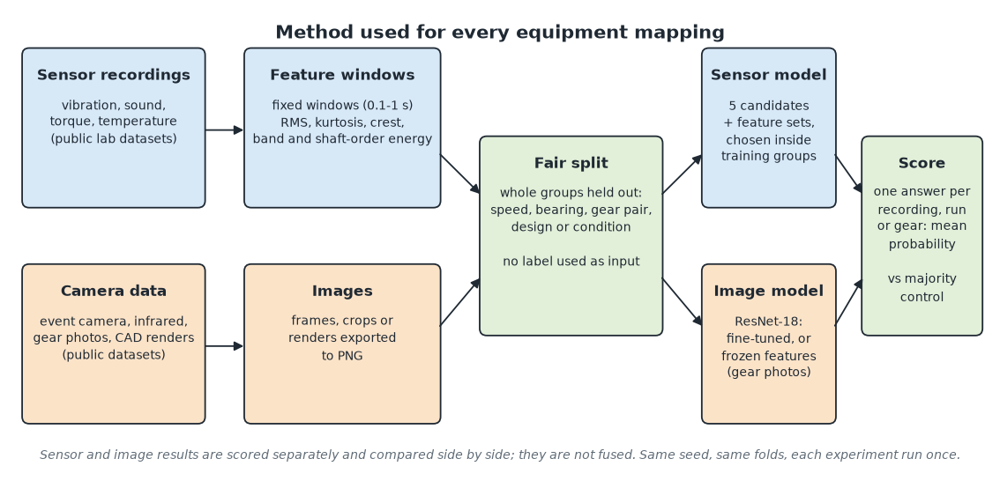

# Project guide

AI-Based Predictive Maintenance for Mining Equipment · Saskatchewan Polytechnic · Group 9: Ganesh Mishra, Lakshya Sharma and Sagar Patel · November 10, 2026, updated November 16, 2026

This guide explains the experiments and how to run the application. Every number comes from a saved result file in `Results/` and can be rerun with the commands in the [README](../README.md). The detailed records are the [evidence matrix](project_guide.md#section-equipment-evidence-matrix), the [methodology](project_guide.md#section-methodology), the [follow-up experiments](experiment_archive.md#record-followup-experiments), the [improvement results](experiment_archive.md#record-improvement-results), the [Grader matched-class results](experiment_archive.md#record-grader-matched-classes-results) and the [deployment verification](experiment_archive.md#record-phase-1-enhancement-report).

## 1. Question and scope

Can sensor data and camera data each classify the current condition of a mining machine component, and how do the two compare?

- **What we built:** for eight mining machines, one component each is mapped onto a public laboratory dataset that has both sensor recordings and images (or a closely related image set). For each machine we train a sensor model and an image model, test both on data held out in whole groups, and provide a working prediction route for uploads.
- **What we do not claim:** no data comes from mining equipment. These are laboratory analogues. The models classify present condition; they do not predict remaining useful life or a repair date. Sensor and image results are compared side by side; no sensor sample is paired with an image sample, and nothing is fused.

## 2. Data

All datasets are public and licensed CC BY 4.0. Sources, versions, checksums and local paths are in the [dataset manifest](../datasets/README.md).

| Machine | Component analogue | Sensor data | Image data | Classes |
|---|---|---|---|---|
| Pump | support bearing | University of Ottawa bearing rig, vibration | XJTU-DV-Pump event camera | healthy, inner race, outer race, ball |
| Haul Truck | wheel-motor bearing | UODS-VAFDC, vibration and microphone | XJTU-DV-Rotor event camera | healthy, inner, outer, ball |
| Belt Conveyor | geared drive | CORA rig, Vx vibration and temperature | CORA infrared, same runs | healthy, 25 / 50 / 75% gear wear |
| Dozer | geared drive | same runs as Belt Conveyor | same | same |
| Excavator | drivetrain | CORA drive-fault runs | CORA infrared, same runs | healthy, bearing, unbalance, misalignment |
| Wheel Loader | electric drive | CORA drive-fault runs | CORA infrared, same runs | healthy, bearing, half-broken bar, broken bar |
| Drill Rig | rotary-head reduction gear | MCC5-THU gearbox vibration | MFGNet-Gear synthetic CAD renders | healthy, wear, pitting, tooth crack (CAD: root breakage) |
| Motor Grader | circle-drive slewing bearing | JUST slewing bearing, six accelerometers | gear-tooth photos (GearBox_adddingImg) | sensor: healthy, inner ring, outer ring, rolling element; images: good vs damaged tooth |

## 3. Method



1. **Features from the signal or image only.** Recordings are cut into fixed windows (0.1 to 1 s). Each window gets statistics (RMS, kurtosis, crest factor, skewness) and the share of energy in frequency bands; where shaft speed is known, the bands are in shaft orders so they line up across speeds. Images are exported as PNG frames, crops or renders. No label is ever used as an input.
2. **Fair split.** The test always holds out whole groups: a speed, a bearing, a gear design, a gear pair or a working condition. Nothing from a held-out group is seen in training.
3. **Model choice inside the training data.** Sensor: five candidate models (random forest, extra trees, gradient boosting, RBF SVM, logistic regression) and the machine's feature sets; the best pair is chosen by macro F1 on validation groups inside the training data. Images: ImageNet ResNet-18, fine-tuned with the number of epochs chosen inside the training data (frozen features and logistic regression for the gear-tooth photos).
4. **One answer per unit.** Each test recording, run or gear gets one prediction: the class with the highest mean probability over its windows or images. We report accuracy, balanced accuracy and macro F1 against a majority-class control.
5. **Planned before running.** Every follow-up experiment was written down and committed before it ran, and each ran once. Weak results are reported, not tuned away.

## 4. Archived results (fair test)

| Machine | Fair test holds out | Sensor: accuracy / balanced / macro F1 | Image: accuracy / balanced / macro F1 | Units tested (sensor; image) |
|---|---|---|---|---|
| Pump | speed profile (sensor), camera speed (images) | **95.8 / 95.8 / 95.8%** | **100 / 100 / 100%** | 24; 24 recordings |
| Haul Truck | 3 whole bearings per round (sensor), speed (images) | **80.0** / 73.3 / 74.1% | 58.3 / 58.3 / 56.6% | 30; 12 recordings |
| Belt Conveyor | one speed per round | 43.8 / 43.8 / 35.0% | 50.0 / 50.0 / 43.2% | 16; 16 runs |
| Dozer (same runs as Belt Conveyor) | one speed per round | 43.8 / 43.8 / 35.0% | 56.3 / 56.3 / 52.1% | 16; 16 runs |
| Excavator | one speed per round | 25.0 / 25.0 / 18.3% | 25.0 / 25.0 / 21.7% | 16; 16 runs |
| Wheel Loader | one speed per round | 31.3 / 31.3 / 32.5% | 18.8 / 18.8 / 20.6% | 16; 16 runs |
| Drill Rig | one speed (sensor), 3 CAD designs per round (images) | 73.3 / 68.1 / 70.5% | **88.9 / 88.9 / 88.8%** | 120 recordings; 4,800 rendered gears |
| Motor Grader | one working condition (sensor), one photo or video set (images) | **84.2 / 84.2 / 84.7%** | **97.2 / 82.6 / 85.8%** | 120 recordings; 2,879 tooth crops |

The Motor Grader row above is the legacy JUST bearing experiment, not the aligned gear sensor comparison. The Aalto gear sensor experiment reports 78.35% accuracy, 77.78% balanced accuracy and 76.58% macro F1 on 425 runs. Its image counterpart reports 82.59% balanced accuracy on tooth crops from different physical gears.

The majority control is 25% for the four-class tests (30% for the Drill Rig sensor, 50% accuracy for the Haul Truck sensor). Bold marks results at or above 80% accuracy.

**Reading the table.**

- **Pump** is the strongest result: both modalities, the same four bearing classes, well above the control. The two sides use different rigs, so they cannot be ranked against each other.
- **Grader** reaches 80% on both sides, but the sensor model diagnoses a slewing bearing and the images diagnose gear teeth, so they answer different questions (see section 5).
- **Drill Rig** images reach 88.9%, but they are CAD renders, not camera photographs.
- **Haul Truck** sensor accuracy is exactly 80%, but its balanced accuracy is 73.3%, and its ball-fault class was recorded without load while every other class was loaded.
- **The four CORA machines** fail when a whole speed is held out (18.8 to 56.3%). They share one rig with one run per class and speed, so each run is worth 6.25 points.

## 5. Follow-up and improvement experiments

All were planned in advance, saved separately, and left the main results and deployed models unchanged.

| Experiment | Test | Result | Conclusion |
|---|---|---|---|
| CORA healthy vs worn (Belt Conveyor runs) | unseen speed, 16 runs | sensor 45.8%, images 75.0% balanced (control 50%) | image gain is 2 runs, not defensible (p = 0.05); CORA modelling stopped |
| Haul Truck sensor without the load-confounded ball class | unseen bearing, 25 recordings | 84.0% accuracy, 73.3% balanced | confirms the load confound; reported separately |
| A. Drill Rig sensor with shaft-order features | unseen speed, 120 recordings | 77.5% accuracy, 75.7% balanced (was 73.3 / 68.1%) | real gain under the same test, still below 80% |
| D. Drill Rig sensor with envelope order features | unseen speed, 120 recordings | 75.0% accuracy, 72.2% balanced | under 80% and below attempt A; not deployed, no further attempts |
| B. Haul Truck images with speed-scaled frames | unseen speed, 12 recordings | 50.0% (archived 58.3%) | no gain; the image model mostly learns the camera angle |
| C. CORA transient runs | unseen repetition at a **trained** speed, 80 runs | 100% Belt Conveyor, 100% Excavator, 97.5% Wheel Loader | features carry fault information; the CORA failure is the change of speed |
| E. CORA transient runs at an **unseen** speed (planned in advance, November 11) | unseen speed, 80 runs | 63.7% Belt Conveyor, 31.3% Excavator, 35.0% Wheel Loader (control 25%) | more runs help gear wear; drive faults stay near chance; not deployed |
| G. Grader sensor without absolute-level features (planned in advance, November 16) | unseen working condition, 120 recordings | 86.7% (archived 84.2%); 86.7% at half and double gain (archived 29.2 / 36.7%); 75.0% with added noise (archived 84.2%) | fixes gain sensitivity but loses noise robustness; failed its pre-set rule, not deployed |
| Grader with matched classes, Aalto rig | unseen gear pair, 425 runs | 78.4% accuracy, **77.8% balanced** (control 50%) | the sensor side now answers the image side's question (healthy gear vs damaged tooth) |
| Grader with matched classes, MCC5-THU | unseen speed, 60 recordings | 88.3% accuracy, 70.8% balanced | shares the Drill Rig's rig; not independent |

## 6. Which machines reach 80%

Under the fair test, four of the eight machines reach 80% on at least one modality: **Pump** (both), **Grader** (both, separate tasks), **Drill Rig** (images, CAD renders) and **Haul Truck** (sensor accuracy, exactly at the line). The four CORA machines do not. They reach 97.5 to 100% only when the test speed was seen in training, which is a narrower test and is labelled as such.

We did not change tests, merge test data into training, or select results after seeing them to raise these numbers. The remaining gaps come from the data: one CORA run per class and speed, three camera angles per class for the Haul Truck images, and synthetic renders for the Drill Rig.

## 7. Working prediction system

- **Three ways to use it:** the integrated notebook (upload a file, see the machine, fault class and confidence), a command-line `predict`, and a local upload page.
- **Dashboard and prediction history:** the upload page links to a local dashboard. It shows the fair-test table from the saved results, whether each route's checkpoint is present and on the trust list, the last route check, and every prediction made from the upload page or the command line. The history (`Processed_Data/prediction_history.jsonl`, not committed) keeps the file name, SHA-256, size, mapping and answer, never the file itself; it downloads as CSV with spreadsheet formulas neutralised. It records what the system answered; it does not track a machine over time, because no file carries a machine or time identity.
- **Demo check:** `python Notebook/predictive_maintenance.py demo-check` reruns all 11 uploads of the [demo script](project_guide.md#section-demo-script). On November 16, 2026 every step gave the expected answer.
- **Routes:** eight sensor routes, eight image routes and the Grader gear-vibration route. The November 10 route check passed all 39 routes, and correctly rejected an unsupported file and returned "Ambiguous Equipment" for a CORA file shared by four machines.
- **Grader gear model:** built from all 425 Aalto runs (logistic regression on vibration, shaft orders and torque). Its accuracy estimate is the 77.8% held-out result; the final fit has no extra gear pair left to test it on.
- **The route check uses training samples.** It shows that each route loads and answers. It is not an accuracy test. On those samples one Excavator misalignment image was called bearing and one Drill Rig pitting render was called healthy.
- **Safety and reproducibility:** saved models load only if their SHA-256 is on the local trust list; the upload page accepts files only from itself and only on this computer; downloaded data is checked against published hashes; package versions are pinned in `requirements-lock.txt`, and pip-audit found no known vulnerabilities in them on November 10, 2026.

## 8. Limits

- No mining-equipment data. Every result is a laboratory or synthetic analogue of a mining component.
- Small test sets. One recording moves accuracy by 6 to 8 points on the CORA and Haul Truck image tests.
- The CORA rig has one run per class and speed. The Dozer reuses the Belt Conveyor runs, and Excavator and Wheel Loader share eight runs.
- Haul Truck ball faults are confounded with load.
- The Pump source gives no bearing IDs, so its test holds out speed profiles, not physical bearings.
- Drill Rig images are CAD renders, and CAD root breakage is mapped to the sensor's tooth crack; camera performance is untested.
- Grader: the sensor and photo sides use different gears and rigs; on Aalto, healthy and faulty runs of a pair are different installations, so part of the signal may be the re-installation.
- PyTorch training on a multi-core CPU is not bit-for-bit repeatable, so image reruns can differ slightly.

## 9. What would make this stronger

1. Field data from one mining machine, with sensor and camera recorded at the same time on the same component.
2. More than one run per class and speed for the CORA-type drives, so a held-out speed is not a single run.
3. More camera angles per class (Haul Truck) and real photographs of gears (Drill Rig).
4. An independent gear pair to validate the final Grader gear model.
5. More MCC5-THU speeds for the Drill Rig. Attempt A's order features improved the fair test, but a refit on all 120 recordings with them offered chose vibration features only (the existing model), so more speeds are needed before order features can be chosen on evidence.

## 10. Data credits

University of Ottawa bearing data (Huang and Baddour); University of Ottawa UODS-VAFDC; XJTU-DV event-camera datasets (Zenodo 17447083); CORA rotating electromechanical system (CSUC Dataverse doi 10.34810/DATA2500); MCC5-THU gearbox datasets (Chen et al., Mendeley doi 10.17632/p92gj2732w.2); MFGNet-Gear (Mei and Shao, Deep Blue Data doi 10.7302/qrdj-n812); JUST slewing bearing datasets (Ren, Mendeley doi 10.17632/hwg8v5j8t6.1); GearBox_adddingImg (Roboflow Universe); Aalto Gear Failure Dataset (Dahl et al., Mendeley doi 10.17632/fywnj597d8.2). All CC BY 4.0. Full links are in the [dataset manifest](../datasets/README.md).


## Running the application

### Data and models

Obtain source data from the [dataset manifest](../datasets/README.md). Keep raw files in `Raw_Data/`, exported frames and their indexes in `Images/`, and deployment checkpoints in `Processed_Data/models/`. These folders are excluded from Git.

```bash
python Notebook/predictive_maintenance.py data-check
python Notebook/predictive_maintenance.py route-check
```

`route-check` performs real local inference: exit 0 means execution checks passed, 1 means a failure, and 2 means required local assets are missing. Execution checks are not independent accuracy estimates and may use fitting samples.

Every component checkpoint needs a verified SHA-256 entry in `Processed_Data/models/trusted_sha256.json`. Verify provenance and hashes before using `trust-models`; do not register an unknown model just to bypass a loading error. Training registers its own outputs. Joblib loading can execute code; image weights use trusted hashes and restricted weight loading.

The Motor Grader gear route uses `grader_gear_sensor.joblib` and `grader_gear_tooth.joblib`. Its original JUST slewing-bearing route remains separate. Restore verified checkpoints for demonstration rather than retraining automatically. Rebuild instructions, export requirements and previous verification records are preserved in the [experiment archive](experiment_archive.md).

### Predictions

```bash
python Notebook/predictive_maintenance.py serve
python Notebook/predictive_maintenance.py predict path/to/input.csv
python Notebook/predictive_maintenance.py demo-check
```

The upload page opens at `http://localhost:8613`, with a dashboard at `/dashboard`. It returns the equipment mapping, fault class, model probability and model name. Stop the local server with Ctrl+C. See the [demo script](project_guide.md#section-demo-script) for supported sample inputs and expected behavior.

Automatic identification recognizes supported schemas or verified image provenance. Shared CORA files and unresolved event-camera inputs remain ambiguous; select a compatible mapping only when its source is known. There is no validated universal whole-machine photograph classifier. Probabilities are uncalibrated model outputs, not failure risks or future failure dates.


## Detailed sections

- [Methodology](#section-methodology)
- [Equipment evidence](#section-equipment-evidence-matrix)
- [Scientific validation](#section-scientific-validation)
- [Demonstration](#section-demo-script)


<a id="section-methodology"></a>

# Methodology

## Task

The project classifies current component condition using eight equipment mappings. Pump and Haul Truck compare aligned bearing labels on separate laboratory rigs. The four CORA mappings use one laboratory rig with shared run IDs between sensor and infrared modalities. The scores are reported independently at run level. Frame-to-window synchronization was not verified. Drill Rig evaluates vibration and synthetic gear renders independently, with a qualified root-crack to root-breakage label mapping. Motor Grader has a JUST slewing-bearing task and two gear tasks. Aalto labels a gear-pair run and the photo model labels a tooth crop. See the [evidence matrix](project_guide.md#section-equipment-evidence-matrix) for the source and test unit of each result.

## Workflow (the same for every machine)

All code is in one file, [Notebook/predictive_maintenance.py](../Notebook/predictive_maintenance.py). Its sections follow these steps in order.

```text
raw files ──► 1a load sensor data ──► feature table (one row per time window)   ──► 3b sensor model ──┐
          └─► 1b load camera data ──► PNG images + index.csv (one row per image) ──► 3c image model  ──┤
                                                                                                      ▼
                     2  split: decides what is training and what is test           3a one answer per
                     4  MACHINES: which groups each machine holds out              recording, metrics
```

1. **Load.** Each raw recording is cut into fixed windows (100 ms or 1 s, depending on the dataset). Each window gets features computed from its own signal: statistics such as RMS, kurtosis and crest factor, and the share of energy in frequency bands. The stationary CORA feature extractor scales frequency by the nominal drive setting. The transient follow-up uses measured RPM. Images are exported from the raw camera files. No feature uses a label.
2. **Split.** See the two tests below. In the primary evaluations, keep all observations within the defined outer group on one side. In the secondary time split, use disjoint portions of the same recording.
3. **Train.**
   - *Sensor:* five candidate models (random forest, extra trees, gradient boosting, RBF SVM, logistic regression) and the machine's feature sets. The best pair is chosen by macro F1 on validation groups held out inside the training data.
   - *Images:* an ImageNet-pretrained ResNet-18 is fine-tuned. The number of epochs (up to 15; up to 6 for gears) is chosen on a validation part of the training data, then the model is retrained on all training images.
4. **Score.** Each test recording (or gear) gets one answer: the class with the highest mean probability over its windows or images. We report accuracy and macro F1 per recording, with a confusion matrix. A majority-class control shows what always guessing the most common class would score.

## The two tests

**Primary held-out evaluation.** The group definition varies by experiment. A held-out speed or operating condition can still contain specimens used at other conditions.

| Machine | Sensor test | Image test |
|---|---|---|
| Pump | train speed profiles A/B, test C/D (24 recordings) | train 20 Hz, test 30 Hz (24 recordings) |
| Haul Truck | 5 rounds, each holding out 3 whole bearings (30 recordings) | train 1000 rpm, test 2000 rpm (12 recordings) |
| Belt Conveyor, Excavator, Dozer, Wheel Loader | 4 rounds, each holding out one speed (16 runs) | same |
| Drill Rig | 3 rounds, each holding out one speed (120 recordings) | 4 rounds, each holding out 3 gear designs (4,800 gears) |
| Grader | JUST holds out six conditions (120 recordings). Aalto holds out eight gear pairs (425 runs). | Each filename-derived video/photo group held out in turn (tooth crops). |

Within each evaluation, model, feature-set and epoch selection use outer training data. Later experiments motivated by results on the same benchmark remain follow-ups.

**Time split (secondary, easier).** Every recording is cut in time: the first 60% trains, the last 30% tests, and the 10% gap in between is dropped. The same recordings appear on both sides. This protocol measures transfer to later portions of known recordings. Settings are fixed (random forest on the first feature set; ResNet-18 with the same epoch rule).

## Leakage controls

- The primary tests check that held-out recording or source IDs do not overlap training. Specimen independence is limited by what the source IDs establish.
- No normalisation uses statistics from test recordings. Images are each scaled on their own; the sensor models scale inside the training fold.
- The raw mean of the UODS accelerometer is not a feature, because inner-race files carry a DC offset.
- Seeds are fixed (sensor 42, images 42, gears and gear renders 613). PyTorch training on a multi-core CPU is not bit-for-bit repeatable, so an image rerun can differ slightly from the saved score.

## Deployment verification

The upload routes use locally fitted checkpoints. Some fits use different inputs from the archived evaluations. For example, Belt Conveyor and Dozer uploads use vibration alone, while some evaluation folds selected temperature features. Deployment smoke tests check successful inference and error handling. Consult the [deployment verification report](experiment_archive.md#record-phase-1-enhancement-report) for those tests. Saved `.joblib` models load only when their SHA-256 is on the local trust list. The Grader gear-vibration model (Aalto, healthy vs tooth damage) is chosen with grouped validation over gear pairs and fitted on all 425 runs; the separate leave-one-gear-pair-out experiment estimates generalization of the selection procedure. The rebuilt checkpoint predicted healthy at 98.7% model probability on the 250 RPM training recording. The [final report](project_guide.md) summarises the whole method with a [diagram](../Figures/methodology_flow.png).

## Follow-up experiments (November 6)

The [follow-up record](experiment_archive.md#record-followup-experiments) uses the same folds and methods with a changed target or subset, saves to `Results/experiments/` and leaves the four-class results and checkpoints unchanged: CORA healthy vs worn (one prediction per held-out run, majority control, four-class model read as healthy vs worn), the Haul Truck fair test without the load-confounded ball class, and a route check with checkpoint hashes.

## Phase 1 diagnostics and follow-up

The signal diagnostics report waveform, FFT amplitude, Welch PSD and optional constant-speed shaft orders using the recording’s acquisition metadata. They run separately from model preprocessing. The grouped CORA candidate, fixed Pump disturbance tests and inference benchmarks are documented in the [Phase 1 enhancement report](experiment_archive.md#record-phase-1-enhancement-report).

## Limits

- No data comes from mining equipment. Each machine maps a mining component onto a laboratory component.
- Test sets are small. One recording moves accuracy by 6.25 percentage points on a 16-run test and 8.33 points on the Haul Truck’s 12-recording image test.
- The CORA rig has one run per class and speed. The Dozer reuses the Belt Conveyor's runs, so it is not separate evidence. Merging the wear levels into healthy vs worn did not give defensible improvement (see the follow-up record). On the CORA transient runs, a held-out repetition at a trained speed scores 97.5–100%. The transient and stationary tests differ in acquisition and preprocessing as well as speed exposure ([improvement results](experiment_archive.md#record-improvement-results)).
- The Haul Truck ball faults were recorded without load and the other classes at 400 N, so ball recall may partly measure load.
- The Pump source gives no bearing IDs, so its test holds out speed profiles, not bearings.
- Drill Rig image performance applies to CAD renders. Camera generalization remains untested. The code maps CAD root breakage to sensor root crack. Keep this label qualification visible.
- The Grader images use a different method: frozen ImageNet ResNet-18 features and a logistic regression, with settings fixed in advance (choosing them inside the training sources is saved as a check). They show real photos of small gears, not the slewing ring, and are scored by balanced accuracy because 94% of the tooth crops are good teeth.


<a id="section-equipment-evidence-matrix"></a>

# Eight-equipment evidence matrix

AI-Based Predictive Maintenance for Mining Equipment · Group 9 · Updated November 8, 2026

The matrix describes eight equipment application mappings. The measurements come from laboratory analogues or component datasets, and the Drill Rig image benchmark uses synthetic CAD renders. Shared CORA run IDs support a comparison at run level. Frame-to-window synchronization was not verified. The Pump and Haul Truck modalities use separate rigs. Source links, licenses and paths are recorded in the [dataset manifest](../datasets/README.md).

## Components, labels and held-out groups

| Equipment | Sensor component and source | Image component and source | Fault classes and comparability | Sensor split | Image split | Main limitations |
|---|---|---|---|---|---|---|
| Pump | Support bearing. Ottawa bearing rig, vibration. | Support bearing housing. XJTU-DV-Pump event camera. | Healthy, inner-race, outer-race, ball fault. | Train speed profiles A/B, test C/D. | Train 20 Hz, test 30 Hz. | Aligned labels on separate rigs. Independent physical bearing IDs were not established for the image split. |
| Haul Truck | Wheel-motor bearing analogue. Ottawa UODS-VAFDC vibration and microphone. | Wheel-motor bearing housing analogue. XJTU-DV-Rotor event camera. | Healthy, inner-race, outer-race, ball fault. | Five outer folds by bearing ID. | Train 1,000 rpm, test 2,000 rpm. | Separate rigs. UODS ball faults were unloaded while other classes ran at about 400 N. Image outer-race and ball recall were both 33.3%. |
| Belt Conveyor | Geared drive analogue. CORA Vx vibration and optional bounded T1 temperature. | Geared drive analogue. CORA infrared frames from the same runs. | Healthy and 25%, 50%, 75% gear wear. | Leave one speed out across F5, F15, F50 and F60. | Same held-out speeds and run IDs as sensor. | One run per class and speed. Sensor wear25 recall and image wear75 recall were zero. Three sensor folds selected vibration plus temperature. |
| Dozer | Final-drive analogue. CORA Vx and optional bounded T1 from the Belt Conveyor runs. | Final-drive analogue. CORA infrared from the same runs. | Healthy and 25%, 50%, 75% gear wear. | Same 16 runs and speed folds as Belt Conveyor. | Same 16 runs and speed folds as Belt Conveyor. | All 16 run IDs are reused. Treat this as a second application mapping of the same evidence. |
| Excavator | Drivetrain analogue. CORA Vx vibration. | Drivetrain analogue. CORA infrared frames from the same runs. | Healthy, bearing fault, unbalance, misalignment. | Four whole-speed folds. | Same held-out speeds and run IDs as sensor. | Both accuracies are at the 25% uniform four-class reference. Local binary follow-ups answer a different question. |
| Wheel Loader | Electric-drive analogue. CORA Vx vibration. | Electric-drive analogue. CORA infrared frames from the same runs. | Healthy, bearing fault, half-broken rotor bar, broken rotor bar. | Four whole-speed folds. | Same held-out speeds and run IDs as sensor. | Eight healthy or bearing runs overlap Excavator. Image accuracy is below the 25% uniform reference and broken-bar recall is zero. |
| Drill Rig | Rotary-head reduction gear analogue. MCC5-THU gearbox vibration. | Reduction gear analogue. MFGNet-Gear synthetic CAD renders. | Healthy, wear and pitting align broadly. The sensor root-crack class is mapped in code to CAD R0 root breakage. | Hold out 1,000, 2,000 or 3,000 rpm in turn. | Four folds holding out three CAD designs each. | Root crack and root breakage require qualification. Synthetic render performance has no established transfer to camera photographs. |
| Motor Grader | Deployed gear analogue: Aalto thruster gearbox vibration. Secondary: MCC5-THU gearbox vibration. Deployed legacy route: JUST slewing-bearing vibration. | Small gear teeth from GearBox_adddingImg v1 real photographs. | Gear candidates distinguish healthy gear from tooth damage. Images distinguish good from damaged individual teeth. JUST diagnoses four bearing conditions separately. | Aalto holds out whole gear pairs. MCC5-THU holds out speeds. JUST holds out operating conditions on four reused supports. | Hold out filename-derived video/photo groups. Score tooth crops. | Different physical gears and evaluation units. Image groups lack verified gear IDs. Aalto has installation confounding, MCC5-THU overlaps Drill Rig, and neither gear sensor result is field validation. |

The Drill Rig crosswalk follows the source definitions in [MCC5-THU](https://pmc.ncbi.nlm.nih.gov/articles/PMC11070670/) and [MFGNet-Gear](https://huggingface.co/datasets/rsmei/MFGNet-Gear). The Motor Grader acquisition and labeling evidence is detailed in the [bearing image investigation](experiment_archive.md#record-motor-grader-image-investigation) and [gear comparison review](experiment_archive.md#record-motor-grader-gear-comparison).

## Archived primary held-out results

Values are copied from the saved score blocks at baseline `05476ba`, rounded to two decimals. Accuracy is the fraction of correct evaluation units, balanced accuracy is the mean class recall, and macro F1 averages class F1 scores equally. A test unit is a scored record, run, render design instance or tooth crop, depending on the row. The count does not imply that many independent physical specimens.

| Equipment | Sensor test units | Sensor accuracy | Sensor balanced accuracy | Sensor macro F1 | Image test units | Image accuracy | Image balanced accuracy | Image macro F1 |
|---|---:|---:|---:|---:|---:|---:|---:|---:|
| [Pump](../Results/pump/) | 24 | 95.83% | 95.83% | 95.80% | 24 | 100.00% | 100.00% | 100.00% |
| [Haul Truck](../Results/haul_truck/) | 30 | 80.00% | 73.33% | 74.10% | 12 | 58.33% | 58.33% | 56.55% |
| [Belt Conveyor](../Results/belt_conveyor/) | 16 | 43.75% | 43.75% | 35.00% | 16 | 50.00% | 50.00% | 43.18% |
| [Dozer](../Results/dozer/) | 16 | 43.75% | 43.75% | 35.00% | 16 | 56.25% | 56.25% | 52.08% |
| [Excavator](../Results/excavator/) | 16 | 25.00% | 25.00% | 18.33% | 16 | 25.00% | 25.00% | 21.67% |
| [Wheel Loader](../Results/wheel_loader/) | 16 | 31.25% | 31.25% | 32.54% | 16 | 18.75% | 18.75% | 20.56% |
| [Drill Rig](../Results/drill_rig/) | 120 | 73.33% | 68.06% | 70.54% | 4,800 | 88.94% | 88.94% | 88.81% |
| [Motor Grader](../Results/grader/) | 120 | 84.17% | 84.17% | 84.70% | 2,879 | 97.22% | 82.59% | 85.84% |

The Grader image experiment uses balanced accuracy as its headline metric because 2,714 of 2,879 crops are labeled good. Its 97.22% raw accuracy is sensitive to that imbalance. The 4,800 Drill Rig synthetic gears represent 12 design groups. CORA has 16 test runs per row, so one changed decision moves pooled accuracy by 6.25 percentage points.

## Secondary time-split accuracy

These experiments use early segments for training and later segments from the same recordings for testing. They measure within-recording transfer and remain separate from the primary held-out results.

| Equipment | Sensor accuracy | Image accuracy |
|---|---:|---:|
| Haul Truck | 100.00% | 100.00% |
| Belt Conveyor | 100.00% | 100.00% |
| Dozer | 100.00% | 93.75% |
| Excavator | 93.75% | 100.00% |
| Wheel Loader | 93.75% | 100.00% |

## Follow-up results

The [follow-up record](experiment_archive.md#record-followup-experiments) adds the CORA healthy vs worn comparison, the Haul Truck result without the load-confounded ball class, the Drill Rig and Pump source checks, and a route check from November 6. The [improvement results](experiment_archive.md#record-improvement-results) add three attempts planned in advance (Drill Rig order features 77.5%, Haul Truck speed-scaled frames 50.0%, CORA transient repetitions 97.5–100% at trained speeds). The [Grader matched-class results](experiment_archive.md#record-grader-matched-classes-results) cover related binary gear tasks. The archived results above are unchanged.

| Gear evidence | Held-out grouping | Scored units | Accuracy | Balanced accuracy | Macro F1 |
|---|---|---:|---:|---:|---:|
| Aalto gear sensor evaluation | 8 physical gear pairs | 425 runs | 78.35% | 77.78% | 76.58% |
| MCC5-THU sensor follow-up | 3 speeds | 60 recordings | 88.33% | 70.83% | 76.01% |
| GearBox_adddingImg image experiment | 55 filename-derived source groups | 2,879 crops | 97.22% | 82.59% | 85.84% |

Aalto is the deployed gear-vibration source. Its separate held-out evaluation groups by physical gear pair and uses a different source from Drill Rig. The sensor labels describe whole gear runs, while the image labels describe visible condition at a single tooth. No sample-level pairing, same-grader inference, or combined score is supported.

## Local deployment checks

The [deployment report](experiment_archive.md#record-phase-1-enhancement-report) records successful inference for eight sensor and eight image routes plus the Aalto gear-vibration route. Its sample predictions and confidence values verify that the interface routes files and loads checkpoints. The smoke samples may have been included in a deployment fit. Some checkpoint training scopes also differ from the archived experiments. For example, the Belt Conveyor and Dozer upload models accept vibration alone, and the Drill Rig and Grader deployment fits use bounded training inputs. See the [20-day audit](experiment_archive.md#record-phase-1-enhancement-report) for the next experiment and its acceptance criteria.


<a id="section-scientific-validation"></a>

# Scientific validation

AI-Based Predictive Maintenance for Mining Equipment · Ganesh Mishra, Lakshya Sharma and Sagar Patel · November 11, 2026

**Readiness · Ready With Limitations.** The local application supports an academic demonstration of current component condition classification. The strongest aligned evidence is the Pump benchmark under changes in speed. CORA compares modalities on the same laboratory runs, with weak unseen-speed performance. The other mappings have different levels of component, label or test-unit alignment. Field validation, future-failure forecasting, and fused sensor–image inference remain outside the demonstrated scope.

The review used committed baseline `53ab430`, the [source manifest](../datasets/README.md), the [evaluation implementation](../Notebook/predictive_maintenance.py), archived image provenance, both notebooks, and the saved result JSON. I recalculated sample counts, accuracy, balanced accuracy, macro precision, macro recall and macro F1 from 111 saved confusion-matrix blocks. Every corresponding saved value agreed within its rounding precision. This checks the arithmetic and recorded class support. It does not reproduce the predictions from raw data.

## Equipment, preprocessing and comparison scope

| Mapping | Sensor dataset and preprocessing | Image dataset and preprocessing | Primary outer test and comparison scope |
|---|---|---|---|
| Pump | Ottawa bearing vibration. 200 kHz, 100 ms windows with amplitude statistics and spectral bands. | XJTU-DV-Pump event camera. Polarity counts in 125 ms frames at 96 × 128, normalized per frame. | Sensor speed profiles A/B → C/D. Images 20 → 30 Hz. Both predict healthy, inner race, outer race and ball condition on separate rigs. Different speed protocols and unverified specimen IDs limit direct comparison. |
| Haul Truck | Ottawa UODS-VAFDC bearing vibration and microphone, 42 kHz. 100 ms statistics and spectral features, optional Hilbert envelope and microphone features. Long envelope uses 0.5 s windows. | XJTU-DV-Rotor. The same 125 ms event-frame representation. | Sensor holds out three bearing IDs per fold across five folds. Images hold out 2,000 rpm after training at 1,000 rpm. Four bearing labels align across separate rigs. The sensor ball class is confounded with load, and the image validation was sensitive to camera angle. |
| Belt Conveyor | CORA geared-drive Vx at 3 kHz. One-second windows sampled every ten seconds, statistics and frequency bands scaled by the drive setting. Optional T1 mean, standard deviation and slope from bounded samples. | CORA infrared, grayscale 96 × 128, all 450 frames per run. | Leave one drive setting out at F5, F15, F50 and F60. Same 16 runs and labels for both sides. Healthy and three wear levels. The same gear-wear setup may recur across speeds. |
| Dozer | Identical CORA Vx/T1 feature table to Belt Conveyor. | Every third infrared frame of those same runs, 150 per run. | Same test groups and classes as Belt Conveyor. The image sample is a subset of the conveyor export. These are two application mappings of one benchmark. |
| Excavator | CORA drivetrain Vx. Same Vx preprocessing as Belt Conveyor. | CORA infrared, 450 frames per run. | Four whole-setting folds, 16 shared sensor/image runs. Labels are healthy, bearing fault, unbalance and misalignment. Both modality results are at the 25% uniform four-class reference. |
| Wheel Loader | CORA electric-drive Vx. Same Vx preprocessing. | CORA infrared, 450 frames per run. | Four whole-setting folds, 16 shared sensor/image runs. Labels are healthy, bearing fault, half-broken and broken rotor bar. The healthy and bearing runs overlap Excavator (eight runs). |
| Drill Rig | MCC5-THU gearbox, six vibration channels at 12.8 kHz. One-second window statistics and spectral energy. | MFGNet-Gear synthetic meshes, two 224 × 224 renders per gear with ImageNet normalization. | Sensor leaves out 1,000, 2,000 and 3,000 rpm in turn. Images hold out three designs per fold across four folds. Healthy, wear and pitting broadly align. CAD root breakage and sensor tooth crack are a qualified crosswalk. |
| Motor Grader | JUST slewing bearing, six vibration channels at 50 kHz with one-second statistics and spectral energy. Aalto gear alternative uses 3,012 Hz, 30 one-second windows per run after 10 s, with acceleration statistics, encoder-based order bands and torque features. | Roboflow GearBox_adddingImg v1. Labeled tooth crops with 15% margin, 224 × 224, ImageNet normalization. | JUST holds out six conditions on four reused supports, one per class. Aalto holds out physical gear pairs. Images hold out filename-derived groups. JUST bearing labels and tooth labels describe separate tasks. Aalto and images share a binary damage concept, using different physical gears and different evaluation units. |

## Model settings and split audit

Sensor model and feature-set selection uses grouped validation within each outer training set, maximizing recording-level macro F1. The candidate settings in the audited code are Random Forest (250 trees, square-root feature sampling, minimum leaf 2, balanced subsampling), Extra Trees (300 trees, square-root feature sampling, minimum leaf 2, balanced class weights), histogram gradient boosting (200 iterations, learning rate 0.05, balanced class weights), standardized RBF SVM (C 10, gamma scale, balanced class weights, probability enabled), and standardized logistic regression (C 1, L-BFGS, 5,000 iteration limit, balanced class weights). The random seed is 42. SVM probability fitting happens within the outer training data and does not establish group-aware probability calibration.

The archived seven ResNet18 studies use ImageNet initialization and fine-tuning, AdamW with learning rate 0.0003 and weight decay 0.0001, and epochs selected by validation macro F1. Camera frames use class-weighted cross-entropy, flips, shifts, intensity scaling and noise, with one training recording per class reserved for validation. The Drill Rig uses unweighted cross-entropy, rotation, flips and shifts, three validation designs, and at most 50 training gears per design and class. The Grader images instead use a frozen ResNet18 encoder and standardized, class-weighted logistic regression with fixed C 0.1. The alternate Grader settings were selected within training source groups and are reported separately.

The evaluator keeps recording windows and frames together in the primary split and averages class probabilities at recording or gear level. Grader photos are scored per tooth crop with groups kept together by source. The outer grouping limits direct duplication across train and test within the defined unit. It does not rule out shared specimens across speeds, shared hardware across mappings, repeated views, or condition-related acquisition effects. The first seven image results came from pre-consolidation code at `c7d8d25`. A full reproduction with the current code remains unverified, especially for Drill Rig epoch selection. See the [reproducibility notes](../README.md#notes).

## Verified performance

These are percentages at the scoring unit shown. Macro precision, recall and F1 weight each class equally. All classes have test support in these rows, so macro recall equals balanced accuracy. An undefined class precision is scored as zero, consistent with the evaluator. Values absent from an archived headline block are derived from its confusion matrix and marked with an asterisk.

| Evaluation | Test units | Accuracy | Balanced accuracy | Macro precision | Macro recall | Macro F1 |
|---|---:|---:|---:|---:|---:|---:|
| [Pump sensor](../Results/pump/sensor.json) | 24 | 95.83% | 95.83% | 96.43% | 95.83% | 95.80% |
| [Pump image](../Results/pump/images.json) | 24 | 100.00% | 100.00% | 100.00% | 100.00% | 100.00% |
| [Haul Truck sensor](../Results/haul_truck/sensor.json) | 30 | 80.00% | 73.33% | 76.04% | 73.33% | 74.10% |
| [Haul Truck image](../Results/haul_truck/images.json) | 12 | 58.33% | 58.33% | 64.58% | 58.33% | 56.55% |
| [Belt Conveyor sensor](../Results/belt_conveyor/sensor.json) | 16 | 43.75% | 43.75% | 33.33% | 43.75% | 35.00% |
| [Belt Conveyor image](../Results/belt_conveyor/images.json) | 16 | 50.00% | 50.00% | 41.79% | 50.00% | 43.18% |
| [Dozer sensor](../Results/dozer/sensor.json) | 16 | 43.75% | 43.75% | 33.33% | 43.75% | 35.00% |
| [Dozer image](../Results/dozer/images.json) | 16 | 56.25% | 56.25% | 56.25% | 56.25% | 52.08% |
| [Excavator sensor](../Results/excavator/sensor.json) | 16 | 25.00% | 25.00% | 14.58% | 25.00% | 18.33% |
| [Excavator image](../Results/excavator/images.json) | 16 | 25.00% | 25.00% | 19.17% | 25.00% | 21.67% |
| [Wheel Loader sensor](../Results/wheel_loader/sensor.json) | 16 | 31.25% | 31.25% | 35.00% | 31.25% | 32.54% |
| [Wheel Loader image](../Results/wheel_loader/images.json) | 16 | 18.75% | 18.75% | 34.17% | 18.75% | 20.56% |
| [Drill Rig sensor](../Results/drill_rig/sensor.json) | 120 | 73.33% | 68.06% | 82.60% | 68.06% | 70.54% |
| [Drill Rig image](../Results/drill_rig/images.json) | 4,800 | 88.94% | 88.94% | 88.92%* | 88.94%* | 88.81% |
| [Grader JUST sensor](../Results/grader/sensor.json) | 120 | 84.17% | 84.17% | 86.24% | 84.17% | 84.70% |
| [Grader tooth image](../Results/grader/images.json) | 2,879 | 97.22% | 82.59% | 89.96% | 82.59% | 85.84% |
| [Grader Aalto gear sensor](../Results/experiments/grader_gear/aalto_sensor.json) | 425 | 78.35% | 77.78% | 75.97% | 77.78% | 76.58% |
| [Grader MCC5-THU gear sensor](../Results/experiments/grader_gear/mcc5_sensor.json) | 60 | 88.33% | 70.83% | 93.64% | 70.83% | 76.01% |

Pump and Haul Truck score recordings. CORA scores runs, Drill Rig scores recordings and CAD gear instances, and Grader scores runs or tooth crops. The image-side test counts at frame or render level are Pump 1,946, Haul Truck 1,392, Belt Conveyor 7,200, Dozer 2,400, Excavator 7,200, Wheel Loader 7,200 and Drill Rig 9,600. These totals count related images from the scored groups. Grader’s 2,879 image units are tooth crops from 55 inferred sources.

### Settings selected per outer fold

Sensor order follows the saved folds. RF means random forest, ET extra trees, HGB histogram gradient boosting, SVM RBF SVM, and LR logistic regression. Each image epoch count is taken from the archived result.

| Mapping | Sensor model / feature set | Image epochs or fixed model |
|---|---|---|
| Pump | ET / vibration | 2 |
| Haul Truck | ET / vibration+long envelope+microphone; HGB / vibration+long envelope; RF / vibration; HGB / vibration+long envelope; LR / vibration+long envelope | 1 |
| Belt Conveyor | LR / vibration+temperature; ET / vibration; RF / vibration+temperature; ET / vibration+temperature | 15, 6, 6, 1 |
| Dozer | LR / vibration+temperature; ET / vibration; RF / vibration+temperature; ET / vibration+temperature | 7, 11, 1, 2 |
| Excavator | SVM / vibration; HGB / vibration; LR / vibration; HGB / vibration | 4, 2, 9, 4 |
| Wheel Loader | ET / vibration; ET / vibration; ET / vibration; LR / vibration | 3, 3, 5, 2 |
| Drill Rig | LR / vibration; RF / vibration; HGB / vibration | 6, 4, 6, 6 |
| Motor Grader | LR / vibration; LR / vibration; LR / vibration; LR / vibration; LR / vibration; LR / vibration | Frozen encoder + LR, C 0.1 |
| Grader Aalto gear sensor | LR / acceleration+orders; ET / acceleration+orders+torque; ET / acceleration+orders+torque; ET / acceleration+orders+torque; SVM / acceleration+orders+torque; ET / acceleration+orders+torque; ET / acceleration; LR / acceleration+orders+torque | See Grader tooth image row |
| Grader MCC5-THU gear sensor | LR / vibration; HGB / vibration; LR / vibration+orders | See Grader tooth image row |

### Confusion matrices

Rows are actual classes, columns are predictions. Class order follows each saved file.

| Evaluation | Class order | Counts |
|---|---|---|
| Pump sensor | healthy, inner, outer, ball | `[[6,0,0,0],[0,6,0,0],[0,0,6,0],[0,1,0,5]]` |
| Pump image | healthy, inner, outer, ball | `[[6,0,0,0],[0,6,0,0],[0,0,6,0],[0,0,0,6]]` |
| Haul Truck sensor | healthy, inner, outer, ball | `[[14,1,0,0],[1,3,0,1],[1,0,3,1],[0,0,1,4]]` |
| Haul Truck image | healthy, inner, outer, ball | `[[3,0,0,0],[1,2,0,0],[0,2,1,0],[0,0,2,1]]` |
| Belt Conveyor sensor | healthy, wear25, wear50, wear75 | `[[2,0,0,2],[2,0,1,1],[2,0,1,1],[0,0,0,4]]` |
| Belt Conveyor image | healthy, wear25, wear50, wear75 | `[[1,0,1,2],[0,3,1,0],[0,0,4,0],[1,2,1,0]]` |
| Dozer sensor | healthy, wear25, wear50, wear75 | `[[2,0,0,2],[2,0,1,1],[2,0,1,1],[0,0,0,4]]` |
| Dozer image | healthy, wear25, wear50, wear75 | `[[1,1,1,1],[0,4,0,0],[0,1,3,0],[1,2,0,1]]` |
| Excavator sensor | healthy, bearing, unbalance, misalignment | `[[2,0,2,0],[1,0,2,1],[1,0,2,1],[2,0,2,0]]` |
| Excavator image | healthy, bearing, unbalance, misalignment | `[[0,1,2,1],[0,1,2,1],[0,2,1,1],[0,2,0,2]]` |
| Wheel Loader sensor | healthy, bearing, half_broken_bar, broken_bar | `[[1,0,2,1],[1,2,1,0],[2,0,1,1],[1,1,1,1]]` |
| Wheel Loader image | healthy, bearing, half_broken_bar, broken_bar | `[[1,1,0,2],[0,1,2,1],[0,2,1,1],[0,2,2,0]]` |
| Drill Rig sensor | healthy, gear_wear, gear_pitting, tooth_crack | `[[5,7,0,0],[0,36,0,0],[0,9,25,2],[1,13,0,22]]` |
| Drill Rig image | healthy, gear_wear, gear_pitting, tooth_crack | `[[950,107,44,99],[155,990,9,46],[64,7,1129,0],[0,0,0,1200]]` |
| Grader JUST sensor | healthy, inner_ring, outer_ring, rolling_element | `[[25,0,0,5],[0,25,0,5],[0,4,26,0],[0,5,0,25]]` |
| Grader tooth image | good_tooth, damaged_tooth | `[[2690,24],[56,109]]` |
| Grader Aalto gear sensor | healthy, tooth_damage | `[[108,34],[58,225]]` |
| Grader MCC5-THU gear sensor | healthy, tooth_damage | `[[5,7],[0,48]]` |

## Generalization, leakage and interpretation

- **Pump** has the strongest aligned fault comparison, with 23/24 sensor and 24/24 image recordings correct. Its two holdouts probe different operating changes. The available identifiers do not establish a specimen holdout. [Ottawa data descriptor](https://pmc.ncbi.nlm.nih.gov/articles/PMC6249544/)
- **Haul Truck** uses bearing-grouped sensor folds but associates all ball-fault recordings with no load and the other classes with nominal 400 N. The load channel is excluded from model features, yet the signals can still encode load. Removing ball changes the task to three classes, yielding 84.0% accuracy and 73.3% balanced accuracy. On the visual side, the archived score was 7/12. The follow-up rerun scored 8/12, with no validation recordings correct during epoch selection in that rerun. That finding is consistent with scene or camera-angle dependence. Its cause was not isolated. [UODS-VAFDC publisher](https://data.mendeley.com/datasets/y2px5tg92h/1) · [Follow-up experiments](experiment_archive.md#record-followup-experiments) · [Improvement B](experiment_archive.md#record-improvement-results)
- **CORA** provides the closest run-level comparison because the sensor and infrared sides share run IDs and fault labels. The app fits each modality independently. Shared run IDs alone provide neither verified frame-to-window alignment nor a measured fusion gain. I matched the local image indexes to vibration filenames and checked for run overlap across the speed split. The four mappings contain 36 distinct stationary runs after deduplication by run ID. Belt Conveyor and Dozer share all 16 runs. The two drive mappings also share four healthy runs with the gear-wear mappings and eight healthy/bearing runs with each other. A single error moves each 16-run score by 6.25 percentage points.
- **CORA follow-ups** answer narrower questions. Healthy-versus-worn balanced accuracy was 45.8% sensor and 75.0% infrared on 16 runs. The infrared exact calculation tests random assignment of healthy predictions conditional on the observed prediction count. It does not test improvement over the collapsed four-class model. The 97.5–100% transient results held out repetitions at known speeds and used a different acquisition protocol and preprocessing. They cannot isolate speed as the sole cause of weak stationary results. The high time-split values measure later portions of recordings seen in training. [Binary follow-up](experiment_archive.md#record-followup-experiments) · [Transient follow-up](experiment_archive.md#record-improvement-results)
- **Drill Rig** sensor data are imbalanced (12 healthy and 36 per fault). Healthy recall is 41.7% in the archived unseen-speed sensor test. The order and envelope follow-ups reached 77.5% and 75.0% accuracy. They reuse the same benchmark and are follow-up comparisons. The CAD result applies to the generated designs and render pipeline. No photo-domain performance or upper bound follows from that result. The class called `tooth_crack` in the image JSON is R0 root breakage. [Label crosswalk](experiment_archive.md#record-followup-experiments)
- **Motor Grader** JUST conditions reuse four supports, with class and specimen confounded. For teeth, 2,714/2,879 crops are good. An always-good classifier would get 94.27% accuracy, so the observed 82.59% balanced accuracy and 66.06% damaged-tooth recall give more context than 97.22% accuracy alone. Filename grouping controls known source overlap without establishing physical gear independence. For an alternate export, matching counts and group totals does not establish matching image content. Aalto holds out gear pairs, while healthy and damaged conditions also differ by installation. MCC5-THU holds out speeds and reuses the Drill Rig source and its healthy recordings. [Gear source audit](experiment_archive.md#record-motor-grader-gear-comparison) · [Matched-class results](experiment_archive.md#record-grader-matched-classes-results) · [Aalto publisher](https://data.mendeley.com/datasets/fywnj597d8/2)

## Motor Grader deployment verification

The local Aalto checkpoint is a fresh fit on all 425 runs from the SHA-256-verified source archive. It uses standardized logistic regression on 100 acceleration, order and torque features. The selected model is registered in the local trust manifest. The exact 250 RPM `GP1.csv` returned `healthy` with **98.7% model probability** in the CLI, notebook and upload page. This recording was used for the final fit. For generalization, use the separate archived leave-one-gear-pair-out evaluation of the model-selection procedure (**78.35% accuracy, 77.78% balanced accuracy, 76.58% macro F1**). [Local rebuild and verification](experiment_archive.md#record-phase-1-enhancement-report)

## Technical checks and deployment prerequisites

| Check | Result |
|---|---|
| Full local pytest | 53 passed, 0 failed, 0 skipped. Existing scikit-learn SVC deprecation warnings were emitted. |
| Lint and dependency compatibility | Pyflakes and `pip check` passed. |
| CLI route check | 39 prediction calls passed, including the Aalto route. Unsupported input and ambiguous CORA checks also passed. |
| Integrated notebook | Clean kernel passed all eight sensor and eight image mappings and 19 upload checks. A separate clean-kernel run passed the real Aalto recording. |
| Local upload server | 16 real-file uploads and six error or ambiguity checks passed. A separate multipart upload passed with the real Aalto recording and matched the CLI probability. |
| Research notebook | All 18 code cells executed in a clean kernel. |
| GitHub Actions | The [audited baseline workflow](https://github.com/theganeshmishra/ai-based-predictive-maintenance-mining-equipment/actions/runs/42968287263) passed. The [main workflow page](https://github.com/theganeshmishra/ai-based-predictive-maintenance-mining-equipment/actions?query=branch%3Amain) tracks documentation commits. Hosted CI skips real-file tests when the local model or recording is absent. |

For a second computer, provision the project environment, all 17 checkpoints, trusted hashes for the locally verified Joblib files, indexed image exports, and the raw or prepared samples listed in the [demo script](project_guide.md#section-demo-script). The optional whole-machine photo detector also needs ONNX Runtime and its separate files. The verification computer has the deployment samples and the Aalto recording, archive and feature cache. The local Grader COCO export and checkpoint metadata match the evaluated archive SHA-256. Full MCC5-THU, JUST and MFGNet mesh archives are absent in this checkout. See the [dataset manifest](../datasets/README.md) for rebuild sources. The audit did not retrain archived models.

## Remaining work before academic evaluation

1. Use the primary held-out table for performance claims. Label time-split, follow-up, frame-level and deployment numbers with their own test units.
2. Rehearse the demonstration on the submission computer with the exact local checkpoints and samples. Keep the CORA ambiguity case and Aalto/Grader task distinctions visible.
3. Treat independent field specimens, matched grader data, synchronized fusion, and failure-time labels as future research. The software demonstration and laboratory comparison are ready within the evidence limits above.


<a id="section-demo-script"></a>

# Demonstration script

AI-Based Predictive Maintenance for Mining Equipment · Group 9 · November 10, 2026, updated November 16, 2026 · about 12 minutes

The files below are the local samples used by `route-check` on November 10, 2026 (`Results/deployment/route_check.json`). They are training samples, so the demo shows that each route works; the accuracy claims come from the fair tests in the [final report](project_guide.md).

## Before the demo (on the demo computer)

1. Pull the latest `main` and install packages: `.venv\Scripts\python.exe -m pip install -r requirements.txt`.
2. Make sure `Processed_Data/models/` holds the checkpoints and that you built them yourself, then run `.venv\Scripts\python.exe Notebook\predictive_maintenance.py trust-models` once.
3. Run `.venv\Scripts\python.exe Notebook\predictive_maintenance.py route-check`. Every route with a local sample should say PASS. If one says "not in the trusted model list", repeat step 2.
4. Run `.venv\Scripts\python.exe Notebook\predictive_maintenance.py demo-check`. It runs every upload in the script below and compares the answer with the expected one; it should end with "all steps as in docs/project_guide.md#section-demo-script" and exit status 0.
5. Open `Notebook/Integrated_Equipment_Fault_Prediction.ipynb`, select the `.venv` kernel and run all cells. The first table shows which checkpoints are found.
6. Start the app with `.venv\Scripts\python.exe Notebook\predictive_maintenance.py serve` and open http://localhost:8613. Optional: delete `Processed_Data/prediction_history.jsonl` so the dashboard history shows only the demo.

The listed paths are the original demonstration inputs. If a local export uses different paths, `demo-check` reuses the outer-fault Pump image from its image index and the Drill Rig and Grader recordings selected by `route-check`. It prints the actual sample names. A missing original Pump folder can use the indexed `Images/pump_denseframes/` export; sensor examples can use `Processed_Data/deployment_samples/`. The expected fault labels stay fixed. Prediction probabilities can differ between recordings. An event frame with a unique hash match in a local Pump index can be identified automatically; an unindexed frame remains ambiguous between Pump and Haul Truck.

## Script

| Step | Do | Expected answer | Say |
|---|---|---|---|
| 1 | Show the [method diagram](../Figures/methodology_flow.png) | – | Features come only from the signal or image; whole groups are held out; one answer per recording. |
| 2 | Upload `Raw_Data/uottawa_bearing/I-C-1.mat`, Automatic | Pump, inner race, 99.9% | The format check finds the Ottawa rig, so the Pump model is used. Pump is our strongest fair-test result: 95.8% sensor, 100% images. |
| 3 | Upload `Images/pump/outer/pump_outer_20Hz_15_-30_t000.png`, Automatic, then choose Pump | a unique indexed hash identifies Pump automatically; otherwise **Ambiguous Equipment** (Pump or Haul Truck). Choosing Pump returns outer | Pump and Haul Truck use the same event-camera format. A unique local index hash establishes source provenance; otherwise the system asks which machine. |
| 4 | Upload `Raw_Data/uods_vafdc/B_11_2.mat` | Haul Truck, ball, 99.0% | The Haul Truck sensor fair test is 80.0%, but ball faults were recorded without load, so we report it with that caveat. |
| 5 | Upload `Raw_Data/cora_vibration/W50_F50_S_Vx.csv`, Automatic | **Ambiguous Equipment** (Belt Conveyor, Excavator, Dozer, Wheel Loader) | This is intended: one CORA rig stands in for four machines, so the system will not guess which one. |
| 6 | Same file, choose Belt Conveyor | Belt Conveyor, wear50, 100% | With a confirmed mapping it predicts. On an unseen speed CORA scores only 44%, which is our main weakness. |
| 7 | Upload `Processed_Data/predict_examples/gear_pitting_2000rpm_20Nm.csv` | Drill Rig, gear pitting, 97.7% | Drill Rig images are CAD renders, 88.9% on unseen designs; sensor 73.3%, 77.5% with order features. |
| 8 | Upload `Processed_Data/predict_examples/just_outer_ring_condition3.csv` | Grader, outer ring, 94.1% | Grader slewing-bearing sensor model, 84.2% on unseen working conditions. |
| 9 | Upload `Raw_Data/aalto_gear/3012Hz/250RPM/0_12Nm/Healthy/GP1.csv` | Grader gear task, healthy, 98.7% | The matched-class gear model: 77.8% balanced on gear pairs it never saw. It is a gear-pair analogue, not the slewing bearing. |
| 9b | Upload `Processed_Data/deployment_samples/grader_gear_tooth/damaged_tooth.png`, choose Grader | damaged tooth, 99.8% | Gear-tooth photos: 82.6% on gears the model never saw. |
| 10 | Upload `README.md` | rejected: matches no known format | Unknown inputs are refused, not guessed. |
| 10b | Open the **Dashboard** link at the top of the page | fair-test table, all routes trusted and PASS, the uploads above in the history | The dashboard reads the saved fair-test results and the last route check. The history keeps only file name, SHA-256, size and answer, never the file, and can be downloaded as CSV. |
| 11 | Show the [80% scorecard](project_guide.md#6-which-machines-reach-80) | – | Four of eight machines reach 80% under the fair test; the four CORA machines do not, and we explain why instead of changing the test. |

## Known surprises (do not hide them)

- On the route-check samples, the Excavator misalignment image is predicted **bearing** (85.2%) and the Drill Rig pitting render is predicted **healthy** (68.7%). Both are training samples. Say so if they come up.
- The Wheel Loader sensor sample `HB_F50_S_Vx.csv` is correct but with only 42.1% confidence.
- The Grader tooth-photo route needs `grader_gear_tooth.joblib` on the demo computer; without it the notebook reports "Model unavailable". Sample crops: `Processed_Data/deployment_samples/grader_gear_tooth/good_tooth.png` and `damaged_tooth.png` (choose Grader).

## Likely questions

- **Is this mining data?** No. Every source is a public laboratory or synthetic dataset mapped onto a mining component.
- **Why not fuse sensor and image?** The two sides come from different rigs (except CORA, where only run IDs match), so there are no paired samples to fuse.
- **Why not 80% everywhere?** The CORA rig has one run per class and speed; holding out a speed leaves the model with a speed it has never seen. At a trained speed it scores 97.5 to 100%, but that is an easier test and we label it as one.
- **Can it predict when a part will fail?** No. It classifies current condition only.
